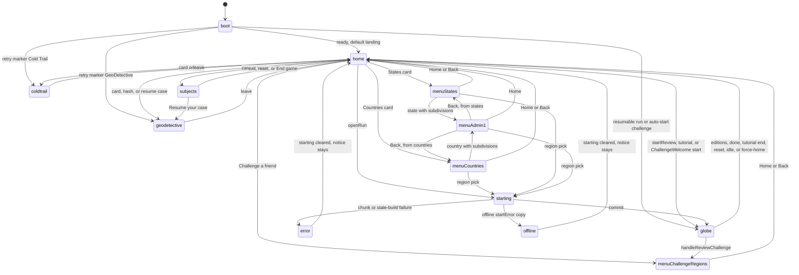

# Map of game-app.tsx for the Phase 4 split

Line numbers in this map are from `384689534353bbda4920edaa938d9a5a40d4ab51` (`38468953`). Edge's Part B will move storage ports in this file and will shift those numbers. Re-check the map against main before PR 2.

This SHA is Phase 1 ports sweep Part A (`#569`), all files except `game-app.tsx`. The file is 8894 lines [tested, `wc -l src/components/game-app.tsx`]. It still talks to `localStorage` and `sessionStorage` directly. It has no `fetch(` and no `new Audio(` [tested, `rg -n '\bfetch\s*\(|new Audio' src/components/game-app.tsx`, no hits]. Audio goes through `@/game/audio/sfx` and `play-guards`. There is no `src/platform` import [tested, `rg -n "from [\"']@/platform" src/components/game-app.tsx`, no hits].

## 1. Inventory

### Routing union

There is no TypeScript `type InAppScreen`. The source of truth is the computed value at `src/components/game-app.tsx:3484-3498` [tested, `rg -n "const inAppScreen" src/components/game-app.tsx`]:

```
const inAppScreen = !ready
  ? "boot"
  : run
    ? "globe"
    : loopOpen
      ? "geodetective"
      : coldTrailOpen
        ? "coldtrail"
        : subjectsOpen
          ? "subjects"
          : starting
            ? "starting"
            : menu
              ? `menu:${menu.kind}`
              : "home";
```

Precedence is strict and top-down. A live `run` beats GeoDetective, Cold Trail, subjects, and menus. `Menu` is at 1104-1108 [tested, lines 1104-1108]: `countries`, `states`, `challengeRegions`, or `admin1` with `countryId`, `countryName`, and `from`.

The 11 `inAppScreen` strings are `boot`, `globe`, `geodetective`, `coldtrail`, `subjects`, `starting`, `menu:countries`, `menu:states`, `menu:challengeRegions`, `menu:admin1`, and `home`.

Hashes are a subset, in `src/lib/screen-hash.ts` [tested, `cat src/lib/screen-hash.ts`]:

| inAppScreen | hash | Pushed? |
| :--- | :--- | :--- |
| `home` | `#home` | yes |
| `geodetective` | `#geodetective` | yes |
| `coldtrail` | `#coldtrail` | yes |
| `subjects` | `#why-learn` | yes |
| `menu:countries` | `#list/countries` | yes |
| `menu:states` | `#list/states` | yes |
| `boot`, `globe`, `starting`, `menu:admin1`, `menu:challengeRegions` | none | `hashForScreen` returns null |

`#c=` friend-challenge fragments are handled in the boot effect, before this map is consulted. Home section fragments such as `#home-about` are scroll targets, not screens. `Choose.scrollTo` uses `history.replaceState` at 4974.

A run in progress has sub-phases from `src/game/run.ts` [tested, `rg -n "export type RunPhase" src/game/run.ts`]: `"aim" | "story" | "done" | "summary"`. Review and challenge complete screens early-return from `PlayLoaded` while `inAppScreen` stays `"globe"`.

### File-local components

[tested, `rg -n "^(export )?function " src/components/game-app.tsx`]

| Component | Lines | Role |
| :--- | :--- | :--- |
| `GameApp` | 1207-4330 | Shell, boot, routing, early returns |
| `Choose` | 4771-5627 | Home |
| `HeroTrailOverlay` / `HeroTrekkerOverlay` / `AtlasBackdrop` | 4389-, 4595-, 5628- | Home hero decoration |
| `RegionList` | 6590-6672 | Country, state, and admin1 lists |
| `Play` | 6673-6969 | Run loader, pool error, places loading |
| `PlayLoaded` | 6971-end | In-run HUD, summary, review complete, challenge complete |
| `ReviewComplete` | 5662-5744 | Review session end |
| `ChallengeWelcome` | 5745-5915 | Received-challenge overlay on Home |
| `ChallengeVerdict` | 5916-6274 | Grandpa verdict clip |
| `ChallengeComplete` | 6275-6589 | Challenge end |

Lazy screens hosted by `GameApp` [tested, `rg -n "lazy(() =>" src/components/game-app.tsx`]: `AgeProfileSettings` 179, `AgeAskGate` 180, `StorytellerHomeHost` 181, `JournalPlayer` 185, `HomeGlobe` 207, `LoopScreen` 310, `TrailScreen` 315, `SubjectPickerScreen` 323, `SatelliteMap` 619.

Shared shell hooks are listed once in the state table at the end of this section. "Uses" below means the screen's own hooks plus the flags that select it.

### boot: BootSplash

- Render: `if (!ready) return <BootSplash />` at 3569-3576. Same component as the index-route prerender fallback in `src/routes/index.tsx`.
- Selects on: `ready === false` at 1230.
- State and refs: `readySignaledRef` at 1232. The boot effect at 2119-2903 calls `setReady(true)` on every exit path, including 2410, 2515, 2555, 2600, 2681, 2718, 2733, 2747, 2773, 2818, 2865, and 2900.
- I/O before first real paint: `consumeRetryScreen()` at 1469 (`meridian.retry-screen`); observability and chunk-recovery install at 2128-2134; map-mode qualify and store at 2170+; `loadFlags`; `pagehide` at 2395; unclean-shutdown handling; `readRun` / `readMc2Run` / `readMc3Run`; session and discarded-shadow reads; challenge hash decode; `preloadTerritory` on some challenge paths; `initAudio()` on first pointer or key at 1214. No `fetch(` here.
- Tests: `src/components/game-app-lazy-boundary.test.ts` (boot does not auto-open GeoDetective). `tests/e2e/geodetective-boot-home.desktop.spec.ts` (bare `/` lands on Home). `tests/e2e/chunk-recovery.desktop.spec.ts`. `tests/e2e/loading-orbs.desktop.spec.ts`. [tested, `rg -l 'BootSplash|boot-splash|geodetective-boot-home' tests src --glob '*.spec.ts' --glob '*.test.ts'`]

### home: Choose

- Render: final `return` of `GameApp` at 4204-4329, wrapping `<Choose …>`.
- Selects on: `ready && !run && !loopOpen && !coldTrailOpen && !subjectsOpen && !starting && !menu`.
- Own state and refs [tested, hooks at 4851-4881]: `loopProgress`, `journalIndex`, `journalNowMs`, `playingJournalId`, `journalOnScreenRef`, `journalRotation`. Hero overlays at 4389 and 4595 use `staticGate` from `heroStaticGateAtMount()`, which reads `navigator.connection.saveData` at 4584-4590.
- Shell state it reads or writes: `difficultyChoice` (persisted as `meridian.difficulty` at 694-706), `deckStatus`, `ageBand` / `openAgeSettings`, card taps that open lists or call `openRun`, `openGeoDetective`, `writeColdTrailOpen` + `setColdTrailOpen`, `startReview`, `setSubjectsOpen`, `openChallengePicker`, first-visit queue flags, notices, `pendingChallenge` / `ChallengeWelcome`, and `challengePreview`.
- I/O: difficulty key via the parent; journal prefetch; `history.replaceState` for in-home section jumps at 4974, which is not a screen hash; lazy `HomeGlobe` / `JournalPlayer`; SFX; `peekLoopProgress`; FirstVisitQueue `seenKey="meridian.firstVisitQueue.v1"` at 4264. `HighContrastToggle` at 485 writes palette prefs.
- Tests (primary): `tests/e2e/home-layout.desktop.spec.ts`, `home-visual-layout.desktop.spec.ts`, `home-hero-trekker.desktop.spec.ts`, `home-globe.desktop.spec.ts`, `home-greeting-keyboard.desktop.spec.ts`, `home-badges-readaloud.spec.ts`, `mobile-home-overlap.spec.ts`, `journal.spec.ts` and journal player or prefetch specs, `nav-back-first-visit.desktop.spec.ts`, `why-learn-card.desktop.spec.ts`, `card-redesign.desktop.spec.ts`, `loading-orbs.desktop.spec.ts`, storyteller greeting specs. Unit: `src/lib/screen-hash.test.ts`, `src/components/home-*.test.ts`, `src/components/first-visit-queue-wiring.test.ts`. Many other specs land on Home through `data-testid="home-heading"`. [tested, `rg -l 'home-heading' tests/e2e --glob '*.spec.ts'`]

### starting: region-open loader

- Render: early return at 3798-3813. Copy is "Loading places" / "Fetching this region's places…".
- Selects on: `starting != null` and no higher-precedence screen. Set in `openRun` at 2940. Cleared in `openRun` `finally` at 3119 if this start is still current, and by `handleManualMapMode` at 2307.
- State and refs: `starting`, `startError`, `runStartGenRef` at 1779-1806.
- I/O in `openRun` at 2916-3130: entrance SFX; `placesFor` and `preloadTerritory` (the actual fetch lives in those modules); `startRun` / `resumeRun` then `commit` → `writeRun`; admin1 preload, fire-and-forget; on failure `isNewBuildDeployed()` then `setStartError` at 3087 with stale-build copy or "Check that you're online…". Milestones and a reportable chunk-failure event at 3109 use `window.sessionStorage`.
- Tests: no spec matches the exact strings "Loading places" or "Fetching this region" [tested, `rg -l "Loading places|Fetching this region" tests src --glob '*.spec.ts' --glob '*.test.ts'`, empty]. Covered indirectly by e2e that starts a Globe, country, or state run, such as `hint-button.spec.ts`, `round-loop-a11y.spec.ts`, and `cleared-mode.spec.ts`. Stale-build retry is `tests/e2e/chunk-recovery.desktop.spec.ts`. Shell registry id `region-loading` at `src/components/ui/shell-registry.ts:75`.

### menu:countries, menu:states, menu:admin1: RegionList

- Render: 4086-4112, 4114-4142, 4144-4168.
- State: `menu` at 1234. A country or state with subdivisions becomes `setMenu({ kind:"admin1", … })` at 4102 and 4135. Back is `setMenu({ kind: menu.from })` at 4159. Home is `setMenu(null)` at 4098, 4133, and 4160. A playable region calls `openRun`.
- I/O: none of its own. `menu:admin1` has no hash, because the hash does not carry a country id.
- Tests: `src/lib/screen-hash.test.ts` for `#list/countries` and `#list/states`. `tests/e2e/nav-back-first-visit.desktop.spec.ts`. `tests/e2e/shared-shell-adoption.desktop.spec.ts` for the region-list header. No `#list/countries` string in e2e filenames [tested, `rg -l '#list/countries|#list/states' tests/e2e`, empty]. Shell registry id `region-list`.

### menu:challengeRegions: challenge region picker

- Render: 4026-4084. Hand-placed `HomeButton`, not yet on `SiteHeader`. Hosts `challengePreviewEl` and `challengeBootNoticeEl`.
- State: `menu.kind==="challengeRegions"`, `challengePreview`, `challengePickError`, `friendChallengesOn`, `challengeMenuHeadingRef` at 2019. Opened by `openChallengePicker` at 2027-2029 or `handleReviewChallenge` at 3196.
- I/O: `pickChallengeRegion` at 2038 loads places; share preview builds a URL from `window.location`; `ShareButton` handles clipboard and Web Share. Flag `friendChallenges` via `isEnabled`.
- Tests: `tests/e2e/friend-challenge.desktop.spec.ts`, `friend-challenge-mc2-create.desktop.spec.ts`, `friend-challenge-mc2-framing.desktop.spec.ts`. Testids `challenge-preview`, `challenge-a-friend`, `challenge-share-container`. Shell registry id `challenge-menu`, baseline, not yet adopted.

### globe: a live Run (Play / PlayLoaded)

`inAppScreen` is always `"globe"` when `run` is set, including review, challenge, tutorial, pool-error, places-loading, and complete screens. No hash is pushed.

**Play loader, 6673-6969.** State: `loadedPlaces`, `poolFailure`, `reviewEntries` at 6783-6796. I/O: `placesFor`, review-deck and challenge catalog loads; `recordMilestone("game_loaded")` at 6802-6805. Pool error at 6905-6922 uses `<ErrorScreen title="Couldn't load places." …>` and both exits call `onEditions`. Places loading at 6925-6934 uses the same copy as `starting` in a different component. Tests: no e2e hit on "Couldn't load places" [tested, `rg -l "Couldn't load places" tests`, empty]. `src/components/ui/shell-registry.test.ts`. Map loading testid `map-loading`.

**In-run HUD, phases `aim` | `story` | `done`, default return of PlayLoaded at 8400-end.** Own state and refs [tested, hooks 7175-8251]: `aim`, `chipSettling`, `chipSettleTimer`, `aimAnnouncement`, `drop`, `dropHitRef`, `story`, `bubble`, `userCollapsedBubbleRef`, `cardDismissed`, `hintsUsedThisPlace`, `hintMessage`, `offerDismissed`, `revealDone`, `mapKey`, `summary`, `scoutSwitchView`, `mapRemountNonce`, `scoutSwitchNote`, `mapModeRef`, `tileRetriesUsed`, `tileSwitchNote`, `lastPlaceIdRef`, `learningEnabled`, `friendChallengesEnabled`, `detectivePairEnabled`, `learningStore`, `showBreakdown`, `didRestoreRef`, `summaryPreviewOpen`, `runChallengePreview`, `runMenuOpen`. I/O: `writeDrop` / `clearDrop` / `readDrop` (`meridian.drop`); learning and review-deck stores; cleared-celebrated flags; `preloadTerritory` on some pin-score paths; challenge record markers at 8019 and 8158-8167; SFX; `loadFlags`; `setReportMapMode("scout")` at 7267. The in-run `HomeButton` HUD is the sole sanctioned shell exception, registry id `in-run-hud`. Tests: `tests/e2e/hint-button.spec.ts`, `round-loop-a11y.spec.ts`, `result-card-overflow.mobile.spec.ts`, `cleared-mode.spec.ts`, `globe-band-switch.desktop.spec.ts`, `band-switch-in-session.desktop.spec.ts`, `scout-*.desktop.spec.ts`, `session-score.spec.ts`, `layout-overflow.desktop.spec.ts`. Unit: `question-bubble`, `result-card`, reveal-watchdog, and `scout-upgrade-lifecycle` tests.

**Review complete, ReviewComplete at 8357-8366.** Selects on `isReviewRun(run) && run.index >= pool.length`. No own hooks. I/O for "Start over" is `handleResetHistory` at 3168 in `GameApp`. Tests: `tests/e2e/review-deck.desktop.spec.ts`, `review-card-actions.desktop.spec.ts`, `review-framing.desktop.spec.ts`, `reset-history.desktop.spec.ts`, `friend-challenge-mc2-review.desktop.spec.ts`. Testid `review-complete`.

**Challenge complete, ChallengeComplete + ChallengeVerdict at 8368-8397.** Selects on `isChallengeRun(run) && (run.index >= pool.length || run.phase === "summary")`. `ChallengeComplete` state: `completion` from `recordChallengeCompletion(run)` at 6314, which writes a sessionStorage once-marker at 915-919, plus `verdictSettled` at 6320. `ChallengeVerdict` state: `videoRef`, `clipPaused` at 6002-6003. I/O: `HTMLVideoElement.play()` / `.pause()` at 6005-6014 on `VERDICT_GRANDPA_VIDEO_URL`. Tests: `tests/e2e/friend-challenge.desktop.spec.ts`, `friend-challenge-mc2-package-b.desktop.spec.ts`, `friend-challenge-mc3-receive.desktop.spec.ts`, `friend-challenge-mc3-verdict.desktop.spec.ts`. Testids `challenge-complete`, `challenge-verdict-*`, `challenge-retry`.

**Ordinary run summary, RunSummaryCard, phase `"summary"`.** State: `summary` at 7215, filled by `handleEndGame` at 3351. "Play again" starts a new session in `onReplayed` at 3621. Tests: `tests/e2e/session-score.spec.ts`, `reset-history.desktop.spec.ts`, `review-deck.desktop.spec.ts`. Testids `end-game-button`, `score-total`, `session-score-breakdown`.

### geodetective: lazy LoopScreen

- Render: 3680-3696, inside `MapErrorBoundary surface="GeoDetective"` and Suspense.
- Selects on: `loopOpen` and no `run`. Initialized only from the one-shot retry marker (`bootRetryRef === "GeoDetective"` at 1471), not from `meridian.loop.open`.
- I/O: `openGeoDetective` at 3332 writes `writeLoopOpen(true)` + `setLoopOpen(true)`. Leave writes both to false at 3687. Same writes in `applyHashScreen` at 3532-3533. Ask-first may show `AgeAskGate` first at 1691.
- Tests: `tests/e2e/geodetective.spec.ts`, `geodetective.reduced.spec.ts`, `geodetective-endgame.spec.ts`, `geodetective-hint.spec.ts`, `geodetective-boot-home.desktop.spec.ts`, `geodetective-unlabeled-tap.spec.ts`, `ws4-geodetective-map-hidden.desktop.spec.ts`, `nav-back-first-visit.desktop.spec.ts`, `ask-age-first.spec.ts`. Unit: `src/components/game-app-lazy-boundary.test.ts`, `src/lib/persisted-screen.test.ts`.

### coldtrail: lazy TrailScreen

- Render: 3701-3714, `MapErrorBoundary surface="Cold Trail"` and Suspense.
- Selects on: `coldTrailOpen`. Init from the retry marker only (`bootRetryRef === "Cold Trail"` at 1624). The open flag is still written on tap-in and leave, but boot does not auto-open. Not closed on bfcache `pageshow` at 1493-1495. Subjects, loop, and age-ask are.
- I/O: `writeColdTrailOpen` + `setColdTrailOpen` at 4240, 3534-3535, 3707, and force-home at 2305-2306.
- Tests: `tests/e2e/coldtrail.spec.ts`, `coldtrail.mobile.spec.ts`, `coldtrail.reduced.spec.ts`, `nav-back-first-visit.desktop.spec.ts`, `src/components/game-app-lazy-boundary.test.ts`, `src/lib/persisted-screen.test.ts`.

### subjects: lazy SubjectPickerScreen

- Render: 3719-3794, `MapErrorBoundary surface="Subjects"` and Suspense. Age settings and age-ask can overlay. The page is `inert` while they are open, at 3723.
- Selects on: `subjectsOpen` at 1475. Session-only. Never persisted. Reload and bfcache land on Home, at 1473-1500.
- I/O: none of its own in `GameApp`. `onResetHistory`, `onEndGame`, and `onResumeCase` go through `askAgeFirst` + `openGeoDetective`.
- Tests: `tests/e2e/subjects-picker.desktop.spec.ts`, `why-learn-page.desktop.spec.ts`, `why-learn-card.desktop.spec.ts`, `why-learn-band-switch.desktop.spec.ts`, `subject-case-navigation.spec.ts`, `ask-age-first.spec.ts`, plus per-subject specs. Hash `#why-learn`: `src/lib/screen-hash.test.ts`, `nav-back-first-visit.desktop.spec.ts`.

### Overlays and notices

These mount on top of a screen, usually Home or a run. They are not `inAppScreen` values.

| Surface | Trigger | I/O | Primary tests |
| :--- | :--- | :--- | :--- |
| Age settings | `ageSettingsOpen`, 4308-4318, 3773+ | profile store via the lazy screen | `tests/e2e/ask-age-first.spec.ts`, age-profile settings toast unit test |
| Age ask gate | `ageAsk` | profile pick, then `proceed()` | `tests/e2e/ask-age-first.spec.ts`, `src/subjects/shared/ask-age-first.test.ts` |
| First-visit queue | 4259-4264 | `meridian.firstVisitQueue.v1`; tutorial seen flag | `tests/e2e/tutorial.spec.ts`, read-aloud specs, `src/components/first-visit-queue-wiring.test.ts` |
| Tutorial overlay, in-run | 8856, `tutorial` | `markTutorialSeen` on end | `tests/e2e/tutorial.spec.ts` |
| Celebration overlay | `celebration` at 1724 | first-win flags; celebration SFX | no e2e filename matches the overlay name [tested, celebration grep in tests was empty for the overlay name]; `cleared-mode.spec.ts` covers band-cleared |
| Cleared-band dialog | `cleared` at 1718, on-run branch 3639-3668 | celebration SFX; `openRun(..., {fresh:true})` | `tests/e2e/cleared-mode.spec.ts` |
| Challenge welcome | `pendingChallenge` at 3957-3970 | `startPendingChallenge`; map pick writes stored map mode | `tests/e2e/friend-challenge-mc2-receive.desktop.spec.ts`, `friend-challenge-mc2-boot.desktop.spec.ts`. Testid `challenge-welcome` |
| Challenge preview sheets | `challengePreview` on Home or menus; `runChallengePreview` in-run at 8250 / 8302 | ShareButton / clipboard | friend-challenge create and package-b specs |
| Idle warning toast | `idleWarn` at 1812; watchdog 3393-3415 | `touchSession` / `isIdleExpired`, then `killIdleSession`. Seam `?idle-ms=` at 1853 | `tests/e2e/discarded-notice.spec.ts` |
| Idle-ended and discarded notice | `idleEndedNote`, `discardedNotice` at 1830 | discarded shadow and `sessionStorage.removeItem(RUN_KEY)` | `tests/e2e/discarded-notice.spec.ts` |
| Start / load error notice, plus in-run `RunStartNotice` at 3462-3478 | `startError` at 1785; `loadNotice` at 3815 | `window.location.reload` at 3132 and 3834; `refreshForNewBuild` writes `meridian.staleRefresh` at 2905-2913 | `tests/e2e/chunk-recovery.desktop.spec.ts` |
| Chunk-reload toast | `chunkReloadNotice` at 1638 | sessionStorage via the chunk-recovery module | `tests/e2e/chunk-recovery.desktop.spec.ts`. Testid `chunk-reload-notice` |
| Map-mode notices | `mapSwitchedNote`, `autoScoutNote`, `mapModeAnnouncement`, `scoutUpgradeEligible` | `writeStoredMapMode`, `probeWebGL` / capability at boot | `tests/e2e/scout-*.spec.ts`, `src/components/map-switched-notice-lifecycle.test.ts` |
| Reset-history toast | `resetToast` at 1648, `historyResetEpoch` | `resetHistory()` | `tests/e2e/reset-history.desktop.spec.ts`. Testid `reset-history-toast` |
| Age toast | `ageToast` at 1633 | none in `GameApp` | age-profile toast unit test |

### Shared state, for the module split

Legend: R means read, W means written, RW means both. "Run" is all `globe` surfaces. Counts in §4 use these table rows. [tested, hook declarations 1230-1852 + 1809 + 3156; setters grepped against the transitions in §5]

| State (decl line) | Boot | Home | starting | Menus | Run (globe) | GeoDetective | Cold Trail | Subjects |
| :--- | :---: | :---: | :---: | :---: | :---: | :---: | :---: | :---: |
| `ready` (1230) | W | R | R | R | R | R | R | R |
| `run` (1233) | W | - (null) | - | - | RW | hidden if set | same | same |
| `menu` (1234) | W | W | W | RW | W | - | - | - |
| `loopOpen` (1471) | W | W | - | - | W | RW | - | W |
| `coldTrailOpen` (1624) | W | W | - | - | W | - | RW | - |
| `subjectsOpen` (1475) | W | W | - | - | - | - | - | RW |
| `starting` (1779) | - | W | RW | W | W | - | - | - |
| `startError` (1785) | - | R | W | R | RW | - | - | - |
| `session` via `useSessionState` (1809, 1116) | W | RW | W | - | RW | - | - | W |
| `difficultyChoice` (1757) | R | RW | R | R | W | - | - | - |
| `mapMode` cluster (1243-1261) | W | RW | R | R | RW | R | R | R |
| `mapSwitchedNote` (1279) | - | R | - | - | W | - | - | - |
| `autoScoutNote` (1288) | W | R | - | - | W | - | - | - |
| `scoutUpgradeEligible` (1300) | W | - | - | - | RW | - | - | - |
| `welcomeMapPick` (1348) | - | RW | - | - | - | - | - | - |
| `pendingChallenge` (1335) | W | RW | - | - | W | - | - | - |
| `challengeBootNotice` (1323) | W | R | - | R | - | - | - | - |
| `challengePreview` / `challengePickError` (1369, 1374) | - | RW | - | RW | - | - | - | - |
| `friendChallengesOn` (1352) | W | R | - | R | R | - | - | - |
| `ageProfile` / `ageBand` (1629) | W | R | - | - | R | R | - | R |
| `ageSettingsOpen` / `ageToast` / `ageAsk` (1632, 1633, 1484) | W | RW | - | - | - | - | - | RW |
| `tutorial` / `inviteDismissed` (1841, 1844) | - | RW | - | - | RW | - | - | - |
| `firstVisitModalOpen` / `bumpPromptQueue` (1852, 1847) | - | RW | - | - | - | - | - | - |
| `celebration` / `cleared` (1724, 1718) | W | R | R | - | RW | W | - | W |
| `idleWarn` / `idleEndedNote` (1812, 1813) | W | R | R | R | RW | R | R | R |
| `discardedNotice` (1830) | W | R | - | - | W | - | - | - |
| `chunkReloadNotice` (1638) | W | R | - | - | - | - | - | - |
| `resetToast` / `historyResetEpoch` (1648, 1649) | - | RW | - | - | RW | - | - | RW |
| `deckStatus` (`useDeckStatus` 3156) | - | R | - | - | R | - | - | - |
| `homeHeadingRef` / `landHomeFocusRef` (1269-1270) | - | RW | - | - | W | - | - | - |

PlayLoaded-only state stays inside a future `play/` module. Home-only state (journal rotation, `loopProgress`, hero `staticGate`) stays inside a future `home/` module. Hash and history refs (`hashSeededRef`, `deepLinkAppliedRef`, `bootRetryRef`, `runStartGenRef`) belong with the shell router.

### Storage keys touched directly in this file

[tested, `rg -n "localStorage|sessionStorage|KEY =" src/components/game-app.tsx`]

| Key | Store | Helpers / lines |
| :--- | :--- | :--- |
| `meridian.difficulty` | localStorage | `readDifficultyChoice` / `writeDifficultyChoice` 687-706 |
| `meridian.run` | sessionStorage | `RUN_KEY` 574; `readRun` / `writeRun` |
| `meridian.run.mc2` | sessionStorage | `RUN_MC2_KEY` 584 |
| `meridian.run.mc3` | sessionStorage | `RUN_MC3_KEY` 593 |
| `meridian.drop` | sessionStorage | `RUN_DROP_KEY` 603; `readDrop` / `writeDrop` / `clearDrop` |
| `meridian.staleRefresh` | sessionStorage | `STALE_REFRESH_KEY` 572; written 2909 |
| story cache (`storyKey(placeId)`) | localStorage | `readCachedStory` / `writeCachedStory` 1045-1062 |
| `meridian.challenge.recorded.summary.${seed}` | sessionStorage | 8019 |
| per-run record marker | sessionStorage | 8158-8167 |
| challenge completion marker | sessionStorage | `recordChallengeCompletion` 901-919 |

Related, not counted in the 21 upward-import rows: `noRawIo` lists 32 game-app rows [tested, python filter of `eslint/layer-baseline.json` `"noRawIo"`]. There is no `navigator.onLine` read in this file [tested, `rg -n "onLine" src/components/game-app.tsx`, no hits]. `navigator.connection.saveData` is read in `saveDataEnabled` at 361 and `heroStaticGateAtMount` at 4584. On-device rewrite uses `globalThis.LanguageModel` at 1012-1091, not a network `fetch`.

## 2. The 21 noUpwardImport entries

[tested, `python3` filter of `eslint/layer-baseline.json` `"noUpwardImport"` where the key starts with `src/components/game-app.tsx|`, count 21]

`game-app.tsx` lives in `components/root` (layer 5). Each entry is a sideways or upward import of another feature area, the map area, or assets. Under the chosen plan, step 1 moves the composer to `src/routes/game-app.tsx` (layer 6). That path change should drop every baseline key, because layer 6 may import layer 5. PR 2 must prove this with `lint:arch` before claiming it. The "curing module" column is who should hold the import after that move, without creating a new feature-to-feature row.

| # | Specifier | Import site | Curing module |
| ---: | :--- | :--- | :--- |
| 1 | `./age-profile/AgeAskGate` | 180 | Route shell. Overlays Home and Subjects via `ageAsk`. |
| 2 | `./age-profile/AgeProfileSettings` | 179 | Route shell (`ageSettingsOpen`, 4308-4318, 3773+). |
| 3 | `./age-profile/LockedLoop` | 148 | Route shell, passed into Home as a slot at 5261. Home must not import it. |
| 4 | `./age-profile/ReadAloudPrefPrompt` | 149 | Route shell, first-visit queue at 4259-4264. |
| 5 | `./age-profile/ReadAloudPrefSettings` | 152 | Route shell, same queue. |
| 6 | `./age-profile/age-profile.css` | 147 | Route shell, or the age-profile area itself, not Home. |
| 7 | `./passport/EarnedBadgeRow` | 153 | Route shell slot into Home at 5298. |
| 8 | `@/assets/home-v5/card-media` | 78 | Route shell passes URLs or media objects into Home. |
| 9 | `@/assets/home-v5/globe-fallback.webp` | 73, used 199 | Route shell passes the URL into Home. |
| 10 | `@/assets/home-v5/hero-mountain.webp` | 72 | Route shell passes the URL into Home. |
| 11 | `@/assets/verdict/grandpa-media` | 74-77 | Route shell passes poster and video URLs into Challenge complete, used at 6066-6077. |
| 12 | `@/game/coldtrail/TrailScreen` | 304, 315 | Cold Trail host in `src/game/coldtrail/`, same area, once that host exists. Until then, the shell. |
| 13 | `@/game/loop/LoopScreen` | 303, 310 | GeoDetective host in `src/game/loop/`, same area, once that host exists. Until then, the shell. |
| 14 | `@/map/capability` types | 253 | Map-mode hook in `src/map/`, same area as `capability.ts`. Until then, the shell. |
| 15 | `@/map/capability` values | 254-261 | Same map-mode hook. |
| 16 | `@/map/map-options` | 263 | Same map-mode hook (`isCoarsePointer`). |
| 17 | `@/map/satellite-map` types `MapMark`, `MapVariation` | 68 | Stay legal on the route shell, or move the types down to `src/lib` later. Play receives the map as a slot. |
| 18 | `@/map/satellite-map` type `ScoutRestoreView` | 262 | Same as 17. |
| 19 | `@/map/satellite-map` lazy `SatelliteMap` | 619-620 | Route shell, or a `src/map/` host the shell imports. Must stay lazy. `components/play` must not import `map`. |
| 20 | `@/map/tile-fallback-copy.ts` | 265 | Stay legal on the route shell, or move the copy down to `src/lib` later. |
| 21 | `@/subjects/shared/SubjectPicker` | 305, 323 | Subjects host in `src/subjects/shared/`, same area, once that host exists. Until then, the shell. |

## 3. Non-test files that mention game-app

[tested, walk of `src/` dropping `*.test.*` / `*.spec.*`, plus config: `rg` / Python `if "game-app" in text`. 36 src files + 2 eslint configs.]

`src/routes/index.tsx` is the only production import of `GameApp` (`import { GameApp } from "@/components/game-app"`). `src/components/result-card.tsx:17` type-imports `Drop` from `./game-app`. Everything else is a comment, contract, or registry pointer.

| File | What it points at |
| :--- | :--- |
| `src/routes/index.tsx` | Renders `<GameApp />` as the index route |
| `src/lib/screen-hash.ts` | Documents `inAppScreen` keys and the `history.pushState` contract |
| `src/lib/chunk-recovery.ts` | Comment: confirmed-stale offer copy is rendered by game-app |
| `src/lib/observability.ts` | Comment: game-app consumes clean-exit state at boot |
| `src/game/shell-helpers.ts` | Origin note: helpers were lifted out of game-app |
| `src/game/run.ts` | Comment: replay path and backfilled difficulty in game-app |
| `src/game/territory.ts` | `openRun` must `await preloadTerritory()` before scoring |
| `src/game/scoring.ts` | Same preload contract |
| `src/game/generated-places.ts` | game-app must never start a run with a partial pool |
| `src/game/challenge.ts` | Boot effect decodes a challenge link the moment it boots |
| `src/game/challenge-verdict.ts` | Pure helpers. Screens in game-app render the result. |
| `src/game/reset-history.ts` | game-app owns the reset UX. A surviving run would re-seed history. |
| `src/game/build-staleness.ts` | `refreshForNewBuild` (game-app and LoopScreen) writes the stale-refresh mark |
| `src/game/palette.ts` | Storage key for the palette toggle shipped in game-app |
| `src/game/loop/LoopScreen.tsx` | Comment: stale-deploy refresh pattern mirrors game-app |
| `src/map/capability.ts` | game-app boot reads the stored map-mode record itself |
| `src/map/satellite-map.tsx` | Default export exists for `React.lazy` in game-app |
| `src/assets/home-v5/card-media.ts` | `.hv5-pic` slots and band-media helpers used by game-app |
| `src/assets/verdict/grandpa-media.ts` | Media for `ChallengeVerdict` in game-app |
| `src/components/ui/shell-registry.ts` | Screen registry: home, region-list, review-complete, challenge-complete, pool-error, in-run-hud (sole exception), challenge-menu, session-loading, region-loading, all `file: src/components/game-app.tsx` |
| `src/components/ui/home-button.ts` | Comment: homepage header (`.hv5-brand`) in game-app |
| `src/components/ui/site-footer.tsx` | Footer link set mirrors the home footer in game-app |
| `src/components/map-error-boundary.tsx` | Shares `meridian.staleRefresh`. Hash-clear on Home mirrors game-app's hash effect. |
| `src/components/SoundToggle.tsx` | Extracted from game-app to avoid an import cycle with lazy screens |
| `src/components/reset-history-control.tsx` | Extracted from game-app |
| `src/components/result-card.tsx` | `import type { Drop } from "./game-app"` |
| `src/components/celebration-overlay.tsx` | Notes static imports already in the game-app bundle |
| `src/components/journal-prefetch.ts` | Save-Data gate copies `saveDataEnabled()` in game-app |
| `src/components/journal-boundary.tsx` | Light shell bundled with game-app. The player stays lazy. |
| `src/components/storyteller-banner-shell.tsx` | Same pattern for the storyteller host |
| `src/components/storyteller.tsx` | Sound toggle in game-app flips `meridian.sound` |
| `src/components/comet-mascot.tsx` | game-app dispatches `comet:edition-select` |
| `src/components/reveal-watchdog.ts` | Pure predicate used by a game-app effect |
| `src/components/home-v5.css` | Comments on `.hv5-txt` reorder and trail or trekker SVGs living in game-app |
| `src/subjects/shared/SubjectDetectiveHost.tsx` | `detectivePair` flag is read in game-app and the host |
| `src/subjects/shared/WhyLearnWorld.tsx` | Some helpers are still private components inside game-app |
| `eslint/layer-baseline.json` | The 21 upward imports and 32 raw-I/O rows |
| `eslint/shell-ban-baseline.json` | File listed under `homeButtonImport` and `pageLocalMain` |

`src/lib/persisted-screen.ts` has no "game-app" string. GameApp is the boot client for its retry marker and open flags, so it is noted here, but it is not in the grep hit list. Out of scope, but also matched: `BRANCH_STATUS.md` and various `docs/**` files. No `package.json` or workflow hit.

## 4. Arena

Two split plans were written against the same inventory and the same SHA. Shared-row counts are inventory §1 table rows the new module owns or touches.

### Option A, split by screen

Each top-level screen or run surface becomes its own module. A thin shell remains. Feature files may not import another feature area, so the composer must move to layer 6 (`src/routes/game-app.tsx`) before or as screens are extracted. A shim left at `src/components/game-app.tsx` that re-exports the route module would be an upward import and is not allowed. `src/routes/index.tsx` points at the new path. The `Drop` type import in `result-card.tsx` retargets to `@/game/shell-helpers`. Screens stay in layer 5 and take callbacks and slots. Cross-cutting overlays stay in the shell. Raw browser I/O is out of this split's scope.

Modules, in migration order, with §5 row counts and approximate lines:

| Step | Module | §5 rows | Approx. lines |
| ---: | :--- | ---: | ---: |
| 1 | Composer path move to `src/routes/game-app.tsx`, plus the `Drop` import fix. High-contrast toggle extracted as a slot in this step or immediately after. | 0 | 8894, path move only |
| 2 | Cold Trail host, `src/game/coldtrail/ColdTrailHost.tsx` | 4 | ~110 |
| 3 | GeoDetective host, `src/game/loop/GeoDetectiveHost.tsx` | 6 | ~100 |
| 4 | Starting view, `src/components/region-loading.tsx`. `openRun` stays in the shell. | 9, view uses 1 | ~40 |
| 5 | Subjects host, `src/subjects/shared/SubjectsHost.tsx` | 10 | ~180 |
| 6 | Region list, `src/components/region-list.tsx` | 7 | ~160 |
| 7 | Challenge menu, `src/components/challenge-menu.tsx` | 10 | ~60 |
| 8 | Review complete, `src/components/review-complete.tsx` | 4 | ~85 |
| 9 | Challenge welcome, `src/components/challenge-welcome.tsx` | 3 | ~170 |
| 10 | Challenge complete and verdict, `src/components/challenge-complete.tsx` | 3 | ~675 |
| 11 | Play and PlayLoaded, `src/map/run/play.tsx` and `play-loaded.tsx` | 23 | ~2370 |
| 12 | Home, `src/components/home-screen.tsx` | 28 | ~1270 |

Step 1 alone drops every `noUpwardImport` key, because the importer is no longer `src/components/game-app.tsx` and the new importer is layer 6. About 5270 lines leave the composer. About 3600 stay in the route shell: boot, `openRun`, hash router, session, map, challenge, idle, and the overlay host. Home and Play are last because they share the most state. Risks called out: keep `SatelliteMap` lazy; keep `handleManualMapMode` in the shell; extract timers with their owner; update `shell-registry.ts` and `game-app-lazy-boundary.test.ts` when a screen leaves the file.

### Option B, split by concern and state ownership

Hooks and controllers move first, then thin views. I/O hooks go in `src/platform/**` (layer 3), not in `src/hooks/**`. Until the composer itself moves to layer 6, extracted views stay as `src/components/*.tsx` siblings, so new feature folders do not add baseline rows. `commit` at 1860-1866 stays the one writer that pairs `writeRun` + `setRun`.

Modules, in migration order:

| Step | Module | §5 rows owned | Approx. lines |
| ---: | :--- | ---: | ---: |
| 1 | Ports: storage (including difficulty and the story prefix), history, saveData, language-model rewrite, in `src/platform/` | 0 | ~400 |
| 2 | Map view types and tile copy down to `src/lib`. Reclassify `src/assets/**` as level 1. | 0 | ~80 |
| 3 | Leaf hooks: difficulty, deck status, chunk-reload notice, reset toast | 1 each | ~130 |
| 4 | Age-profile hook and overlay host | 2 | ~150 |
| 5 | Session hook, idle watchdog, discarded notice | 3 | ~220 |
| 6 | Overlay queue: first-visit, tutorial or invite, celebration or cleared | 3 | ~200 |
| 7 | Map-mode hook in `src/map` | 4 | ~280 |
| 8 | Challenge receive and preview hook | 5 | ~280 |
| 9 | Run controller (`commit`, `openRun`, `startReview`) | 3 | ~350 |
| 10 | Router hook and remaining boot, `inAppScreen` and hash or history | 6 | ~700 |
| 11 | Thin views as root siblings (`home-choose.tsx`, `region-list.tsx`, `play-*.tsx`) | 0, props only | lists ~83, home ~1273, play stack ~2978 |
| 12 | Composer to `src/routes/game-shell.tsx`. Views move into `home/` and `play/`. Registry and `Drop` import updated. | 0 | ~400 glue |

Steps 1-10 mostly clear `noRawIo` rows, not the 21 upward imports. Step 2 can clear entries 17, 18, and 20 by moving their targets down. Step 12 clears the rest, once the importer is layer 6. After step 12, `game-app.tsx` should be a re-export, and the shell should only wire hooks and switch on `inAppScreen`. Do not create `src/components/home/` or `src/components/play/` before step 12. Risks called out: one hash writer only; map-mode live region must stay mounted across Play to Home; every boot exit must still call `setReady(true)`; `pageshow` must not close Cold Trail; `runStartGenRef` must cancel in-flight `openRun` on force-home.

### Chosen plan, a hybrid

Step 1 comes from option A. Move the composer from `components/root` (layer 5) to `src/routes/` (layer 6) as a path move only. Shared state rows: 0. This should clear all 21 `noUpwardImport` rows. PR 2 must prove that with `lint:arch` before claiming it. In the same step, retarget `src/routes/index.tsx` and move the `Drop` type import in `result-card.tsx` to `@/game/shell-helpers`. Extract the high-contrast toggle as a slot in this step or immediately after.

Steps 2 onward come from option B. Extract state owners in B's fewest-shared-first order: leaf hooks, then age-profile, session / idle / discarded, overlay queue, map-mode, challenge receive and preview, run controller, then router / boot / hash-history.

Option B's step 1, the storage and history ports in `src/platform`, is deferred until edge's Part B storage-port work lands. That lane owns those files now and would conflict.

Last, the thin views (lists, Home, the Play stack) move into feature folders, as in option A's screen modules, once their state owners exist. Keep asset and map imports in the shell, passed as slots, unless a later PR reclassifies `src/assets/**` as layer 1. Home and Play go last because they share the most state, 28 and 23 rows.

Why this mix: A's composer move cures the baseline at once for almost no risk. B's hooks-first order shrinks the shared state before the big views move, so the split avoids A's heavy prop-drilling for Home and Play. Deferring B's port step keeps this lane out of another lane's files.

Final order:

| Step | Work | §5 rows | Approx. lines |
| ---: | :--- | ---: | ---: |
| 1 | Composer path move to `src/routes/game-app.tsx`. Retarget `index.tsx` and the `Drop` type import. High-contrast toggle as a slot. | 0 | 8894, path move only |
| later | Deferred: storage, history, saveData, and language-model ports in `src/platform`. Wait for edge's Part B. | 0 | ~400 |
| 2 | Leaf hooks: difficulty, deck status, chunk-reload notice, reset toast | 1 each | ~130 |
| 3 | Age-profile hook and overlay host | 2 | ~150 |
| 4 | Session hook, idle watchdog, discarded notice | 3 | ~220 |
| 5 | Overlay queue: first-visit, tutorial or invite, celebration or cleared | 3 | ~200 |
| 6 | Map-mode hook in `src/map` | 4 | ~280 |
| 7 | Challenge receive and preview hook | 5 | ~280 |
| 8 | Run controller (`commit`, `openRun`, `startReview`) | 3 | ~350 |
| 9 | Router hook and remaining boot, `inAppScreen` and hash or history | 6 | ~700 |
| 10 | Cold Trail host, `src/game/coldtrail/ColdTrailHost.tsx` | 4 | ~110 |
| 11 | GeoDetective host, `src/game/loop/GeoDetectiveHost.tsx` | 6 | ~100 |
| 12 | Starting view. `openRun` stays with the run controller. | 9, view uses 1 | ~40 |
| 13 | Subjects host, `src/subjects/shared/SubjectsHost.tsx` | 10 | ~180 |
| 14 | Region list | 7 | ~160 |
| 15 | Challenge menu | 10 | ~60 |
| 16 | Review complete | 4 | ~85 |
| 17 | Challenge welcome | 3 | ~170 |
| 18 | Challenge complete and verdict | 3 | ~675 |
| 19 | Play and PlayLoaded | 23 | ~2370 |
| 20 | Home, Choose and heroes | 28 | ~1270 |

## 5. Statechart of top-level screen routing

`error` and `offline` are not `inAppScreen` values. They appear as `startError` copy on Home or a menu after `starting` clears, or as pool-error / `RunStartNotice` / `MapErrorBoundary` during `"globe"`. Offline copy is "Check that you're online…", set at 3088. This file never reads `navigator.onLine` [tested, `rg -n "onLine" src/components/game-app.tsx`, no hits].

Hash and history rules [tested, 3504-3567 and Choose 4967-4974]:

1. On `inAppScreen` change, if `hashForScreen(inAppScreen)` is non-null and differs from `location.hash`: the first hash-less visit uses `history.replaceState` at 3519-3521 (`hashSeededRef`); later changes use `history.pushState` at 3523.
2. `popstate` at 3546-3554: if `run !== null`, ignore. Else `screenForHash(location.hash)` then `applyHashScreen`.
3. `applyHashScreen` at 3531-3544 writes loop, coldtrail, subjects, and menu (countries or states only). `admin1` and `challengeRegions` are not hashable.
4. Deep link at 3560-3567: after `ready`, once (`deepLinkAppliedRef`), if no retry restore and no `run`, apply a non-home screen hash.
5. Choose `scrollTo` at 4974 uses `history.replaceState` to a section fragment. These must not be treated as screens.
6. Challenge links `#c=` are consumed in the boot effect, not by `screenForHash`.
7. `inAppScreen === "boot"` skips the scroll-reset effect at 3499-3502. Every other screen change does `window.scrollTo(0, 0)`.

`commit` at 1860-1866 is the one writer that pairs `writeRun` + `setRun` and retires `discardedNotice`.



| To | Trigger | From / notes | Line |
| :--- | :--- | :--- | :--- |
| boot → Home | Boot effect finishes with no retry, no resumable run, no pending challenge | Default 368-rule landing | `setReady(true)` 2900, and earlier bare-home exits 2410, 2681, 2747, 2773, 2865 |
| boot → geodetective / coldtrail | `consumeRetryScreen()` returned that surface; state init 1471 / 1624 | ErrorScreen "Try again" one-shot (`meridian.retry-screen`) | 1469, 1471, 1624 |
| boot → globe (resume) | Saved resumable `readRun()` / mc2 / mc3, not idle-expired, not a review run, friendChallenges on if needed | `commit(restored)` then `setReady` | 2554, 2599, 2731, 2816, 2828 |
| boot → globe (mc1 challenge auto-start) | Valid `#c=` path that `commit`s a challenge run directly | Some formats auto-commit. mc2/mc3 receive often wait. | 2495, 2554 |
| boot → Home + ChallengeWelcome | `receiveMc2Challenge` validates, sets `pendingChallenge`, `setMenu(null)`, `setReady` | Overlay, not its own screen | 2673-2681 |
| boot → Home + challengeBootNotice | Bad, disabled, child, region, or corrupt challenge link | Stays Home | 2463, 2478, 2511, 2646, 2665, 2685 |
| boot → Home + discardedNotice | Unclean shutdown, idle-expired saved run, stale scoring, new-day or expired shadow | Run dropped | 2093, 2849-2865, 2882-2891 |
| Home → menu:states / countries | Card taps | `withCardTap` | 4219-4220 |
| menu:* → menu:admin1 | Country or state with subdivisions | | 4102, 4135 |
| menu:admin1 → menu:countries / states | Back | | 4159 |
| any menu → Home | Home or Back on the list | `setMenu(null)` | 4098, 4133, 4160, 4051 |
| Home / menu → starting → globe | `openRun` | `setStarting` 2940; `commit(next)` 3038; `setStarting(null)` 3119 | 2916-3130 |
| starting → Home + startError | `openRun` catch, offline, chunk failure, or stale build | `setStartError` 3087; starting cleared 3119 | 3067-3119 |
| Home → geodetective | GeoDetective card (`askAgeFirst` then `openGeoDetective`), hash `#geodetective`, or subjects "Resume your case" | Locked bands never open, 3332-3345 | 4227-4236, 3332, 3533, 3756 |
| Home → coldtrail | Cold Trail card or hash `#coldtrail` | Writes open flag | 4240, 3535 |
| Home → subjects | Why-Learn card or hash `#why-learn` | Session-only | 4251, 3536 |
| Home → menu:challengeRegions | "Challenge a friend" or review-complete "pick a map" | Flag-gated | 2027-2029, 3196 |
| Home → globe (review) | `startReview` | Due deck; `commit` 3226 | 3205-3227 |
| Home → globe (tutorial) | `onTakeTour` | `openRun(..., { tutorial: true })` | 3252 |
| ChallengeWelcome → globe | Start (`startPendingChallenge`) | Does not call `ensureSession`. Isolates slots. | 1904-1957 |
| globe → Home | editions, summary done, tutorial end, or reset | `setRun(null); setMenu(null)` | 3591-3612, 3274-3284, 3168-3177, 3234-3237 |
| globe → menu:challengeRegions | `handleReviewChallenge` | Drops run, opens picker | 3192-3196 |
| geodetective / coldtrail / subjects → Home | `onLeave` / `onExit` / reset success / End game on subjects | Flag writes as above | 3687, 3707, 3729-3737 |
| any full-screen → Home | `handleManualMapMode` | Cancels `openRun` gen, deletes `RUN_KEY`, closes loop, coldtrail, starting, tutorial, and menu. No-op during a challenge run, 2269. | 2260-2308 |
| any session-bearing screen → Home | Idle watchdog → `killIdleSession` | Drops run and session, sets discarded and idle-ended | 2069-2110, 3393 |
| pageshow (bfcache) | Close subjects, age-ask, and loop, not Cold Trail, then Home | New arrival rule | 1496-1502 |
| popstate / Back | `applyHashScreen` if no run | Mid-run Back does nothing to the machine | 3546-3554 |
