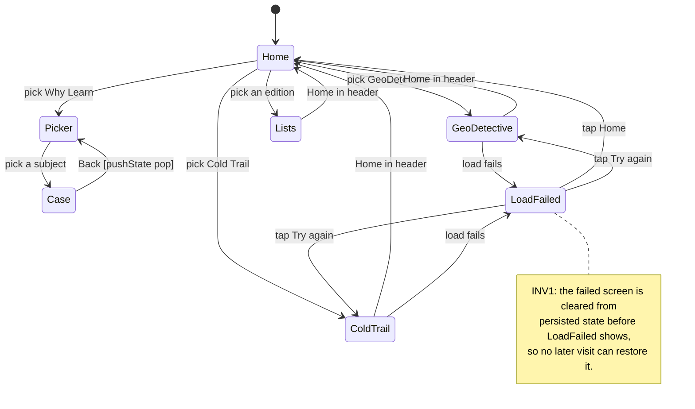

# Stream N — navigation, URLs and error recovery (Phase 0 statechart)

Branch `fix/ui-nav-recovery`. Items 7–10. Owner of `src/components/game-app.tsx`
(S and G send game-app patches to N through the integrator).
Phase 0 draft by the integrator; Stream N keeps this file from here.

## Rules (invariants the fix must hold)

- **INV1** A screen that failed to load is never restored on a later visit.
  (Item 7, P0 — today a failed Cold Trail load persists and reopens from `/`,
  `/#home` and the board's Home link; the only escape is clearing site data.)
- **INV2** Every error screen shows the shared header (Home) plus Try again.
- **INV3** Back returns to the previous in-app screen; it never leaves the
  site from an in-app screen. (Item 8 — today `game-app.tsx` only calls
  `replaceState`, ~lines 2377 and 4751, so Back exits.)
- **INV4** At most one first-visit prompt is visible at any moment; the queue
  order is Scout Map notice → tour banner → read-aloud sheet → support bubble,
  most important first. (Item 9.)
- **INV5** A shared link opens the screen it names; existing deep links keep
  working. (Item 8.)
- **INV6** Home is reachable from every screen in one tap (shared `SiteHeader`).

## Screens and URLs

Real routes today: `/` (home + all in-app screens, state-driven inside
game-app), `/board`, `/credits`, `/privacy`, `/contact`.
Target: each in-app screen gets a hash route with `pushState`
(e.g. `/#geodetective`, `/#coldtrail`, `/#why-learn`, `/#case/<subject>` —
Stream N fixes the exact names in its first commit and lists them here).

| Screen | Today | Target |
| --- | --- | --- |
| Home | `/` (state) | `/#home` |
| Why Learn picker | state | `/#why-learn` |
| Subject case | state | `/#case/<subject>` |
| GeoDetective | state | `/#geodetective` |
| Cold Trail | state | `/#coldtrail` |
| Country / State lists | state | `/#list/<level>` |
| Board / Credits / Privacy / Contact | real routes | unchanged |
| Error (load failed) | broken screen restored | `ErrorScreen`: header + Home + Try again, failed screen NOT persisted |

## Statechart

First-visit prompt queue (INV4) is a parallel concern on Home only: prompts
are states of one queue machine — `Idle → ScoutNotice → TourBanner →
ReadAloudSheet → SupportBubble → Idle` — exactly one visible at a time; a
prompt that is dismissed or completed advances the queue; a returning visit
shows none of them again.

## Item 10 note

Cold Trail "Couldn't load" in a headless browser: Stream N reproduces first.
If the failure is headless-only, the PR says so with evidence (browser,
error, why prod is unaffected); if it is ours, it is fixed under INV1/INV2.

## Handoff

- Done: Phase 0 statechart + invariants (integrator). Item 7 (Phase 0.5
  P0) is built on this branch — see below.
- Item 7, what was built: the trap was the persisted open flag.
  Tapping the Cold Trail (or GeoDetective) card writes
  `meridian.coldtrail.open` / `meridian.loop.open` to localStorage;
  boot reads it at first render and restores the screen. When the
  screen's chunk failed into MapErrorBoundary, the flag stayed set,
  so `/`, `/#home` and the board's Home link all booted back into
  the broken screen, and Try again's reload restored it too.
  - `src/lib/persisted-screen.ts` (new): maps the boundary's
    `surface` to the screen's store writer; `clearPersistedScreenOpen`
    / `rearmPersistedScreenOpen` / `isPersistedScreen`.
  - `MapErrorBoundary`: the catch clears the failed screen's flag
    (INV1 — the next visit lands on Home); the card offers the
    shared `HomeButton` beside Try again / Refresh on the two
    persisted screens (INV2); Try again re-arms the flag before its
    reload so only the retry restores the screen. Case stores are
    untouched — an in-flight case survives and resumes on re-entry.
  - Tests: `src/lib/persisted-screen.test.ts` (behavioural — a
    failed load does not restore on the next visit, driven through
    the same readers boot uses) + an item 7 source pin in
    `map-error-boundary.test.ts`. Targeted runs green; `tsc
    --noEmit` and `lint:nav` clean.
  - PR 368 overlap: 368 (open, parked) makes boot ignore the open
    flags entirely. It cures the same restore loop by a different
    cut and touches none of this fix's files. If 368 lands first,
    this branch's flag-clearing is superseded by its boot change
    (its removal of the flag writers will need this branch's
    imports reconciled); the Home control on the error card stands
    either way. This branch does not touch any file in 368's diff.
- Next: items 8–10 continue on this branch in Phase 2 (hash routes
  with `pushState`, first-visit queue, Cold Trail headless-load
  repro). When Stream S lands the shared `ErrorScreen`, this stream
  re-points the boundary card to it.
- Open: exact hash names (Stream N's first commit decides, listed above).
- Ruled out: changing the real routes (`/board` etc.) — they already
  work; clearing the case stores on failure (the case is not the
  failure — only the screen's open flag is); editing any file in
  PR 368's diff.

## Graph

- Add node: `src/lib/persisted-screen.ts` — failed-load cure for the
  persisted GeoDetective / Cold Trail screens (item 7, INV1/INV2).
  Edges: `MapErrorBoundary` depends-on it; it depends-on the
  coldtrail and loop stores' open-flag writers. (Integrator folds
  this in at merge.)

## Phase 2 (Stream N, on top of Phase 0.5)

Stream S cherry-picked in: `920c9ddd` (shared shell components) +
`4c7af0da` (lint:nav shell bans). Items:

- **Item 8 — DONE.** Hash routes with `pushState`:
  `src/lib/screen-hash.ts` maps game-app's `inAppScreen` values —
  home `#home`, geodetective `#geodetective`, coldtrail
  `#coldtrail`, subjects `#why-learn`, country/state lists
  `#list/countries` / `#list/states`. A screen change pushes its
  hash; `popstate` drives the screen state back (Back returns to
  the previous screen, INV3); a first visit carrying a screen hash
  opens the screen it names (INV5). Unmapped screens (a quiz run,
  admin-1 drill-down — it needs a country id the hash does not
  carry) push nothing; `#c=` challenge fragments and home section
  fragments (`#home-about`, …) name no screen and are untouched.
  Tests: `screen-hash.test.ts` (round-trip + non-screen fragments).
- **368 rule — DONE, with targeted test.** A bare visit to `/`
  always lands on Home even if a case was left open; the error
  screen's Try again still reloads into that case. Boot no longer
  reads the localStorage open flags for its first screen (they stay
  written on tap-in/leave as a record). Try again writes a one-shot
  sessionStorage marker (`meridian.retry-screen`, in
  `src/lib/persisted-screen.ts`); boot's initialisers consume it
  exactly once (`consumeRetryScreen`). This supersedes the
  Phase 0.5 note above about PR 368: 368 is closed, its rule lives
  here now, and #518's flag-clearing stands as the failure half
  (INV1) beside it. Tests: three new cases in
  `persisted-screen.test.ts` (bare visit with both flags set →
  null; re-arm → restore once → null; unknown surface → null).
  All 9 pass.
- **Item 30, game-app half (Stream G's item) — DONE.** The Home
  GeoDetective card reads its guess count from
  `geodetectiveConfig(ageBand).guessCap` — the same band table the
  loop's counter uses — spelled as a word ("Five"/"Six"). The
  LoopScreen.tsx half is Stream G's.
- **Item 10 — conclusion: explained by PR 520.** 520's root cause
  (three field captures, build b2ef88a7): headless browsers have
  no WebGL2, Cold Trail's map threw `GPUInitializationError` into
  the app-level boundary, and the persisted-flag restore looped
  it. 520 contains it at the map surface (LoopMapBoundary + the
  static fallback). What I ran: read 520's body and evidence in
  full; no headless repro was run in this sandbox in this pass.
  The non-WebGL failure class (a lazy chunk failing) is the half
  this PR's item 7 fix covers. Item 10 closes when 520 merges.
- **Shared-shell adoption — partial.** Home's footer is now
  `SiteFooter` (an exact mirror of the shipped footer: same
  testids, labels, handlers). The error boundary's Home control is
  `BrandHomeButton`, per the new lint ban on the retired pill.
  `SiteHeader` on Home: not adopted — Home's hv5 header is the
  design SiteHeader was built from, and swapping it is Stream S/W
  territory, not a nav fix. `ErrorScreen` in MapErrorBoundary: not
  adopted — ErrorScreen is a full page (PageColumn + SiteHeader);
  the boundary is an overlay on a live screen, and its card
  already meets INV2 (Home + Try again). Route-level error
  surfaces are the ErrorScreen fit; recorded here as the reason.
- **Item 9 — DONE (owner top-up, 2026-11-16).** Wired on Home:
  GameApp builds the ordered eligibility list — Scout notice
  (`autoScoutNote`) → tour banner (`showTutorialInvite`) →
  read-aloud sheet (`shouldAskReadAloudPref()`) — and renders it
  through Stream S's `FirstVisitQueue`
  (`seenKey="meridian.firstVisitQueue.v1"`), which shows exactly
  one. Each prompt keeps its own seen-store and dismiss path; the
  queue only sequences visibility, exactly as mapped. The fourth
  prompt, the storyteller greeting bubble, keeps its hero slot and
  is held by the widened `tutorialInviteVisible`
  (`firstVisitPrompts.length > 0`) until the queue drains — the
  host's existing no-competing-popups hold, extended from the
  invite to the whole queue. The read-aloud sheet's old standalone
  mount below the home `</main>` is gone; it renders as the
  queue's third prompt, and its `onAnswered` bumps a GameApp state
  tick so the queue recomputes. Tests:
  `src/components/first-visit-queue-wiring.test.ts` — two pending
  prompts never render at once, the queue advances as each
  prompt's own store clears it, plus source pins (INV4 order,
  the bubble hold, the Scout notice renders nowhere else). UX
  flag stands as recorded: the seat prefers read-aloud earlier;
  the statechart order is unchanged.
- **Item 34(a) — DONE (owner top-up).** The send-off overlay
  (storyteller-home.tsx, copy G3) now ends the moment the case
  opens: `showSendoffOverlay` checks for
  `[data-testid="loop-screen"]` on append and watches with a
  MutationObserver, fading and removing itself as soon as the
  case screen mounts. Its ≤2.5s ride-along still covers the
  loop's load; it never sits on Clue 1. Pinned in the wiring
  test above.
- **Item 34(b) — NOT REPRODUCED on a complete install; no
  change.** First attempt in this sandbox could not run the
  repro: every borrowed `node_modules` tree is missing
  `maplibre-gl/dist/maplibre-gl-worker.mjs`, so `vite build`
  failed at bundling (environment defect). Re-run on a fresh
  worktree with `npm ci` from the lockfile (worker present,
  `build:pages` green) and the cached Playwright Chromium,
  GeoDetective opened at 1280×800 [measured]: a full-page
  capture (1280×1769) plus scroll-top and mid-play captures
  show no hard horizontal line anywhere in the background.
  A row scan of the full capture over both margin bands finds
  exactly one sharp row transition, at y=800 — the capture's
  own viewport stitch seam, not page pixels; at y=695–705 the
  background is a uniform (236,226,199) ±1. Static pass agrees:
  `.mode-screen::before` is fixed/inset-0 continuous, and
  styles.css carries no loop backdrop rule and no
  viewport-height rule that could end at ~700px. No CSS was
  guessed at. Evidence captures are held with the job's
  verification evidence (geo-full.png, geo-top.png, geo-1.png).
- **Item 17 (Stream W's item, this stream's file) — NOT LANDED.**
  W's diagnosis (picker side is correct; `saveBand` defers behind
  `bandChangeRunInProgress` while a GeoDetective case is open)
  arrived with the top-up, but the top-up's room went to items
  9 + 34 and the 34(b) build attempt; the one-line cure in
  game-app.tsx is left untouched for the integrator to price
  with the owner rather than half-landed here.

## CI cure (post-Phase 3)

- CI's build job failed on 2 subtests in
  `game-app-lazy-boundary.test.ts`. Behaviour verified first:
  boot initialises both open states from the one-shot
  `consumeRetryScreen()` marker only — the persisted flags are
  never read at boot, so the 368 rule holds and no code changed.
  Both pins were stale: (a) pinned the pre-368 source shape
  `useState<boolean>(false)`; (b) pinned the PR #203 contract
  (boot restores from the persisted flag), which the 368 rule
  supersedes. Both pins now assert the 368 contract — init from
  the retry marker only, plus a negative assertion that fails if
  boot reads the persisted flag again. Suites: lazy-boundary +
  persisted-screen + screen-hash 24/24, tsc clean.

## Item 17 cure (owner-approved top-up, 2026-11-16)

- Root cause (traced in `game-app.tsx`, confirming Stream W's
  diagnosis): `saveBand` writes the new band immediately but
  defers the change event to a round boundary when
  `runInProgress`. GameApp passed the picker
  `bandChangeRunInProgress={run !== null || loopOpen}`, so with a
  GeoDetective case left open the picker's band event deferred to
  a boundary the picker never hits — the picker never re-read the
  band, so its counts never re-dealt (counts and filter were
  always right).
- Cure (one line, `game-app.tsx`): the SubjectPicker mount now
  passes `bandChangeRunInProgress={run !== null}`. A live subject
  round still defers (the in-round protection is untouched); a
  background case no longer counts. Both `AgeProfileSettings`
  mounts keep `run !== null || loopOpen` — leaving an open case
  is a run in progress for their confirm flow.
- Tests: `ask-age-first.test.ts` re-pins the picker expression
  and adds a pin that both settings mounts keep `loopOpen`; the
  store seam stays pinned both ways in `store.test.ts`
  (immediate event when not mid-run, deferred when mid-run).
  Targeted suites 71/71, `tsc --noEmit` clean, `lint:nav` clean.

## Item 40 offender fix (P2 sweep leftover, 2026-11-16)

- Stream K unified the badge vocabulary on PR 522 — a badge states
  the case's state: "New" = never played, "Done" = finished;
  "Open" is retired — and listed one offender in this stream's
  file without editing it: the chip beside the GeoDetective title
  on the Home card (`game-app.tsx`).
- What the chip actually marked: not a case state. It is an
  edition tag on the Home card, rendered only in the unlocked
  variant of the card (a locked band renders `LockedLoop`
  instead) — it meant "this edition is unlocked for your band".
  The shared `Badge` carries only the case states New/Done,
  neither of which is true of an unlimited edition, so the chip
  keeps its `hv5-chip` styling and now says what it means:
  **"Unlocked"**.
- Tests: no test pinned the old chip text (the lazy-boundary
  "Open" hits are the `loopOpen` state, untouched). Targeted
  game-app suites pass (lazy-boundary + 160 neighbouring tests),
  `tsc --noEmit` clean, `lint:nav` clean.

## Round 2 (Review Round 2 fixes, 2026-11-16)

Tip after this round: `1925f4ab`. This branch predates PR 521's
Round 2 adoption (tip `3d3c0ef7`); no rebase yet — the merge train
handles it. Overlaps to expect at the train: 521 adopted
ErrorScreen on GeoDetective (its surface meets this branch's
map-error-boundary where LoopScreen mounts it), and 521's
SiteHeader renders the shared HomeButton — the same control
fix 3 below moves the error card to, so that change converges
rather than conflicts in intent.

- **Q1 (owner-ruled) — prompts overlay below the header.**
  `FirstVisitQueue` gains a `placement` variant: `"overlay"`
  (default) takes the prompt out of flow, fixed below the header;
  `"flow"` restores the pre-Q1 in-flow render. The Home mount
  passes `placement="overlay"` explicitly — one line flips it
  back. Two cascade lessons, both measured on the built artifact:
  (1) a bare Tailwind `fixed` on the wrapper loses to
  `.atlas-home > :not(.atlas-bg)` (the atlas lift forces
  `position: relative` on every direct child — CDP matched-rules
  evidence), so position/top live in a named styles.css rule
  (`.first-visit-queue-overlay`) whose selector outranks the lift;
  (2) offsets are measured, not guessed: at 1280 the header's
  bottom edge is 136.5px (offset 10rem), at 390 the wrapped
  header's bottom is ~293px (offset 19rem).
  Test: `tests/e2e/nav-back-first-visit.desktop.spec.ts` —
  header bounding-box top ≤40px at 390 and 1280 with a prompt
  pending, exactly one prompt visible, prompt top ≥ header
  bottom. Red on main [measured]: both Q1 tests fail on the
  hermetic main build (no queue; the invite renders in-flow).
  Green here [measured]: 4/4 in the hermetic recipe.
- **Bug 12 — Back behaviour.** The boot pushed `#home` over a
  fresh visit to `/`, leaving a phantom hash-less entry: first
  Back landed on `/` and did nothing. The push effect now seeds
  the first screen's hash with `replaceState` when the URL is
  hash-less (visits arriving with a fragment keep the push, so a
  deep link's entry stays in the stack); later screens still
  push. E2e in the same spec: (a) open GeoDetective → Back lands
  on `#home`, game closed — fails on main [measured]; (b) fresh
  visit → one Back leaves to about:blank — passes on main (main
  has no hash routing to regress; the test pins the seeding
  against this branch's Round-1 push-only boot). Existing unit
  pins (screen-hash, persisted-screen, lazy-boundary) unchanged
  and green.
- **Bug 13 — error card uses the shared HomeButton.**
  MapErrorBoundary rendered `BrandHomeButton` ("Meridian home");
  both card variants now render `HomeButton` — the control
  SiteHeader renders — keeping the 44px floor and focus
  treatment. The pin in `map-error-boundary.test.ts` moved with
  it. The shell-ban baseline gains the file under
  `homeButtonImport` (the rule's own mechanism for HUD/end-of-
  flow uses); 521's ErrorScreen adoption retires this surface
  and shrinks the entry back out.
- **Bug 10 residue — guess copy from one word source.** The
  GeoDetective intro hardcoded "Five guesses" (wrong for the
  7–10 band's cap of 6) and the Home card kept a private
  two-entry word table. New `src/lib/number-words.ts`
  (`numberWord`, words to Twelve, digit fallback) is the one
  source; the intro renders `numberWord(activeDealConfig.
  guessCap)` — the same config the counter uses — and the card
  uses it via `geodetectiveConfig`. Unit tests in
  `number-words.test.ts` cover every cap the deal config can
  produce. Overlap note: this touches LoopScreen's intro, the
  half PR 519 rendered by a 5/6 ternary; the generic helper
  supersedes the ternary at the merge train.
- **Gates [measured]:** full unit suite 1197 pass / 0 fail
  (1208 tests); `tsc --noEmit` clean; `lint:nav` clean; hermetic
  e2e (complete install, pinned Chromium, built artifact):
  nav-back-first-visit 4/4 here, 3 fail / 1 pass on main as
  recorded above.

## Round 2 merge-train cure (518, post-rebase)

- **Symptom:** CI e2e on the rebased tip failed grownups
  "home UX polish": the tutorial invite's "Not now" click was
  intercepted by `.hv5-hero`.
- **Root cause [measured]:** the atlas lift
  (`.atlas-home > :not(.atlas-bg)`) sets `z-index: 1` unlayered;
  the queue's Tailwind `z-40` is layered and loses, so the overlay
  tied at z-index 1 with the content column and tree order painted
  the hero over it (probe: queue computed z 1, elementFromPoint at
  the button = SECTION.hv5-hero). The named overlay rule claimed
  position/top but never z-index.
- **Fix:** the same unlayered rule now sets `z-index: 40` (the
  design value). Probe after: computed z 40, elementFromPoint =
  the button itself.
- **Second layer [measured]:** with stacking fixed, the test's
  journal step clicked raw coordinates through the *next* queued
  prompt (read-aloud sheet, 352,160 576×336 over the h2 at
  475,414; elementFromPoint = the sheet's option button). The
  overlay covering content until answered is the Q1 design; the
  spec now answers the sheet first (same pattern as its invite
  dismissal), no assertion changed.
- **Gates [measured]:** grownups 5/5, nav-back-first-visit 4/4,
  full unit exit 0 (0 fail both suites), on the cured tip in the
  hermetic env.

## Graph (Phase 2 additions)

- Add node: `src/lib/screen-hash.ts` — the screen ↔ hash contract
  (item 8, INV3/INV5). Edges: `game-app.tsx` depends-on it.
- Amend node: `src/lib/persisted-screen.ts` — now also the 368
  rule (one-shot retry marker; boot ignores the open flags).
- Edge: `game-app.tsx` depends-on `ui/first-visit-queue.tsx`
  (item 9, INV4) and on `read-aloud-pref.ts`'s
  `shouldAskReadAloudPref` for the queue's third prompt.
