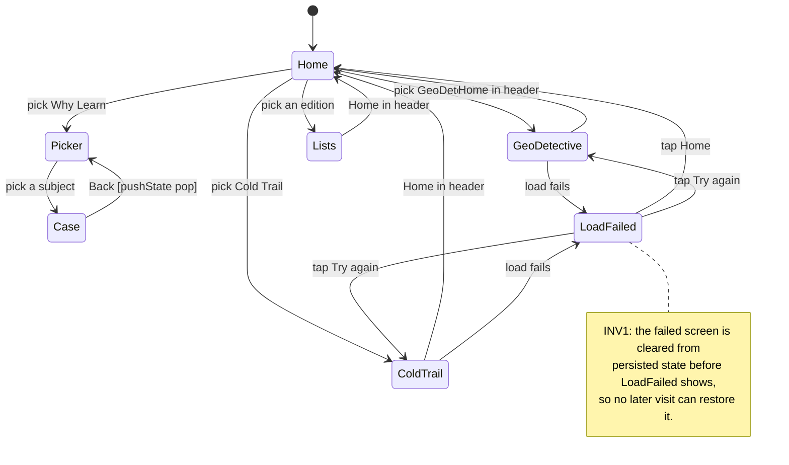

# Stream N — navigation, URLs and error recovery (Phase 0 statechart)

Branch `fix/ui-nav-recovery`. Items 7–10. Owner of `src/components/game-app.tsx`
(S and G send game-app patches to N through the integrator).
Phase 0 draft by the integrator; Stream N keeps this file from here.

## Rules (invariants the fix must hold)

- **INV1** A screen that failed to load is never restored on a later visit.
  (Item 7, P0 — today a failed Cold Trail load persists and reopens from `/`,
  `/#home` and the board's Home link; the only escape is clearing site data.)
- **INV2** Every error screen shows the shared header (Home) plus Try again.
- **INV3** Back returns to the previous in-app screen; it never leaves the
  site from an in-app screen. (Item 8 — today `game-app.tsx` only calls
  `replaceState`, ~lines 2377 and 4751, so Back exits.)
- **INV4** At most one first-visit prompt is visible at any moment; the queue
  order is Scout Map notice → tour banner → read-aloud sheet → support bubble,
  most important first. (Item 9.)
- **INV5** A shared link opens the screen it names; existing deep links keep
  working. (Item 8.)
- **INV6** Home is reachable from every screen in one tap (shared `SiteHeader`).

## Screens and URLs

Real routes today: `/` (home + all in-app screens, state-driven inside
game-app), `/board`, `/credits`, `/privacy`, `/contact`.
Target: each in-app screen gets a hash route with `pushState`
(e.g. `/#geodetective`, `/#coldtrail`, `/#why-learn`, `/#case/<subject>` —
Stream N fixes the exact names in its first commit and lists them here).

| Screen | Today | Target |
| --- | --- | --- |
| Home | `/` (state) | `/#home` |
| Why Learn picker | state | `/#why-learn` |
| Subject case | state | `/#case/<subject>` |
| GeoDetective | state | `/#geodetective` |
| Cold Trail | state | `/#coldtrail` |
| Country / State lists | state | `/#list/<level>` |
| Board / Credits / Privacy / Contact | real routes | unchanged |
| Error (load failed) | broken screen restored | `ErrorScreen`: header + Home + Try again, failed screen NOT persisted |

## Statechart

First-visit prompt queue (INV4) is a parallel concern on Home only: prompts
are states of one queue machine — `Idle → ScoutNotice → TourBanner →
ReadAloudSheet → SupportBubble → Idle` — exactly one visible at a time; a
prompt that is dismissed or completed advances the queue; a returning visit
shows none of them again.

## Item 10 note

Cold Trail "Couldn't load" in a headless browser: Stream N reproduces first.
If the failure is headless-only, the PR says so with evidence (browser,
error, why prod is unaffected); if it is ours, it is fixed under INV1/INV2.

## Handoff

- Done: Phase 0 statechart + invariants (integrator). Item 7 (Phase 0.5
  P0) is built on this branch — see below.
- Item 7, what was built: the trap was the persisted open flag.
  Tapping the Cold Trail (or GeoDetective) card writes
  `meridian.coldtrail.open` / `meridian.loop.open` to localStorage;
  boot reads it at first render and restores the screen. When the
  screen's chunk failed into MapErrorBoundary, the flag stayed set,
  so `/`, `/#home` and the board's Home link all booted back into
  the broken screen, and Try again's reload restored it too.
  - `src/lib/persisted-screen.ts` (new): maps the boundary's
    `surface` to the screen's store writer; `clearPersistedScreenOpen`
    / `rearmPersistedScreenOpen` / `isPersistedScreen`.
  - `MapErrorBoundary`: the catch clears the failed screen's flag
    (INV1 — the next visit lands on Home); the card offers the
    shared `HomeButton` beside Try again / Refresh on the two
    persisted screens (INV2); Try again re-arms the flag before its
    reload so only the retry restores the screen. Case stores are
    untouched — an in-flight case survives and resumes on re-entry.
  - Tests: `src/lib/persisted-screen.test.ts` (behavioural — a
    failed load does not restore on the next visit, driven through
    the same readers boot uses) + an item 7 source pin in
    `map-error-boundary.test.ts`. Targeted runs green; `tsc
    --noEmit` and `lint:nav` clean.
  - PR 368 overlap: 368 (open, parked) makes boot ignore the open
    flags entirely. It cures the same restore loop by a different
    cut and touches none of this fix's files. If 368 lands first,
    this branch's flag-clearing is superseded by its boot change
    (its removal of the flag writers will need this branch's
    imports reconciled); the Home control on the error card stands
    either way. This branch does not touch any file in 368's diff.
- Next: items 8–10 continue on this branch in Phase 2 (hash routes
  with `pushState`, first-visit queue, Cold Trail headless-load
  repro). When Stream S lands the shared `ErrorScreen`, this stream
  re-points the boundary card to it.
- Open: exact hash names (Stream N's first commit decides, listed above).
- Ruled out: changing the real routes (`/board` etc.) — they already
  work; clearing the case stores on failure (the case is not the
  failure — only the screen's open flag is); editing any file in
  PR 368's diff.

## Graph

- Add node: `src/lib/persisted-screen.ts` — failed-load cure for the
  persisted GeoDetective / Cold Trail screens (item 7, INV1/INV2).
  Edges: `MapErrorBoundary` depends-on it; it depends-on the
  coldtrail and loop stores' open-flag writers. (Integrator folds
  this in at merge.)
