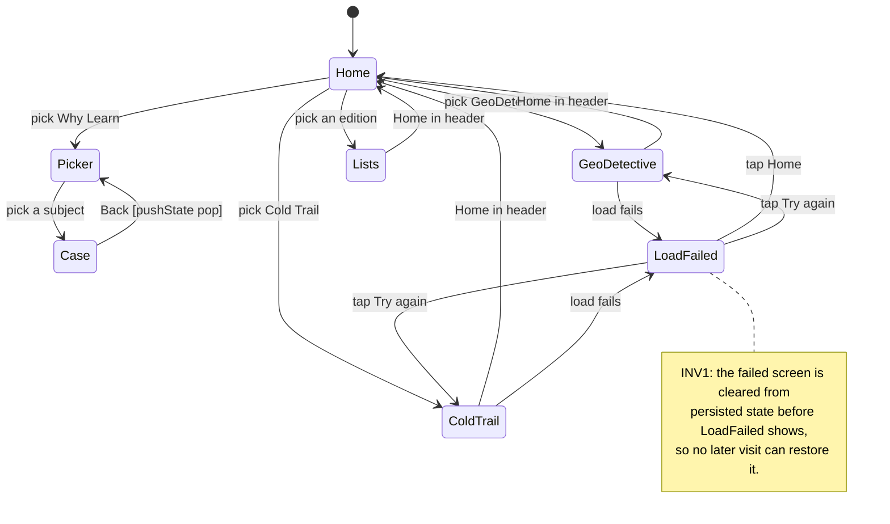

# Stream N — navigation, URLs and error recovery (Phase 0 statechart)

Branch `fix/ui-nav-recovery`. Items 7–10. Owner of `src/components/game-app.tsx`
(S and G send game-app patches to N through the integrator).
Phase 0 draft by the integrator; Stream N keeps this file from here.

## Rules (invariants the fix must hold)

- **INV1** A screen that failed to load is never restored on a later visit.
  (Item 7, P0 — today a failed Cold Trail load persists and reopens from `/`,
  `/#home` and the board's Home link; the only escape is clearing site data.)
- **INV2** Every error screen shows the shared header (Home) plus Try again.
- **INV3** Back returns to the previous in-app screen; it never leaves the
  site from an in-app screen. (Item 8 — today `game-app.tsx` only calls
  `replaceState`, ~lines 2377 and 4751, so Back exits.)
- **INV4** At most one first-visit prompt is visible at any moment; the queue
  order is Scout Map notice → tour banner → read-aloud sheet → support bubble,
  most important first. (Item 9.)
- **INV5** A shared link opens the screen it names; existing deep links keep
  working. (Item 8.)
- **INV6** Home is reachable from every screen in one tap (shared `SiteHeader`).

## Screens and URLs

Real routes today: `/` (home + all in-app screens, state-driven inside
game-app), `/board`, `/credits`, `/privacy`, `/contact`.
Target: each in-app screen gets a hash route with `pushState`
(e.g. `/#geodetective`, `/#coldtrail`, `/#why-learn`, `/#case/<subject>` —
Stream N fixes the exact names in its first commit and lists them here).

| Screen | Today | Target |
| --- | --- | --- |
| Home | `/` (state) | `/#home` |
| Why Learn picker | state | `/#why-learn` |
| Subject case | state | `/#case/<subject>` |
| GeoDetective | state | `/#geodetective` |
| Cold Trail | state | `/#coldtrail` |
| Country / State lists | state | `/#list/<level>` |
| Board / Credits / Privacy / Contact | real routes | unchanged |
| Error (load failed) | broken screen restored | `ErrorScreen`: header + Home + Try again, failed screen NOT persisted |

## Statechart

First-visit prompt queue (INV4) is a parallel concern on Home only: prompts
are states of one queue machine — `Idle → ScoutNotice → TourBanner →
ReadAloudSheet → SupportBubble → Idle` — exactly one visible at a time; a
prompt that is dismissed or completed advances the queue; a returning visit
shows none of them again.

## Item 10 note

Cold Trail "Couldn't load" in a headless browser: Stream N reproduces first.
If the failure is headless-only, the PR says so with evidence (browser,
error, why prod is unaffected); if it is ours, it is fixed under INV1/INV2.

## Handoff

- Done: Phase 0 statechart + invariants (integrator). Item 7 (Phase 0.5
  P0) is built on this branch — see below.
- Item 7, what was built: the trap was the persisted open flag.
  Tapping the Cold Trail (or GeoDetective) card writes
  `meridian.coldtrail.open` / `meridian.loop.open` to localStorage;
  boot reads it at first render and restores the screen. When the
  screen's chunk failed into MapErrorBoundary, the flag stayed set,
  so `/`, `/#home` and the board's Home link all booted back into
  the broken screen, and Try again's reload restored it too.
  - `src/lib/persisted-screen.ts` (new): maps the boundary's
    `surface` to the screen's store writer; `clearPersistedScreenOpen`
    / `rearmPersistedScreenOpen` / `isPersistedScreen`.
  - `MapErrorBoundary`: the catch clears the failed screen's flag
    (INV1 — the next visit lands on Home); the card offers the
    shared `HomeButton` beside Try again / Refresh on the two
    persisted screens (INV2); Try again re-arms the flag before its
    reload so only the retry restores the screen. Case stores are
    untouched — an in-flight case survives and resumes on re-entry.
  - Tests: `src/lib/persisted-screen.test.ts` (behavioural — a
    failed load does not restore on the next visit, driven through
    the same readers boot uses) + an item 7 source pin in
    `map-error-boundary.test.ts`. Targeted runs green; `tsc
    --noEmit` and `lint:nav` clean.
  - PR 368 overlap: 368 (open, parked) makes boot ignore the open
    flags entirely. It cures the same restore loop by a different
    cut and touches none of this fix's files. If 368 lands first,
    this branch's flag-clearing is superseded by its boot change
    (its removal of the flag writers will need this branch's
    imports reconciled); the Home control on the error card stands
    either way. This branch does not touch any file in 368's diff.
- Next: items 8–10 continue on this branch in Phase 2 (hash routes
  with `pushState`, first-visit queue, Cold Trail headless-load
  repro). When Stream S lands the shared `ErrorScreen`, this stream
  re-points the boundary card to it.
- Open: exact hash names (Stream N's first commit decides, listed above).
- Ruled out: changing the real routes (`/board` etc.) — they already
  work; clearing the case stores on failure (the case is not the
  failure — only the screen's open flag is); editing any file in
  PR 368's diff.

## Graph

- Add node: `src/lib/persisted-screen.ts` — failed-load cure for the
  persisted GeoDetective / Cold Trail screens (item 7, INV1/INV2).
  Edges: `MapErrorBoundary` depends-on it; it depends-on the
  coldtrail and loop stores' open-flag writers. (Integrator folds
  this in at merge.)

## Phase 2 (Stream N, on top of Phase 0.5)

Stream S cherry-picked in: `920c9ddd` (shared shell components) +
`4c7af0da` (lint:nav shell bans). Items:

- **Item 8 — DONE.** Hash routes with `pushState`:
  `src/lib/screen-hash.ts` maps game-app's `inAppScreen` values —
  home `#home`, geodetective `#geodetective`, coldtrail
  `#coldtrail`, subjects `#why-learn`, country/state lists
  `#list/countries` / `#list/states`. A screen change pushes its
  hash; `popstate` drives the screen state back (Back returns to
  the previous screen, INV3); a first visit carrying a screen hash
  opens the screen it names (INV5). Unmapped screens (a quiz run,
  admin-1 drill-down — it needs a country id the hash does not
  carry) push nothing; `#c=` challenge fragments and home section
  fragments (`#home-about`, …) name no screen and are untouched.
  Tests: `screen-hash.test.ts` (round-trip + non-screen fragments).
- **368 rule — DONE, with targeted test.** A bare visit to `/`
  always lands on Home even if a case was left open; the error
  screen's Try again still reloads into that case. Boot no longer
  reads the localStorage open flags for its first screen (they stay
  written on tap-in/leave as a record). Try again writes a one-shot
  sessionStorage marker (`meridian.retry-screen`, in
  `src/lib/persisted-screen.ts`); boot's initialisers consume it
  exactly once (`consumeRetryScreen`). This supersedes the
  Phase 0.5 note above about PR 368: 368 is closed, its rule lives
  here now, and #518's flag-clearing stands as the failure half
  (INV1) beside it. Tests: three new cases in
  `persisted-screen.test.ts` (bare visit with both flags set →
  null; re-arm → restore once → null; unknown surface → null).
  All 9 pass.
- **Item 30, game-app half (Stream G's item) — DONE.** The Home
  GeoDetective card reads its guess count from
  `geodetectiveConfig(ageBand).guessCap` — the same band table the
  loop's counter uses — spelled as a word ("Five"/"Six"). The
  LoopScreen.tsx half is Stream G's.
- **Item 10 — conclusion: explained by PR 520.** 520's root cause
  (three field captures, build b2ef88a7): headless browsers have
  no WebGL2, Cold Trail's map threw `GPUInitializationError` into
  the app-level boundary, and the persisted-flag restore looped
  it. 520 contains it at the map surface (LoopMapBoundary + the
  static fallback). What I ran: read 520's body and evidence in
  full; no headless repro was run in this sandbox in this pass.
  The non-WebGL failure class (a lazy chunk failing) is the half
  this PR's item 7 fix covers. Item 10 closes when 520 merges.
- **Shared-shell adoption — partial.** Home's footer is now
  `SiteFooter` (an exact mirror of the shipped footer: same
  testids, labels, handlers). The error boundary's Home control is
  `BrandHomeButton`, per the new lint ban on the retired pill.
  `SiteHeader` on Home: not adopted — Home's hv5 header is the
  design SiteHeader was built from, and swapping it is Stream S/W
  territory, not a nav fix. `ErrorScreen` in MapErrorBoundary: not
  adopted — ErrorScreen is a full page (PageColumn + SiteHeader);
  the boundary is an overlay on a live screen, and its card
  already meets INV2 (Home + Try again). Route-level error
  surfaces are the ErrorScreen fit; recorded here as the reason.
- **Item 9 — DONE (owner top-up, 2026-11-16).** Wired on Home:
  GameApp builds the ordered eligibility list — Scout notice
  (`autoScoutNote`) → tour banner (`showTutorialInvite`) →
  read-aloud sheet (`shouldAskReadAloudPref()`) — and renders it
  through Stream S's `FirstVisitQueue`
  (`seenKey="meridian.firstVisitQueue.v1"`), which shows exactly
  one. Each prompt keeps its own seen-store and dismiss path; the
  queue only sequences visibility, exactly as mapped. The fourth
  prompt, the storyteller greeting bubble, keeps its hero slot and
  is held by the widened `tutorialInviteVisible`
  (`firstVisitPrompts.length > 0`) until the queue drains — the
  host's existing no-competing-popups hold, extended from the
  invite to the whole queue. The read-aloud sheet's old standalone
  mount below the home `</main>` is gone; it renders as the
  queue's third prompt, and its `onAnswered` bumps a GameApp state
  tick so the queue recomputes. Tests:
  `src/components/first-visit-queue-wiring.test.ts` — two pending
  prompts never render at once, the queue advances as each
  prompt's own store clears it, plus source pins (INV4 order,
  the bubble hold, the Scout notice renders nowhere else). UX
  flag stands as recorded: the seat prefers read-aloud earlier;
  the statechart order is unchanged.
- **Item 34(a) — DONE (owner top-up).** The send-off overlay
  (storyteller-home.tsx, copy G3) now ends the moment the case
  opens: `showSendoffOverlay` checks for
  `[data-testid="loop-screen"]` on append and watches with a
  MutationObserver, fading and removing itself as soon as the
  case screen mounts. Its ≤2.5s ride-along still covers the
  loop's load; it never sits on Clue 1. Pinned in the wiring
  test above.
- **Item 34(b) — NOT REPRODUCED in this sandbox; no change.**
  The screenshot repro could not run: `vite build` fails at
  bundling in every local worktree — `node_modules` is a borrowed
  tree and `maplibre-gl/dist/maplibre-gl-worker.mjs` is missing
  from all of them (build log error, environment defect; tsc and
  the unit suites are green). Static pass: `.mode-screen::before`
  is fixed/inset-0 continuous (ruled out in Phase 2), and
  styles.css carries no loop backdrop rule and no viewport-height
  rule that could end at ~700px. The culprit still needs a
  screenshot repro on a machine with a complete install; no CSS
  was guessed at.
- **Item 17 (Stream W's item, this stream's file) — NOT LANDED.**
  W's diagnosis (picker side is correct; `saveBand` defers behind
  `bandChangeRunInProgress` while a GeoDetective case is open)
  arrived with the top-up, but the top-up's room went to items
  9 + 34 and the 34(b) build attempt; the one-line cure in
  game-app.tsx is left untouched for the integrator to price
  with the owner rather than half-landed here.

## Graph (Phase 2 additions)

- Add node: `src/lib/screen-hash.ts` — the screen ↔ hash contract
  (item 8, INV3/INV5). Edges: `game-app.tsx` depends-on it.
- Amend node: `src/lib/persisted-screen.ts` — now also the 368
  rule (one-shot retry marker; boot ignores the open flags).
- Edge: `game-app.tsx` depends-on `ui/first-visit-queue.tsx`
  (item 9, INV4) and on `read-aloud-pref.ts`'s
  `shouldAskReadAloudPref` for the queue's third prompt.
