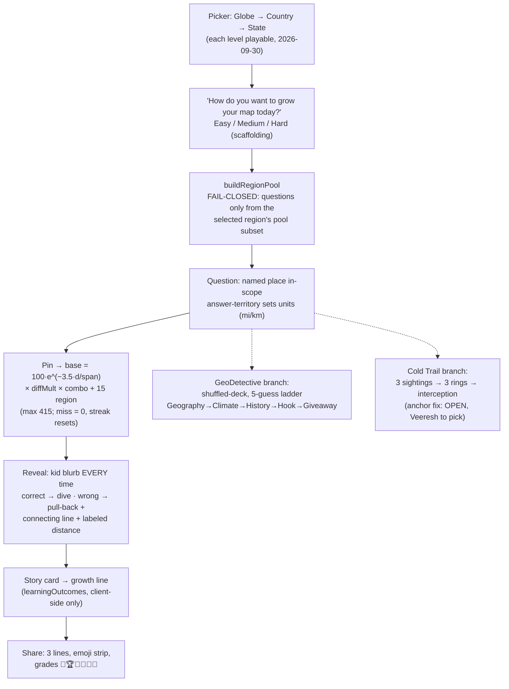

# Meridian Product & Decision Handbook — 02 · Game-design decisions

*The "what and how." Every section is one decision (or one bundle of related decisions): the rule, the exact numbers or copy, the date Veeresh decided it, and — most important for a new agent — the **why**.*

> Convention used throughout: **OPEN** marks a decision Veeresh hasn't made yet. Historical notes are labeled so you never mistake an old proposal for current truth.

---

## 1. Editions: the Globe → Country → State drill-down picker

The picker asks the kid to choose their map: **Globe → Country → State**, and **each level is playable** (2026-09-30). This was a deliberate choice over two rejected alternatives:

- **Rejected:** hardcoding the 50 US states. The picker never assumes the USA — the world is the default view.
- **The globe edition highlights continent boundaries** at the widest zoom; boundaries then reveal progressively as you zoom (see §9).

Two invariants the dealing code enforces, both fail-closed:

1. **`buildRegionPool` fail-closed dealing policy** (chosen 2026-09-30 alongside the picker): questions are *always* drawn from the selected region's pool subset. If the pool can't be built, the game refuses to deal rather than dealing a wrong-region question. A kid who picks Japan never gets quizzed on Ohio.
2. **The question-scope invariant:** every question's answer is a named place inside the selected region. Pool-indexing and lazy clue/region chunks exist so this holds even when the full dataset isn't loaded.

## 2. GeoDetective — the mystery-place edition

GeoDetective is the 4th edition (named by Veeresh, 2026-10-02): a **5-guess mystery-place ladder** with satellite imagery as the guess surface. The player taps a labeled place on the satellite map, a bottom sheet opens, and each miss draws a **distance ring + direction arrow** on the map.

### The clue ladder (positional — order is the design)

1. **Geography** — plain-spoken, picture-able; never coordinates or elevation
2. **Climate** — landforms → weather intuition, non-redundant with geography
3. **History** — history first, one true memorable hook
4. **The Hook** — a person, event, record, or quote; *if a kid can't retell it, the card failed*
5. **Giveaway** — a landmark that names the place without naming it

Clue files are pool-indexed and lazy-loaded (`public/loop/clues/{index}.json`); the file itself never contains the place name. Clues were produced by Liz's content team under **prompt v1 FINAL (reading age ≈ 10)**; the crew retired on 2026-10-17, so future clue-production ownership is open.

### The big decision: unlimited, not daily

The engineering design doc (`docs/geodetective.md`) originally described a **one-mystery-per-day** design (it was rewritten on 2026-10-17 for the unlimited model below): new puzzle at midnight UTC, day index `Math.floor(Date.now() / 86400000) % manifest.size`, a `?loop-date=` E2E seam, and a 30-day archive in `localStorage` (`meridian.loop.v1`).

**Veeresh overruled this on 2026-10-06: GeoDetective is FULLY UNLIMITED.** His reasoning, in his words: *"1 mystery per day will kill the game."* The deck deals via a **shuffled-deck (Fisher–Yates, crypto RNG)** across all **387 validated clue files** (content gate cleared 2026-10-05, PR #59) — no daily gating, play as many cases as you want.

Engineering notes that survive the change: the `meridian.loop.v1` namespace stays, the typeahead guess index (`names.json`, 119,038 entries) stays, and repeated places never consume a guess.

### Streaks and sharing (2026-10-06 / PR #130, 2026-10-11)

- **Streak = consecutive solves.** Skip-a-case is explicitly **not** allowed (deliberate: skipping would cheapen the streak).
- `bestStreak` is persisted; the share line shows ` · 🔥 N best streak` when it's **≥ 2**, hidden at 0/1.
- Finish all 387 cases and you get a **completion celebration**.
- Share text: date kept, streak shown per the rule above, **skip-case NO**, and the emoji strip is spoiler-free.

## 3. Cold Trail — the triangulation edition

Three **sightings**, three **rings**, one **interception**. Each sighting gives a distance + bearing from a named anchor place ("575 km southwest of Umraniye"); the player taps where the rings cross to make the interception.

### OPEN: the sighting-anchor problem (spec is DRAFT, 2026-10-09)

Veeresh's own screenshots caught the flaw: **sightings reference obscure anchor places with zero geographic context** — *"2,275 km west of Rasht"* means nothing to a child (or to most adults). The spec (`~/workspace/specs/coldtrail-sighting-anchors.md`) frames this as a violation of the core principle — *difficulty is scaffolding, not a wall* — and proposes four options:

- **A (recommended):** famous anchors only — "2,275 km west of **Tehran**" (data-only fix, zero code)
- **B:** keep obscure anchors but add a context line (*"Umraniye is a district in Istanbul, Türkiye"*)
- **C:** visual anchor pins on the map
- **D:** tiered anchors by case difficulty

**Veeresh has not picked yet** — agent work on the fix is gated on his choice. Acceptance bar (already set): a kid persona can start placing rings within 30 seconds of reading a sighting, and Veeresh plays one case on his phone and says "a kid could do this." Deck stays at 60 cases; the triangulation mechanic itself is out of scope for the fix.

## 4. Scoring v3 (live in Meridian 1.0)

Scoring v3 exists because Veeresh said, on 2026-09-30, **"the scoring system sucks"** — and pointed at **MapTap (maptap.gg)** as the reference: difficulty tiers with score multipliers, a running score total. The full design is in `~/workspace/your_files/meridian-scoring-proposal.md` (a proposal doc — the shipped rules below are what Veeresh approved from it).

### The formula

```
base     = round(100 × e^(−3.5 · d / span))     # the distance curve (unchanged since v2)
diffMult = {1: 1.0, 2: 1.25, 3: 1.5, 4: 2.0, 5: 2.5}
combo    = 1 + 0.05 × min(streak, 20)           # streak = consecutive hits incl. this one
region   = +15  (explicit, labeled)             # right country in globe edition,
                                                # right admin1 in country edition,
                                                # n/a in state edition (you're inside it)
place    = min(400, round(base × diffMult × combo)) + region
```

- **Spans:** state 900 / country 4500 / globe 16250. `base` hits 100 at ≤ ~22 km and decays exponentially past it.
- **Max per place: 415.** Miss (outside the radius) = **0**, streak resets, **nothing subtracts**, and the reveal + story always play — anti-frustration is part of the design, not an afterthought.
- The **+15 region bonus** is the old hidden floor-lift made explicit and labeled ("right area, wrong spot" still pays — beginner kindness, but as a line item, never hidden math).

### Worked example (from the approved proposal)

120 km off-target, difficulty 4, globe, 6th consecutive hit, right country:
`base = 97 → 97 × 2.0 × 1.30 = 252 → 252 + 15 = 267 🔥6`, shown on the reveal as
`97 × 2.0 × 1.3 + 15 country = 267`. **Every point is explainable on the reveal screen** — no hidden math was a hard requirement.

### Session score, grades, sharing

- **Session score accumulates across editions until "End game"** (the old "rounds" concept is dead — `ROUND_WEIGHTS` and friends were deleted).
- The reveal shows a **per-difficulty breakdown**; the summary adds **average per place** (bounded 0–415, the comparable skill signal) and **best streak**.
- **Grade tiers on the 0–415 range:** 🎯 300+ · 🏆 200+ · 🌟 120+ · 👏 60+ · 🙂 1+ · 💨 miss.
- The difficulty chip sits on the question card (*"Lesser-known · 2x"*) and the streak flame appears at **🔥 ≥ 2**.

## 5. Difficulty tiers & the picker

Five tiers, one per place (global, never per-edition — a place's tier is calibrated against its home-region pool and travels with it everywhere). The dataset contract (`docs/scoring-difficulty-contract.md`):

| Tier | Name | Mult | Meaning |
|---|---|---|---|
| 1 | Famous | 1x | Known to most people in the country (world: globally) |
| 2 | Well-known | 1.25x | Known to most who follow the topic/region |
| 3 | Everyday | 1.5x | Known within the state / nationally aware |
| 4 | Lesser-known | 2x | Obscure even within the state |
| 5 | Hidden | 2.5x | Deep cut — locals or specialists only |

*(Names as shipped in `src/game/scoring.ts`. The contract doc's older names — Easy / Moderate / Challenging / Hard / Extreme — are proposal-era; the code's names are what the player sees on the chip.)*

Generated-place heuristic (GeoNames fields): population brackets (≥1M → 1 … <10k → 5), capital status bumps toward easier (national capital always tier 1), prominence overrides (UNESCO → 1–2, national parks → 2), **default 3** — "the middle of the pool is the safest place for an uncertain place." Hand-reviewed overrides in `data/difficulty-overrides.json` always win; the **327 curated starters keep their hand-set tiers** and are the reference for what each tier feels like.

Two hard rules: the catalog targets roughly **15% / 25% / 35% / 20% / 5%**, and **no region pool may open with its easiest place at tier 3+** — every pool must contain at least one tier ≤ 2 place (the per-pool anchor rule, enforced in tests).

The picker asks the kid, verbatim: **"How do you want to grow your map today?"** — Easy / Medium / Hard. It is learning scaffolding: famous-first → obscure, never gamer difficulty.

## 6. The dataset & the Hyderabad rule

- **GeoNames `allCountries.zip`** (CC-BY 4.0 — attribution is *required* and live in the app: *"Place data: GeoNames CC-BY 4.0 · place history: Wikipedia CC BY-SA"*): **124,690 places**, real difficulty tiers 1–5, state names 99.7% coverage. Per-region depth matters more than the global total; no-repeat is the dealing logic's job, not the dataset's.
- **The Hyderabad rule** (Veeresh's permanent hard gate, on main since PR #15, 2026-09-30): **every place's coordinates must match its claimed location.** A one-time audit of the 433-place curated catalog (106 + 327) found **zero mismatches** — and the rule is locked in by a **build-time gate** (`src/game/validate-places.ts` + `validate-places.test.ts`, plus `validateGeneratedPlace` on dataset import). A bad coordinate can't ship; the build fails first.

## 7. Answer-reveal design (Veeresh, 2026-09-30 / 2026-10-01)

- A **kid-friendly blurb on EVERY reveal, right or wrong** — this is the learning payload firing.
- **Correct:** a Google-Earth-style dive-in to the true spot.
- **Wrong:** pull back to fit *both* the player's pin and the true spot in one frame (framing scales with the error), draw the **connecting line with a labeled distance**; the miss card **leads with the distance, then a small summary**.
- The reveal always shows **the player's pick beside what was asked**: city + state in country editions, city + state + country in globe editions — and where boundary data lacks state detail, an honest **"near \<city\>"** fallback (a raw pin is *never* presented as a named place).
  - **OPEN:** the exact "near" wording and the 100 km fallback budget are still undecided.
- **Globe naming (PR #63):** when pin and true spot resolve at different granularities, both drop to the **symmetric country level** — "Your pin: Brazil · True spot: Angola", never the misleading state-vs-country comparison. City-level "near …" naming is **parked, NOT approved**.
- **Pin legend (light theme):** the legend was rewritten, the pin was *not* recolored (the dark pin is load-bearing contrast on light satellite imagery). Legend text: *"Your pin is your guess · the gold mark is the true spot."*

## 8. Units (decided 2026-10-11, #138)

Distances are shown in **miles for USA answers, kilometers for the rest of the world — by answer territory**, not by edition context. A kid in Texas answering about France sees kilometers.

## 9. Boundaries: progressive reveal, zero labels

- **Boundaries reveal progressively with zoom:** continents at globe view, countries at mid-zoom, states/provinces close in — and the lines stay **subtle** so the quiz region highlight stays dominant.
- **NO labels anywhere on the quiz map.** Naming things is the game; a label would hand the answer away. (The GeoDetective guess surface is the deliberate exception: it uses labeled places because *tapping the label* is the guess verb there.)
- **Admin-1 scope (decided 2026-10-05):** NARROW — **7 playable countries only (EG / FR / DE / IT / JP / MX / GB)**, NE 10m source. GeoBoundaries was rejected on license, the global ~199-country scope on cost. The globe-edition context gap for the rest of the world is accepted for now.

## 10. Share text

Three lines, spoiler-free, Wordle-style:

```
meridian <date>
<the site URL, alone on its line>
<score summary>
```

- A **per-place emoji strip in play order** (no place names, no distances — no spoilers).
- Streak shown spaced: `🔥 2 best streak` (hidden below 2).
- Grade tiers on the 0–415 range: 🎯 300+ · 🏆 200+ · 🌟 120+ · 👏 60+ · 🙂 1+ · 💨 miss.
- **Session share omits the emoji strip** — sessions bank totals only (deliberate).

## 11. Stale-deploy handling (approved 2026-10-01)

When a region chunk fails to load *only* because the deploy moved on (build-meta mismatch), the kid sees **"A new version of Meridian is available."** with a **one-tap Refresh button** — never a dead-end error screen.

**Extended to every screen (issues #209–#211, 2026-10-26).** Three gaps from the PR #203 review are now closed, in plain terms:

- **No more endless spinners (#209).** A download can *hang* — never finish, never fail — and a hang used to leave the loading spinner up forever. Every big download behind a loading screen now has a 10-second patience limit: the map data, the place lists, and the GeoDetective / Cold Trail / map screens themselves. A download that runs out of patience lands on the same friendly, recoverable error card a failed download gets.
- **The error card tells the truth (#210).** The card that catches a broken screen download used to always say "Couldn't load the map" — even when GeoDetective or Cold Trail was the thing that failed. It now names what actually failed. And it checks whether the tab is simply old: if a new version has been deployed, the card *is* the new-version prompt above, Refresh button included, on every screen — not just where a game starts.
- **Small politeness + focus fixes (#211).** Merely *focusing* a home-screen card (tabbing past it with a keyboard) no longer starts the map-data download for players who turned on their browser's Save-Data mode — tapping or hovering still warms it up, and starting a game always loads it for real. Cold Trail's "couldn't load" screen now receives keyboard/screen-reader focus on arrival, exactly like GeoDetective's heading already did. And a new automated pin keeps score honest: the region bonus may only be read after the map data has fully loaded — never guessed from a half-loaded map.

## 12. Edition → picker → dealing flow



*Diagram in words: the picker (Globe → Country → State) feeds fail-closed dealing from the selected region's pool; each question runs guess → scoring → reveal with its story card, then the session share; GeoDetective and Cold Trail branch off the main deal as their own loops.*

## 13. Hint policy — per age band, and ON by default (2026-10-20)

Hints are a real feature (Veeresh, 2026-10-09): a lightbulb button in the game offers a coarse directional nudge ("Look toward the northern part of the map!") — never the answer, never worth points. How often the bulb may be tapped is set by the player's age band:

| Profile | Hint policy | What the player gets |
|---|---|---|
| 5-7 | free | Bulb always available; after 2 misses the mascot also *offers* a hint (opt-in, never an interruption) |
| 8-10 | one-per-round | Bulb available; one hint per place, then it greys out until the next place |
| 11-13 | none | No bulb at all — this band plays clean (and can earn the Clean Round badge) |

**The default changed on 2026-10-20.** The game never checks the player's age — the band comes from a profile a parent may set, and most players never set one. Before this ruling, a player with no profile was quietly treated as 11-13, which meant **no hint bulb, ever, for almost every player** — Veeresh found this playing the live site himself. His ruling, in his words: *"Change the default so everyone gets the hint bulb"* — *"we dont check the age of the player, so we need the hints on by default".*

What the ruling does (issue #182):

- **No profile set → hint policy "one-per-round".** The bulb shows, one hint per place — the 8-10 shape. The mascot offer stays off (it belongs to the 5-7 "free" policy only).
- **Explicitly chosen bands are untouched.** A profile a parent deliberately set to 11-13 still gets no bulb. The ruling changes the *default*, not a parent's choice.
- **Nothing else about the default changes.** An unset profile still plays with the 11-13 numbers (round lengths, pin tolerance, clue counts), and the run still records its band as "11-13" — so the Clean Round badge works as before: it keys off the recorded band plus hints actually used — and, as always, only a won round can earn it. A default player who taps a hint has used a hint (no badge, same as anyone); a default player who never taps and wins can still earn it.
- **Runs already in flight keep their snapshot.** A quiz run or GeoDetective mystery already in progress when this ships finishes with the policy it was dealt — the bulb shows from each player's next run.

*Superseded:* the pre-2026-10-20 default — "no profile resolves to 11-13 for everything, hint policy included" — is replaced by the rule above. The per-band table itself is unchanged since 2026-10-09.

## Sources

- `~/workspace/your_files/meridian-scoring-proposal.md` — scoring v3 design, formula, worked examples, display + share design, migration notes
- `~/workspace/bench-wt/bento/docs/scoring-difficulty-contract.md` — tier definitions, pipeline heuristic, override file, per-pool anchor rule, mix targets
- `~/workspace/bench-wt/bento/docs/geodetective.md` — clue ladder, persistence, share format, accessibility, content gate (387 sets)
- `~/workspace/specs/coldtrail-sighting-anchors.md` — the anchor problem, options A–D (DRAFT, awaiting Veeresh's pick), acceptance criteria
- `~/workspace/your_files/game-review-recommendations.md` — Admin-1 narrow decision, symmetric country naming, pin-legend copy, top-10 improvement slate (recommendations; Veeresh decides)
- `~/MEMORY.md` — slogan (2026-10-01), philosophy (2026-10-03), GeoDetective unlimited decision (2026-10-06), #130–#138 decisions (2026-10-11), reveal design (2026-09-30/10-01), share format, stale-deploy copy, blurb principles, Hyderabad rule (2026-09-30), dataset facts (2026-09-30), picker wording, learningOutcomes flag (2026-10-04)
- GitHub issue #182 (2026-10-20) — the hidden-bulb bug report and Veeresh's hints-on-by-default ruling quoted in §13; the fix merged as PR #184 (2026-10-20, squash `11a95a7`)
