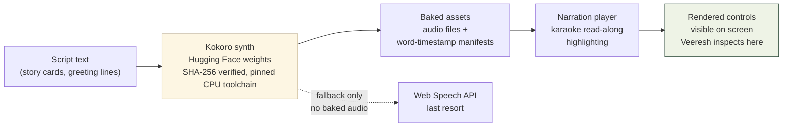

# Meridian Handbook — 04 · Audio & TTS

*The sound story: the voices that read to kids, the instruments that answer "how close am I?", and the environment quirk that will ambush you if nobody warns you.*

---

## 1. Why Meridian sounds the way it does

Meridian's top priority is learning, not the game — and sound is a teaching channel. Every audio decision serves that: narration that sounds like a warm human reading to a child (never a robot), and game sounds that *answer questions* ("how close am I?") instead of decorating. There are two completely separate audio systems, and newcomers mix them up constantly:

1. **Narration (TTS → baked audio files)** — the storyteller reading story cards aloud, the page mascot's daily greeting. Natural human tone is the whole point.
2. **Game SFX (100% Web Audio, zero audio files)** — every game sound is synthesized live in the browser. No downloads, no assets, no music bed.

Keep these apart in your head and the rest of this chapter falls into place.

---

## 2. The voice story: why Kokoro, and the day Veeresh chose the tone

The requirement came from a real pain: the original listen-mode audio on the course repo sounded robotic. Veeresh asked for research into every option for *natural human* TTS with read-along word highlighting. The audit (Track A, system-design course repo, September 2026) recommended **build-time Kokoro narration** — text synthesized once, offline, into audio files the app plays back.

The decision wasn't made on paper. On **2026-09-29**, Veeresh *listened* to a Kokoro proof narration and said, verbatim: **"This is what I wanted."** That sentence is the voice direction, and it's worth internalizing exactly what it ruled out: any voice that sounds like a machine reading words. The standard is *"a warm human reading to a child."*

**The pipeline philosophy is offline/baked:** synthesis happens at build time on the dev machine (Hugging Face model weights, pinned CPU-only PyTorch toolchain), and the app ships pre-made audio files plus word-timestamp manifests. Nothing is synthesized on the player's device. Two reasons: kids' phones are weak, and voice is the one place where the "zero assets" purity has to bend — you cannot synthesize a documentary narrator with Web Audio. The page mascot's audio greeting is explicitly documented as **the one exception to the no-assets rule**.

### The two voice personas (locked, Veeresh 2026-10-11, decision #137)

| Voice | Used for | Personality |
|---|---|---|
| **TruthTeller** | Greetings — the page-mascot welcome lines (Comet the star-dragon pup), a *different* greeting line every day | Warm, welcoming, documentary-narrator ease. Short, friendly, never salesy. |
| **am_fenrir** | Story lines — story-card narration, clue hooks, reveal lines, summary lines | The same warm human narrator, now in *storytelling* register: unhurried, clear, kid-addressed. |

Decision #137 also said "zero new work" — these two voices cover everything; don't invent a third.

The delivery rule: **audio greeting plays when sound is on; animated-text greeting plays when audio is off** (the both-vs-text nuance was delegated to the Game Designer agent). Veeresh's bar is concrete: on **2026-09-29** he heard the proof and said the tone was right but he *could not see the rendering* — which became a standing requirement, covered in §4.

### TTS production pipeline



Practical notes a newcomer needs:

- Weights come from **Hugging Face** (official Kokoro source) — any proposed non-official source requires an explicit explanation before approval is even asked for (Veeresh's standing rule).
- The model-weight **SHA-256 is verified** against the recorded value before synthesis runs; the toolchain is CPU-only and pinned (`pip-audit` results recorded at synthesis time).
- Synthesis scratch files are gitignored; only the finished audio + manifests are committed.
- Voice coverage decision (from the same program): US + UK only — after being told Kokoro has no credible free offline Australian voice, Veeresh said "US and UK should be fine."

---

## 3. The environment quirk that will ambush you

Every newcomer who touches the TTS toolchain hits this one, and it's documented here so it costs you five minutes instead of a day.

**`huggingface_hub` builds its httpx proxy mounts from the shell's proxy env vars, and the runtime's `no_proxy` contains bracketed IPv6 literals (`[::1]`, `[fd8b:...]`). httpx chokes on them with:**

```
httpx.InvalidURL: Invalid port: ':1]'
```

That error kills any `hf_hub_download` or model-load call. It looks like a network problem; it is a *string-parsing* problem.

**The two workarounds (use one per command, never edit the system env):**

1. If model weights are already cached locally: `export HF_HUB_OFFLINE=1` before running the script (verified working — the offline synth ran this way).
2. Otherwise sanitize `no_proxy` (strip the `[` / `]`) in the invoking shell only.

Do **not** "fix" this by editing the system environment — scope it to the command. This is recorded in `~/TOOLS.md`; read that file before running anything with `huggingface_hub`.

---

## 4. Read-along highlighting and narrator controls: the part Veeresh actually inspects

Here is the standing rule, and it is a *deliverable* rule, not an audio-quality rule: **an audio file is not a deliverable.** The deliverable is the narrator controls and the synchronized read-along (karaoke) word highlighting **rendered on screen where Veeresh can see and inspect them.**

What "done" looks like:

- Word-timestamp manifests accompany every baked narration (synced highlighting, not guesswork).
- The player renders visible narrator controls (play/replay — see the locked #136 wording below) and highlights words as they're read.
- A Web Speech fallback exists for the no-baked-audio case, but it is explicitly the *fallback*.

The #136 locked wording lives here because it *is* the narration UI:

- **Story card:** "The words are right here — read along with me. Tap the replay button to try again."
- **Home banner:** "Tap me to try again."

(Approved as proposed by Veeresh, 2026-10-11. Do not paraphrase these — they're his words.)

---

## 5. Game SFX: 100% Web Audio, zero assets

The second audio system. The design document is the source of truth: **`docs/sfx-spec.md`** in the repo (the earlier `~/workspace/your_files/meridian-sfx-spec.md` was the base spec; the repo copy carries the later celebration extension). The implementer contract is a single module: **`src/game/audio/sfx.ts`**.

### Sonic identity (three adjectives every sound must satisfy)

1. **Cartographic** — precise, pen-on-paper. Fast clean attacks, sine/triangle cores. Every sound lands like a cartographer's tap on a map.
2. **Inquisitive** — sound always answers "how close am I?" Confirms lean up, wins climb, losses fall, **distance is literally pitch**.
3. **Brass-warm** — aged-chart warmth. Low-passed tones, gentle shimmer (never above −12 dB), slight detune pairs (±4 cents). No sawtooth edge, no sub-bass, no sparkly highs.

### The recipes (what each one does)

- **`playConfirmGuess()`** — a guess is locked in: two sines, 660→720 Hz lift + 990 Hz fifth, ~95 ms.
- **`playRingReveal(distanceKm)`** — the signature sound: pitch = distance, `f = round(1568 · d^(−0.28))`. 1 km → 1568 Hz (bright ping, G6); 20,000 km → 98 Hz (dull thud, G2). Three timbre bands at 500 km and 4000 km. A correct guess clamps to 1 km → brightest ping. Do not "improve" this mapping — the exponent and endpoints are tuned so a 42 km guess lands mid-bright.
- **`playWin()`** — rising C-major arpeggio, ~1.1 s. **`playLose()`** — muted two-note descent, "a page turning, not a buzzer."
- **`playDeal()`** — the next mystery's "case file snapped open" (paper snap + low tick; noise is synthesized at runtime, not sampled).
- **Home:** `playCardTap()` (D5, 587 Hz), `playDifficultySelect()` (a fifth above, so the two never feel identical).
- **Celebrations (later extension):** pin-drop pass/fail (placement accepted/rejected — a wrong *guess* is never a "fail"), globe-spin loop texture (with 30 s auto-stop and loop-voice rules), next-place chart-unroll, small cheer at streaks 10/25/50, medium applause on clearing a difficulty, **grand fanfare** on the 387-cycle completion or hard clear, toast chime, confetti pop.

### Architecture rules (the ones that protect the player)

- **Lazy AudioContext** — created on the first user gesture only (autoplay policy); `webkitAudioContext` fallback; idempotent init (React StrictMode double-effects).
- **Never crashes, never blocks** — every play function guards and no-ops silently in SSR/jsdom; sounds are fire-and-forget, never awaited, never gating gameplay.
- **Enhancement only** — every sound has a visual equivalent on screen. Sound is never the sole signal (this is a hard product rule).
- **Persisted toggle** — `localStorage` key `meridian.sound`, speaker icon in the home header. **Default: ON** (Veeresh's standing open call — flipping to OFF first-run is a one-line change if he wants it).
- **Reduced motion does NOT mute sound** — motion and sound are orthogonal; the sound toggle is the "reduced sound" control. That was the audio designer's documented call.
- **Mix ceiling:** master gain 0.8 into a compressor, no clipping ever; ≤ 8 concurrent voices with priority stealing (ring/win/lose never stolen by UI blips); no sound longer than 1.2 s; everything phone-speaker-friendly (fundamentals 98–1600 Hz).

### Shipped history

| When | What |
|---|---|
| 2026-10-06 (PR #75) | First 6 sounds + header toggle shipped; audio designer audited 36/36 checks |
| 2026-10-06 (PR #78) | Celebration audio/animation (streaks, cleared modes) |
| 2026-10-06 (PR #81) | Rework on Veeresh's "Perfect let's merge": brass fanfare entering an edition, win/lose sounds on **every** guess, 16 sounds, one mute |

---

## 6. Live vs pending (as of 2026-10-16)

- **LIVE:** all Web Audio SFX above (editions + GeoDetective + celebrations); the sound toggle; the storyteller voice personas (TruthTeller greetings, am_fenrir story lines).
- **OPEN (tracked):** GeoDetective Web Audio SFX — the mode's own sound design still has an open issue against it.
- **Veeresh's open call:** sound default ON vs OFF for first-run quiet (one line to change; currently ON).
- **Ongoing:** the "real game audio" goal — richer, more musical feedback layered over the SFX foundation — is still in progress, not a shipped feature. Don't present SFX as finished artistry.

---

## Sources

- `~/workspace/your_files/meridian-sfx-spec.md` — base SFX spec (recipes, mix rules, architecture contract).
- Repo `docs/sfx-spec.md` — current spec incl. celebration extension §§2.7–2.15 and loop-voice rules (read this one first).
- Memory 2026-09-29 — Kokoro proof narration ("This is what I wanted"), read-along visibility requirement, hybrid TTS plan, US+UK voice coverage.
- Memory 2026-10-06 — SFX PRs #75/#78/#81, page-mascot voice decisions (pre-made audio = the one assets exception), sound-toggle behavior.
- Memory 2026-10-11 — decisions #136 (hint wording), #137 (TruthTeller / am_fenrir), sound default-ON open call.
- `~/TOOLS.md` — the huggingface_hub / no_proxy / httpx quirk and its workarounds.
