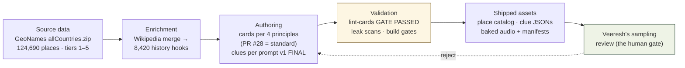

# Meridian Handbook — 05 · Content System

*How Meridian's learning content is made and kept honest. Read this before you touch a card, a clue, a place name, or anything a kid reads.*

---

## 1. The one idea this whole chapter rests on

Meridian's philosophy, in Veeresh's own framing: **the cards are the learning payload and the game is the delivery vehicle.** Players are learners who want to grow; the game exists to get the cards in front of them. So every content rule below is written as a *learning* rule first, and difficulty tiers are scaffolding (famous-first → obscure), never gamer difficulty. If a piece of content doesn't teach a kid something they can retell tomorrow, it failed — even if it "works" in the game.

---

## 2. The four kid-friendly blurb principles (with teeth)

Veeresh approved these on 2026-10-01 (from a Barry Farms before/after sample), and they are enforced on **every** story card and GeoDetective clue. The repo's `AGENTS.md` repeats them as card content rules. Memorize them:

1. **History first, modern identity second.** The story leads with the past — a founding, a person, an event — and only then says what the place is today.
2. **Plain-spoken geography kids can picture. Never elevation, never coordinates.** "A short drive north of Aleppo" is geography a kid can feel. "At 1,200 m elevation" is not.
3. **One memorable hook — person, quote, event, movie, record.** The test: *if a kid can't retell it to a friend, the card failed.*
4. **Short and story-like. Stats only if they teach.** Records, firsts, founding years teach. Census numbers don't.

The canonical standard is **PR #28** — that PR's before/after (the Barry Farms sample) is what "following the principles" concretely looks like. If you're unsure whether your card passes, diff it against PR #28's standard, not your own judgment.

And the fifth card rule, which stands apart because it is absolute: **No fabrication, ever.** No LLM near place data. `history`/`fact` fields come from curated notes or the verified pipeline. A wrong fact in a kids' learning game is not a bug — it's a breach of trust.

---

## 3. The hooks: 8,420 of them, and the four places that must stay hookless

Meridian ships **8,420 enrichment hooks** — the one-liner place histories attached to catalog places (history-first per principle 1). They came from a Wikipedia merge (PRs #52/#53, live on main) with an automated crawl plus a validator (38/38 tests on the content pipeline).

Critical newcomer knowledge: **not every place has a hook, and four places must never get one.** These are intentional, not missing data:

- **Warren, ME** and **Hirske** — intentionally hookless (design decision).
- **Solvang, CA** and **Tuzla** — hookless after the **PR #53 strip** (their hooks were removed deliberately during review).

If a pipeline "helpfully" backfills these, it is a regression. No hooks are ever hand-written.

### Attribution (live in the app — copy it exactly)

> **Place data: GeoNames CC-BY 4.0 · place history: Wikipedia CC BY-SA**

The dataset is GeoNames `allCountries.zip` (CC-BY 4.0, attribution required in-app): 124,690 places, real difficulty tiers 1–5, state names 99.7%. The deeper rule is per-region depth over global totals — the picker drills Globe → Country → State, and each level must be playable.

Two build-time gates guard place integrity:

- **The Hyderabad rule** (Veeresh's permanent hard gate, merged via PR #15): every place's coordinates must match its claimed location. A one-time audit of the 433-place catalog found zero mismatches; `src/game/validate-places.ts` + its test lock them in at build time.
- **`validateGeneratedPlace`** on the dataset import path — generated places get the same treatment.

---

## 4. GeoDetective clue production: the 387

GeoDetective is the 5-guess mystery-place edition (the 4th edition, named by Veeresh 2026-10-02, fully unlimited — his explicit 2026-10-06 ruling: "1 mystery per day will kill the game"). Its content is **387 validated 5-tier clue sets**, produced by **Liz's crew** and merged into the design record (PR #70).

### The production story (why you can trust these numbers)

- **Prompt v1 FINAL** — the generation prompt, locked by Veeresh **2026-10-04** (`~/workspace/your_files/geodetective-generation-prompt-v1.md`). Do not alter without him.
- **Reading age ≈ 10** — his locked ruling: "a 10-year-old can read each clue aloud without stumbling, and retell its point to a friend the next day."
- **The ladder:** Geography → Climate → History → Hook → Giveaway. Each clue narrows the candidate set (region → sub-region → shortlist → near-decisive → convert). Tier 5 is a giveaway, never a summary. The four card principles (§2) apply as universal writing rules on every tier.
- **Fail-closed:** if any tier can't be honestly filled, the *whole set* is rejected — never ship a 4-clue day.
- **The name-leak ban:** substring + diacritic-folded name/alias ban, mechanically checkable. A leaked answer is game-over for that day; over-strict rejection is cheap by comparison.
- **Volume math:** the run delivered 388 sets; independent re-verification found 2 tier-5 violations the crew reviewer had missed — Palestina (tier 5 repeated tier 3) and Bremerhaven (tier 5 restated tiers 3+4) — which were rejected/recomposed, so the shipped count is **387**. The run report lives at `scripts/clues/production/tier2-run-report.md` on the clue branch.
- **Delivery format:** pool-indexed lazy clue files — `public/loop/clues/*.json`, one file per mystery place, loaded on demand.
- **The human gate stays Veeresh's:** 387 sets are *validated*, and he defines what counts as reviewed (expect sampling, not all 387).

---

## 5. The gates: what must pass before content ships

Content does not land on vibes. In order:

1. **`node scripts/lint-cards.mjs` must print `GATE PASSED`.** This is the prebuild card gate — content fails here, the build stops.
2. **`npx tsc --noEmit`** and **`npm test`** — the same gates as code; content files participate.
3. **The clue validator** (composer + hardened validator, 38/38 tests on `feat/geodetective-clues`): name-leak ban, per-clue source fields, reading level, difficulty + aliases — every set, automated.
4. **Veeresh's sampling review** — for human judgment calls the validator can't make (tone, the retell test, locked copy).

Working conventions for content branches: feature branch → PR → merge (main is protected); **stage named files only, never `git add -A`**; every branch carries `BRANCH_STATUS.md`; push early and often.

### Locked copy (do not touch without Veeresh)

- **Donation copy:** "Grown-ups — buy me a coffee? ☕" / "Your support keeps Meridian free for kids." Any alteration is a review BLOCK. No paywalls, ever.
- **#136 hint wording:** story card — "The words are right here — read along with me. Tap the replay button to try again." / home banner — "Tap me to try again." (2026-10-11, approved as proposed.)
- **Share text:** three lines — `meridian <date>`, the site URL alone on its line, then the score summary; spoiler-free emoji strip in play order; grades 🎯 300+, 🏆 200+, 🌟 120+, 👏 60+, 🙂 1+, 💨 miss. Deliberate: session share omits the strip (sessions bank totals only).

---

## 6. The content pipeline

Notice what the pipeline does **not** contain: no LLM drafting place facts. The "no fabrication" rule (§2) is architectural, not aspirational.

---

## 7. The provenance lesson (learned the hard way)

On **2026-10-04**, a report claiming "41 vetted agent personas" was falsely attributed to Liz's crew. The origin was unknown; Veeresh had to trace it himself. The damage wasn't the wrong number — it was that *nobody checked* before repeating it.

The standing rule this produced: **verify provenance before repeating any claim** — about content, about who decided what, about "owner approved." In branch docs this is now enforced as a review rule: every "owner decided" line must cite the owner's actual words (message + date), and an uncited attribution is itself a review BLOCK. When you're new here, the fastest way to earn trust is to show your sources.

---

## Sources

- Repo `AGENTS.md` — card content rules (all five, incl. "no fabrication, ever") and working conventions.
- `scripts/lint-cards.mjs` — the prebuild card gate.
- `~/workspace/your_files/geodetective-generation-prompt-v1.md` — prompt v1 FINAL (5 tiers, name-leak ban, reading age ≈ 10, fail-closed).
- `~/workspace/your_files/geodetective-clue-production-delegation.md` — the Liz's-crew production run (388 → 387 sets, validation bar, boundaries).
- `src/game/validate-places.ts` + `validateGeneratedPlace` — the Hyderabad-rule build-time gates.
- Memory 2026-10-01 — the four blurb principles (Barry Farms sample) and PR #28 as canonical standard.
- Memory 2026-10-04 — the "41 vetted agent personas" false-attribution incident.
- Memory 2026-10-06 — GeoDetective design record (PR #70), Liz's crew delivery, fully-unlimited ruling.
- Memory 2026-10-11 — locked copy: donation text, #136 hint wording, share-text design.
