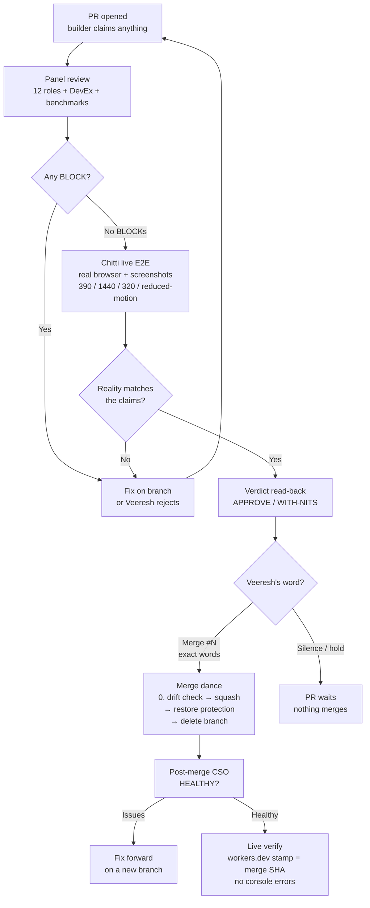

# Meridian Product & Decision Handbook — 08 · How we work

The collaboration system behind Meridian. Read this before you review a pull request, touch a branch, or ask Veeresh anything. It explains the people, the pipeline, the rules, and the mistakes we refuse to repeat.

---

## 1. The people

### Veeresh — the owner

Veeresh is the product owner and the sole approver of everything that ships. That is not a figure of speech:

- **Merge decisions are his alone.** A review dispatch never carries standing merge authorization. Every PR holds until he says the exact words — e.g. "Merge #148" or "Merge #148 — tier split ON at merge."
- **Terse imperatives are binding approvals.** "Merge", "Keep it", "Yes always" — each is a decision, not a mood. When he says one, you execute fully, then report.
- **Corrections by number are the decision record.** He answers numbered one-liners with numbers, and he corrects with numbered restatements of fact. Acknowledge every point precisely. Never relitigate.
- **Stop means stop.** When he cuts a work thread ("stop cooking"), all work stops immediately — no defense, no further token spend, background runs killed. (2026-10-16)
- **His phone is the final gate.** He play-tests on his own phone, and his lived experience outranks CI. A standing rule from his "Yes always" (2026-10-11): Chitti runs E2E live for PR reviews — panel code review alone is never sufficient.

### Chitti — his agent

Chitti is Veeresh's personal AI agent and the orchestrator of this whole system. Chitti:

- **Reviews** — runs the Scrum team panels, assembles the verdict, reads it back.
- **Verifies** — independently re-inspects code, runs E2E live with screenshots, checks gates on the real artifacts. "We don't trust what they did and that why we need to review" is the standing philosophy.
- **Orchestrates** — dispatches work to parallel subagent crews, runs the merge dance, post-merge verification, and live checks.
- **Retracts fast.** On 2026-10-15 Chitti asserted a `\u00A0` BLOCK three times ("I verified it in code myself") and it was a false positive caused by reading JSON-encoded output. He retracted it publicly with byte-level proof the same session. That behavior is the standard: own the miss, fix the process (now skill rule 10), move on.

Chitti commits as `Chitti <57240576+veeresh-bikkaneti@users.noreply.github.com>` so commits attribute to Veeresh's GitHub account — this avoids the branch-protection trap where ruleset 24141972 demands extra approval for unattributed changes.

### Liz — the content crew

Liz runs delegated Meridian content work on her own VM with an AI-agent crew, relayed through chat. (Whether Liz is human or AI is not established.) Her delegation boundary is **content pipelines, not mode code**:

- GeoDetective clue production (387 validated five-tier sets, landed 2026-10-05, PR #59).
- Wikipedia enrichment (8,797 hooks, PRs #52/#53).
- Per Veeresh's standing rules (2026-10-04): relay her instructions **verbatim** — paraphrases get misread; ship incrementally; blocked-means-wait; brief/build-plan/prompt updates keep locked rules untouched.

Her reach has extended into product design: the repo record credits her with commissioning the v5 homepage redesign (2026-10-15), which Veeresh accepted with his explicit "Merge #158" on 2026-10-16. Some provenance claims in branch docs need Veeresh's citation (see §7 — branch docs are claims, not facts).

### The Scrum team — the review panel

Veeresh's standing AI-agent review panel for contested PRs. In his own words:

> **"I built the Scrum team primarily to ensure we are thorough."** (2026-10-12)

> **"We don't trust what they did and that why we need to review."** (2026-10-10 — the standing review principle)

How it works:

- **Advisory only.** It returns APPROVE / APPROVE-WITH-NITS / NOT READY with blockers. The PR body says "owner merges." Veeresh merges. A panel verdict is never, by itself, permission.
- **Standing composition rule:** Code Reviewer + Software Architect + SRE sign off with zero blockers before anything is shown to Veeresh (standing order, 2026-10-05).
- **Two sizes:** the full 37-lens panel for contested PRs (sprint arc → verdict → blameless retro, 1–2 improvements carried forward) and focused panels — typically 4 clusters (Engineering, UX/Accessibility, Design & Game, Fresh-eyes/DevEx) — for smaller PRs.
- **Known blind spot:** subagents can't see the screen or operate a browser. When Veeresh asked whether the panels actually review and test, Chitti admitted plainly they don't touch the browser — and Veeresh answered "Yes" plus the thoroughness line. So every contested re-review gets Chitti's own **live visual E2E** (real browser, screenshots at multiple viewports, 2026-10-12 rule).
- **Track record (through 2026-10-16):** #121 NOT READY 1 BLOCK; #145 NOT READY 2 BLOCKs (fixed before merge); #148 APPROVE-WITH-NITS, 0 BLOCKs (after its own NBSP false-positive retraction); #158 first round NOT READY 2 BLOCKs (invisible focus ring on the dark card; documentation) → cures → APPROVE-WITH-NITS.
- **It reviews; it does not create.** The panel never builds. (One exception: 2026-10-11, Veeresh dispatched it to *build* GeoDetective bestStreak — PR when green, still no merge without his word.)

### The gamestudio-subagents crew

Veeresh's installed game-studio agent pack (audit-clean since 2026-10-10). Its role is advisory and creative: its satellite-fallback recommendation became Veeresh's **D3 owner decision** when he adopted it with "Keep it" (2026-10-15) — one retry, then a session-only Scout Map fallback, which shipped in #148. Provenance matters here: it was a crew *recommendation* first, misattributed in branch docs as an owner approval, corrected by Chitti's docs cure pre-merge. That correction became skill rule 11.

---

## 2. The Review Pipeline

The standing playbook is `~/workspace/custom-skills/local-meridian-review-pipeline/SKILL.md`. This section is the human-readable summary. Read the skill before you touch a review.

**Stage order:**

1. **Browser setup** — Playwright chromium installed, fixtures seeded, external tile servers stubbed (`serveBuiltArtifact` serves the built artifact at `http://127.0.0.1:4123/Meridian/`).
2. **12-role expert panel** — fanned out in parallel: Game Designer, Game Developer, Game Audio Designer, Game Narrative Designer, Game Economy Designer, Game Level Architect, Senior Architect, Senior Developer, Frontend Developer, UX Researcher, UX Designer, and **Office Hours** (fresh-eyes: what did everyone miss?). Verdict contract: APPROVE / APPROVE-WITH-NITS (nits listed by severity) / BLOCK (exact reason). Zero BLOCKs = ready. Any BLOCK = not ready.
3. **DevEx review** — is it maintainable by a stranger? Are complex sections commented? Does BRANCH_STATUS.md describe the work honestly?
4. **Benchmarks** — build sizes, first load, FPS (target 60, floor 30). **Gate: ≤5% regression vs main on any metric; a regression is a BLOCK.**
5. **Doc generation** — BRANCH_STATUS corrected if stale; new systems get Mermaid architecture diagrams; behavior changes get changelog entries.
6. **Autoplan** — merge sequencing across open PRs (never #34), oldest first, dependency-aware, with predicted conflict files.
7. **Merge (the dance)** — step 0 first: check required-context drift (see §5). Then, if needed, temp-lift protection → `gh pr merge <N> --squash` → restore → `git push origin --delete <branch>` → rebase the next PR if it conflicts.
8. **Comprehensive System Overview (post-merge)** — fresh main, conflict-marker grep, tsc, full tests, build, E2E on touched surfaces, `flags.json` validity. HEALTHY / ISSUES FOUND.
9. **Land-and-deploy** — confirm CSO healthy; deploys auto via GitHub Pages; post-deploy `npm run smoke:crash`; verify live, no console errors.

**Chitti's own live E2E is not optional.** For every contested PR, Chitti runs Playwright himself against the built artifact, takes screenshots at 390 / 1440 / 320px and reduced-motion, clicks the actual surfaces, and publishes the numbers. Panels check logic; Chitti checks reality.

**Clean-slate re-reviews.** A contested re-review starts in fresh context with no stale thread — the crew's claims don't carry over; only byte-level facts do.

### The pipeline, as a diagram

*Diagram in words: branch → repo gates → the 12-role panel plus live E2E → any BLOCK loops back to fixes; even with no BLOCKs, the merge waits for Veeresh's exact word → squash merge → protection restored → live verification.*

---

## 3. The merge law

1. **Merge only on Veeresh's explicit per-PR word.** A review dispatch is not a merge order. A finished panel is not a merge order. The exact words "Merge #148" are a merge order.
2. **Any BLOCK means stop.** A BLOCK blocks the PR, not the branch — the branch stays untouched until the owner or the branch owner fixes it. Silently fixing and merging around a BLOCK is forbidden unless Veeresh authorizes taking over.
3. **Never merge PR #34.** Ever. No exceptions. It stays open as a permanent DO NOT MERGE.
4. **Only the base branch matters.** Announcing a merge that landed into the wrong base is a real past mistake — check the base before stating any merge state.
5. **When a merge flips a live flag, name it.** Veeresh bakes the flag state into his merge command ("tier split ON at merge"); echo it back as executed. (2026-10-15)

---

## 4. Working rules

These are enforced, not suggested. Every one has a story behind it — the story is usually "someone learned this the hard way."

- **BRANCH_STATUS.md on every feature branch** (Veeresh, 2026-10-02): an active work flag at the repo root — done vs pending, updated as work lands, committed and pushed with the work. The branch tells its own story.
- **Never `git add -A`.** Stage named files only. A sibling crew's blanket add once dirtied a shared worktree index; a "docs" commit landed with someone else's dataset rebuild in it. Inspect `git status` and the index before every commit.
- **Push early, push often** (2026-09-30): the VM is not durable storage. No long-running local-only branches. PR when green.
- **Commit early and often** (2026-09-29): every completed unit gets an atomic commit immediately. Local commits are the durability mechanism.
- **Ship incrementally, agile not waterfall** (2026-10-04): push shippable increments; a gate measures readiness, it doesn't stockpile work behind a big-bang release.
- **Package downloads need provenance first** (standing): what it's for, trusted source, security/CVE review via api.osv.dev, size — then explicit approve/deny. No bare approval cards; no approval without the groundwork.
- **Skill/plugin installs go through the audit gate** (2026-10-05): manual audit trace (network calls, exfiltration, credential harvesting, obfuscation) **AND** NVIDIA SkillSpector static scan, fully local. HIGH/CRITICAL on the actual install surface blocks unless Veeresh overrides after seeing the breakdown. No auto-injection hooks without his explicit approval.
- **Approval cards carry the why** (2026-09-29): before any approval request fires, explain what it is, where it comes from, why it's needed, and its size — inside the plan he approves, not after. A card without a preceding explanation is a bug. (2026-10-16: Chitti ran a package refresh before explaining it and owned the miss — explain first, always.)
- **Branch protection is always restored.** After every temp-lift, verify byte-identical — don't assume.
- **Flaky E2E:** if parallel runs fail but sequential (`--workers=1`) passes, it's VM flakiness, not a regression. Re-run sequential before declaring a BLOCK.
- **Preserve the test wrapper** when resolving package.json conflicts — the explicit `node --test ...; S1=$?; ...` chain, in full.

---

## 5. Verification lessons (the scar tissue)

These are the rules written in past mistakes. New reviewers: internalize them before your first verdict.

1. **Verify escapes at byte level** (skill rule 10). Tool output is JSON-encoded: one backslash displays as two. A BLOCK that depends on how a string renders (escape sequences, NBSP, double-escaping) must be proved from the file's bytes (`od -c` or a short Python byte count) before it is reported. On 2026-10-15 a `\u00A0` BLOCK was asserted three times and was a false positive — exactly one backslash byte, a valid escape. All three were retracted with byte proof.
2. **Builder claims are hypotheses** (Veeresh's standing rule): "we don't trust what they did and that why we need to review." Independently inspect code, tests, consumers, dead exports, conflicts, and UI behavior. The #121 crew's "all green" missed 5 real BLOCKs.
3. **Test-count claims need file-level traceability.** Builder counts were wrong repeatedly — but not always in the same direction: on #158 the *status file* was the stale one and the PR body was right (grandpa 25/25, badges 8/8, storyteller mobile 23/23 — all reproduced by Chitti). Verify; don't assume either direction.
4. **Baseline-main runs adjudicate regressions.** If main fails it too, it's pre-existing, not your PR's bug: the 7 `tapstart.desktop` E2E failures and the React #418 hydration error under throttling were both proven on unmodified main (2026-10-16) — they belong on their own fix branch, not as PR BLOCKs. Conversely, grandpa spec numbers only mean something with `VITE_KOFI_URL` set at both build and test time — record the env requirement with every grandpa number.
5. **Tests must not pass vacuously.** A green test that can't fail is decoration. Mutation checks settled #144/#153; rewritten tests on #155/#158 were checked for weakening — several were *strengthenings*, which is how it should be.
6. **Branch docs are claims, not facts** (skill rule 11). Every "owner approved / owner decided / agreed by the owner" line must cite Veeresh's actual words (message + date). A `BRANCH_STATUS.md` "SAFE TO MERGE" line must list every unresolved panel BLOCK. An uncited owner-decision claim is itself a BLOCK. (Lesson 2026-10-15: WS-4 docs turned a crew recommendation into "Owner decision (2026-10-14)"; D3 stayed unruled until Veeresh said "Keep it" the next day. On #158, the cited scrum report didn't exist in the repo at all.)
7. **Scope to the true commit range** (`git log origin/main..branch`) — branches carry stale replays. **Silent merge hazard:** identical declarations on both branches auto-merge without conflict markers — the duplicate declaration is caught only by tsc (#153 lesson).
8. **E2E harness workarounds can mask production bugs — treat them as bug reports.** If the harness force-repairs something the product should do itself, fix production and remove the workaround (2026-09-29: `repairMapContainer()` hid a real 0px-collapse bug).
9. **Check required-context drift before every merge** (dance step 0): required-check names have drifted before (Oct 2026: the stored `build` vs the actual job `build (22.x)`); re-check the stored name against the workflow's job name before every merge. Report drift and get Veeresh's word to correct it. Never lift or change protection or a ruleset without his explicit approval for that specific merge.

---

## 6. How Veeresh communicates

ADHD-friendly output is **permanently on** (stated 2026-10-05): bottom line first, short scannable one-idea lines, bold anchors, no walls of text; lead with the next action, number multi-step work, end with one concrete next action; lists ≤5; decisions as numbered one-liners he answers by number; no preamble, no recap, no pleasantries. It stays on until he says "stop adhd mode" or "normal mode."

Beyond format:

- **Binary choices land best after a plain restatement.** After a dense explanation, "i am confused" is the signal — simplify first, then the numbered choice. (2026-10-15)
- **Overrides come with reasons he stands by.** On #153 he chose "accept on my verification" over the recommended targeted panel pass and said "merge" — Chitti noted it once in his words and implemented fully, never relitigated.
- **Parallel tracks get subagents.** When work has multiple independent tracks, he wants them all worked in parallel.
- **He wants visible progress with clean verbose logs.** Never hide background activity; surface it proactively.
- **He corrects with numbered restatements of fact** — those are the decision record. Acknowledge every point precisely.

---

## Sources

- `~/workspace/custom-skills/local-meridian-review-pipeline/SKILL.md` (pipeline stages, operating rules 1–11)
- `~/MEMORY.md` (owner decisions, review history, standing rules, lessons)
- `~/AGENTS.md` (working conventions, package/skill audit rules, merge-dance lessons)
- `~/memory/groups/scrum-team.md` (panel purpose, composition, track record through 2026-10-16)
- `~/memory/people/liz.md` (delegation boundary, standing relay rules, v5 commission)
- Alignment synthesis: `~/dreams/alignment/derived/ALIGNMENT_SYNTHESIS.md` (communication norms, overrides, provenance discipline)
