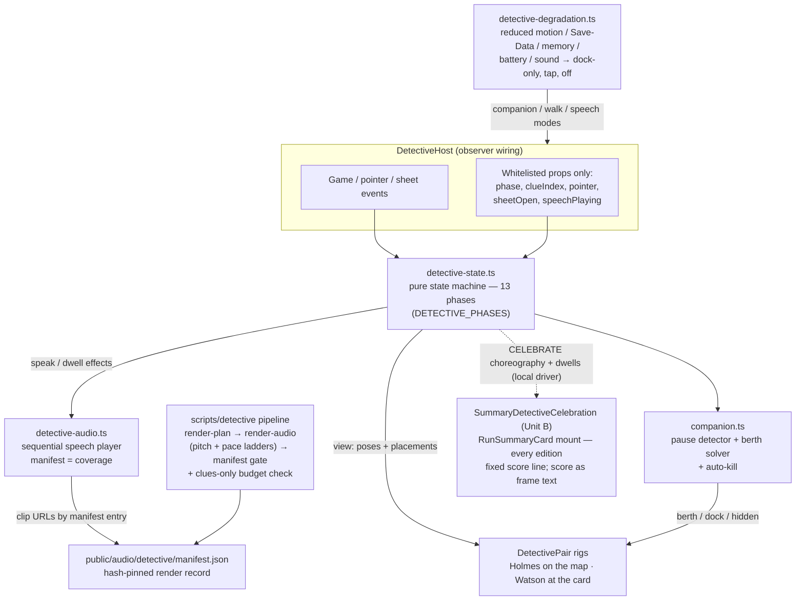

# 10 — Holmes & Watson: the detective pair (decision record)

*Status as of 2026-11-06: built on `feat/detective-pair` — units
U1–U10, plus the owner's fold-in Unit A (tap-Watson replay) and
Unit B (game-end celebration in every edition), plus the review
cure pass — in PR #355, which is OPEN. The feature is **to be
merged dark — not yet merged; feature OFF.** This chapter records
what is decided, what is built, and what still gates the
switch-on. It does not record approval where none has been given:
the review panel has NOT approved this PR's final tip yet, and no
merge or flip is approved by anything written here.*

## The decision

- Veeresh, 2026-11-05, on the approved full-loop mockup: "I guess its
  ok let's build it" — then all six scope decisions answered "All
  recommended." The build therefore follows BUILD-SCOPE.md: two
  stations (Watson at the clue card, Holmes on the map), a
  pause-triggered waypoint companion that is answer-blind by
  construction, pre-rendered voices only, and a post-solve debrief as
  the one place Holmes draws a conclusion.
- Veeresh, 2026-11-06 (fold-in order): tap-Watson replay (Unit A) and
  the game-end celebration in every edition (Unit B) belong in this
  PR, not a follow-up.
- The pair ships behind the `detectivePair` feature flag, **default
  false** — in `src/lib/flags.ts` (baked-in default) and, since U9,
  in `public/flags.json` as an explicit `false`, so the remote flip
  path is ready and testable.

## How the system fits together

## The flip gate (not yet passed)

Turning the flag on is a separate, later step, gated on ALL of:

1. The child-panel kill criteria **K1** (a scripted Holmes pause at a
   wrong place must not pull children's guesses toward it) and **K6**
   (children must still claim the guess as their own) — these need a
   real child panel and have not run.
2. The automatable gates in U10 (swap test, occlusion and absence
   audits, the performance protocol) passing on the shipping tip.
3. The full review pipeline's verdict on the final tip.
4. Veeresh's explicit word for the flip itself.
5. Every **named flip gate** in the next section, each closed by its
   own stated trigger or cure condition.

Until all of these hold, the flag stays false. A flags.json redeploy
is the whole flip mechanism — and the whole kill-switch.

### Named flip gates (recorded by the cure pass — not cured in it)

Each gate below blocks the flip, not the dark merge, unless it says
otherwise. Wording is the panel's / gate evidence's, kept by name so
the re-run panel and the flip owner can check them off one by one.

- **FG-1 · Station occlusion (HIGH, two panel seats).** The shipped
  Phase A capture stills 1 + 3 and frames f06/f09 show the pair
  standing ON clue cards, covering text; the U5 smoke shows them over
  the search input + legend. The U10 stations "gap 0 / overlap 0"
  rests on ONE Clue-1 sample against the anchored card (see the U10
  gate report's cure-pass qualification). **Trigger/cure:** before
  the flip, station overlap must be asserted across clues 1–5, the
  CELEBRATE and DEBRIEF layouts, and after layout shifts / scroll;
  the cure must reserve or offset real space (gutter, side placement,
  or shrink) — overlaying the card is not a cure.
- **FG-2 · External-speech absence unwired.** The machine handles
  `externalSpeechStarted` / `externalSpeechEnded`, but
  `DetectiveHost` never dispatches them, so the storyteller hook
  narration (`LoopScreen.tsx`) can overlap the pair's speech.
  **Trigger/cure:** wire the dispatch + an E2E proving the pair goes
  absent / silent during external speech, before the flip.
- **FG-3 · Core-387 silence.** Phase A audio covers the Capitals
  pack only. If the flag flips before U11, core-deck cases play the
  full visual ritual over silent clue reads. **Trigger:** U11
  complete OR coverage-gated speech (no ritual without its reads)
  is required before the flip.
- **FG-4 · The 88 missing names hit famous places.** The render
  backend deterministically refuses 88 planned name reads, and they
  are not obscure: **Lahore (13.0M), Karachi (11.6M), Baghdad
  (7.2M)**; capitals **Tashkent, Phnom Penh, Kampala, Mogadishu,
  Ulaanbaatar, Chisinau** (plus Tallinn, a below-tier case answer).
  The debrief's name slot is silent in **case 462 (Baghdad)** and
  **case 491 (Tallinn)**. **Trigger:** the flip / Phase-B decision
  must explicitly accept these named gaps or cure the top-end names
  first (see also the flip-day probe ownership below).
- **FG-5 · K4 performance additions.** K4 stays a flip gate (proxy
  FAIL-as-measured rows; battery unmeasured; re-measure on hardware).
  Added trigger, recorded verbatim from the panel: **auto-kill can
  latch during case-load jank on instant-drain paths (tap/off speech
  reaches SEARCH_IDLE during load jank)** — the flip check must
  exercise that path, not only steady-state search.
- **FG-6 · K6 ear pass is 244 flagged entries, 69 out-of-band.** The
  K6 owner ear pass covers **244 flagged manifest entries, 69 of
  them outside their pitch family band** — it is not a 3-line check.
  Two entries are resolved by name here:
  - **ack-3 — cured by Unit B's re-render (recorded accurately).**
    Unit B's `--fixed` passes incidentally re-rendered ack-3 under
    the flagged-retry semantics: **115.1 Hz / 90 wpm** (was 107.4 Hz /
    81 wpm at U2). 115.1 Hz is **inside Holmes's 110–160 Hz family
    band** (still flagged: outside the 120–145 Hz target). Its
    manifest note still quotes the older 107.4 Hz pitch-ladder text;
    the measured fields (115.1 Hz / 90 wpm) are the current truth.
    ack-3 therefore does **not** stand as an outstanding K6 item on
    its old numbers; the ear pass still hears it as a flagged line.
  - **win-watson — still flagged, stays a named K6 item.** Current
    manifest: **115.1 Hz / 138 wpm, status flagged** — outside
    Watson's 82–100 Hz target, inside the wider 78–127 Hz family
    band. The K6 ear pass must explicitly pass or re-render it.
- **FG-7 · Guess-during-reading is dropped.** `guessConfirmed` is a
  no-op outside the SEARCH phases, so a guess confirmed while a clue
  read is playing is silently dropped by the machine.
  **Trigger/cure:** pendingGuess symmetry (the pendingClue /
  pendingEnd pattern) is required before the flip.
- **FG-8 · Dock overlaps MapLibre attribution at 390 px.** Capture
  stills f04/f05 and still-2 show the dock over the attribution.
  **Trigger/cure:** move the dock or the attribution before the flip.
- **FG-9 · Exclusion-marker over-claim.** `measureExclusions` reads
  the target-correlated pulse marker. **Trigger/cure:** restrict it
  to the draft marker and correct the "No game data" comment, before
  the flip.
- **FG-10 · measure() scroll-throttle.** The host's measurement path
  needs its scroll-throttle before the flip.
- **FG-11 · Tap-mode drops ALL non-clue lines (equity).** In tap
  speech mode, non-clue lines (acks, decodes, endings) are dropped,
  so low-end / Save-Data players — the tap-mode population — get a
  lesser pair. **Trigger:** fix before the flip, or the flip decision
  explicitly accepts it on the record.
- **FG-12 · Debrief needs a text equivalent.** The spoken debrief
  (frame → name → close) has no caption. **Trigger/cure:** a text
  equivalent (caption) for the debrief is a flip item.
- **FG-13 · K5 widening at the flip gate.** The swap test must be
  widened at flip time: a touch trace (the shipped K5 used a pointer
  trace) and a second endpoint.
- **FG-14 · DRAFT-line ratification.** The decode templates (as
  reworded in the cure pass), and Unit B's score-celebration line,
  are DRAFT wording. (The third draft, the amazement fragment, was
  cut by the cure pass and needs no ratification.) **Trigger:**
  owner / panel ratification of the DRAFT lines is a named flip gate.

### Flip-day ownership: the 88-name probe

- **Owner:** the agent running the flip — Chitti — on Veeresh's
  explicit flip word.
- **Trigger:** at flip time, Chitti re-runs the 88-name render probe
  (the deterministic plan set minus the manifest's name keys). If the
  probe still recovers **0/88**, the flip decision must explicitly
  accept the named famous gaps in FG-4 — or hold the flip. Silence
  is not acceptance.

### THE FLIP — executed 2026-11-06

- **The word:** Veeresh, 2026-11-06 09:54 CST, in the 'meridian'
  chat: "flip" — given after the complete gate state (FG-1…FG-14,
  the re-vote's six Act-On items, K4 measured on the throttled
  proxy only, K1/K6 child sessions not yet run) had been presented
  to him in writing in that chat. This chapter records his word as
  the explicit acceptance the section above requires: the FG-4
  named gaps are accepted as-is, and the remaining gates are stood
  down by the owner, not cured. They stay on the record above as
  known state, not as closed items.
- **The change:** `public/flags.json` — `detectivePair` false →
  true (one line). The pair's code was already live dark on both
  hosts (main `f6009cc`, PR #355); this redeploy is the flip.
- **The probe:** re-run at flip time per the ownership above; its
  result is appended to this record when it lands. (0/88 is the
  expected outcome — the backend failure is deterministic per
  string across every attempt so far.)
- **Kill-switch:** reverting is the same one-line redeploy with
  `false`; clients pick it up on next boot, no client release.

### INCIDENT — "Holmes and Watson is not in prod" (2026-11-06, cured same day)

- **Report:** Veeresh, playing the flipped build, 2026-11-06 13:51
  CST: Watson alone at the map's bottom-left corner, Holmes nowhere
  — on a core case, at desktop width. A fresh-player live test on
  both hosts showed the same picture.
- **Diagnosis (measured on a byte-copy mirror of the prod build;
  full record `DIAGNOSIS-prod-pair.md` in the evidence folder):**
  the pair rendered correctly — placement and paint hid it.
  **RC1:** Holmes's dock position and Watson's dock cluster shared
  one origin (both at the 12 px inset); Watson's ~100 px figure box
  fully covers Holmes's 70 px box, and the dock's z-index (5) paints
  over Holmes's wrapper (auto) — Holmes was invisible in every dock
  phase, and on every "remote" berth (a pause >320 px from the
  dock — nearly every desktop pause). **RC2:** on the shipped
  layout (tall header, map, then cards), the station and the dock
  both start BELOW the viewport fold at 390–1440 px widths, so the
  case-open duet and the clue reads played off-screen. **RC3:** the
  station anchor went stale during slow first loads (measured
  flicker between two card positions ≈440 px apart). The auto-kill
  (FG-5) and the core-case silent-speech path (FG-3) were both
  investigated and **refuted** as causes.
- **Why the gates missed it:** every shipped assertion checked DOM
  presence and bounding boxes. An off-screen or fully occluded
  figure passes both. No gate ever asserted viewport intersection
  or figure-vs-figure overlap.
- **The cure (branch `fix/prod-pair-visibility`):** (1) Holmes's
  dock moves BESIDE Watson — x = inset 12 + Watson 100 + gap 8 =
  120 — and the berth solver's dock reference moves with it.
  (2) On entering a clue phase (case open, each read), the active
  clue card is scrolled into view once — by a hand-computed minimal
  `scrollBy`, not `scrollIntoView({block})`, whose options form is
  coerced to align-to-top on Safari ≤15.3 and would re-hide the
  station above the card; the station rides above the card into
  the viewport. Search phases never scroll. (3) A deferred anchor
  re-measure for RC3 was tried and REMOVED before merge: early
  bisection against the companion E2E (K3 pan-cancels-a-berth)
  implicated it. Both builds fail K3-pan in loaded batches, but
  with different signatures: on unmodified main the U6 auto-kill
  had already latched before the berth attempt (under SwiftShader
  + VM load, frame collapse trips the auto-kill — rolling FPS <45
  in SEARCH — a load property the suite's own comments already
  disclose); on the cured build the failure's cause is unproven —
  a mid-pause kill and confirm-chain starvation cannot be separated
  in the surviving logs. The re-measure's guilt is unproven either
  way;
  a defect cure does not ship an unproven third change. RC3
  self-heals on scroll, resize, or the next phase change, and
  stands as a follow-up, not a cure.
  New E2E gate `detective-visibility.spec.ts` asserts both figures
  in-viewport and zero mutual overlap — station AND dock, 1280 px
  AND 390 px, core AND Capitals — registered in the Playwright
  config and the telemetry guard's context list. Note it does NOT
  run in CI: the required CI `e2e` job runs only a 6-file subset
  with no detective specs — the same gap that let this incident
  (and a stale flag-off summary test, repaired in this PR) ship.
- **Standing lesson:** for anything a player must SEE, presence is
  not evidence. Visibility gates assert viewport intersection and
  occlusion, or they assert nothing.
- **Correction (2026-11-06 — owner's word: "fix the records"):** the
  panel re-vote on the cured tip was first reported as 12/12 with
  zero BLOCKs. The true tally is 11 seats non-blocking (5 APPROVE ·
  6 APPROVE-WITH-NITS) + 1 BLOCK — the Reality Checker seat, cast
  23:03Z, before the 23:16Z merge; its verdict reached the
  coordinator only after the merge, which proceeded on an incomplete
  count (a process fault). The BLOCK's own text states the code cure
  itself is evidenced and is not the blocker; it required this
  records correction. Logs lost in a /tmp wipe (unrecoverable): the
  visibility RED-run log, the summary flag-off control log, the
  geodetective control log, and one K3-pan solo-pass log; survivors
  are preserved in the evidence folder's `diag/`. Full text: the
  "Correction" section of PR #358's body.

## Staging rework — PR C: Sound Everywhere (2026-11-06)

- **The word:** Veeresh, 2026-11-06: "mute and unmute should be
  available in each game edition, and click on character should also
  act as mute or unmute" — with the programme order "No mockup needed
  just build it into production". Design of record: the staging
  council's Q6 (evidence folder, `COUNCIL-staging-rework.md`). PR C is
  slice 1 of 3 (C → A → B); it ships the mute order first because it
  is independent of the staging and walking work.
- **What shipped:**
  - The existing `SoundToggle` now also renders in-screen in
    `LoopScreen` (GeoDetective, `sound-toggle-loop`) and `TrailScreen`
    (Cold Trail, `sound-toggle-trail`) — the two editions that had no
    in-screen mute. With the home header and map-quiz chrome
    instances, every edition now has mute reachable mid-game.
  - The component lives in `src/components/SoundToggle.tsx` (moved
    out of `game-app.tsx`): `game-app` lazy-loads both screens, so
    importing the toggle back from `game-app` would close an import
    cycle. One implementation everywhere — never a copy.
  - On the pair's own surface (GeoDetective, flag on): a ≥44 px
    speaker chip on the pair cluster (station + dock) wired to the
    same toggle, a slashed-speaker badge latched on the cluster while
    muted, and Holmes's figure body as an alias tap target for the
    same action. Tap-Watson keeps its shipped replay behaviour; the
    two hitboxes are separate elements, both handlers stop
    propagation, and the E2E gate proves each tap never fires the
    other's action. At the dock — where the staging of the day
    painted Holmes's box over the left of Watson's replay box — the
    Holmes alias narrowed to a 44 px strip so both tap centres stayed
    unobstructed; at a berth it kept Holmes's full box. (Premise
    superseded the same day: PR #358 moved Holmes's dock beside
    Watson, the boxes no longer overlap, and PR A restored the full
    70 px dock alias — see the staging record below.) The figures
    themselves are never greyed or altered while muted (Brand ruling).
- **The one-key decision:** everything flips the single persisted
  `meridian.sound` value through `setSoundEnabled`, and all audio
  keeps gating on `isSoundEnabled()`. A pair-only mute was rejected
  by the council: it would need a second persisted key and a second
  player gate, and it produces two contradictory sound truths ("the
  button says muted, the game still sounds"). Pair speech keeps its
  own finer control — the read-aloud preference — as before.
- **The immediate-stop mechanism:** `sfx.ts` gained a minimal
  in-process listener set, `onSoundChanged` (the age-profile events
  pattern: synchronous delivery, isolated listener errors,
  unsubscribe contract). `setSoundEnabled` notifies it in the same
  event that flips the persisted value. `DetectiveHost` subscribes
  and, on mute, calls the speech player's `stopAll()` — the player's
  own stop path (`currentStop` pauses the speaking clip; the queue
  is flushed) — in that same event. This replaces the host's old 1 Hz
  `isSoundEnabled()` poll, which leaked up to a second of speech
  after a mute tap. Unmuting never resumes a stopped line: the queue
  was cleared and nothing re-enqueues it. Co-mounted toggle instances
  subscribe too, so the screen toggle, the chip, and the Holmes alias
  can never show different states. No new machine props were added —
  mute is host-level sound state, and answer-blindness is untouched.
- **Evidence:** unit tests for the listener set in `sfx.test.ts`
  (synchronous delivery, unsubscribe/count, throwing-listener
  isolation) and a new E2E gate, `tests/e2e/detective-sound.spec.ts`
  (project `detective-sound`): toggles in both screens flip the key;
  a tap on Holmes during a slowed read pauses the speaking clip
  within 1 s, flushes the queue, and latches the badge; unmute
  clears the badge without resuming; Watson replays without muting;
  Holmes mutes without replaying; the chip drives the same key.
- **Kill-switch note:** none needed — PR C adds no flag and touches
  no existing one (`detectivePair` stays as the owner set it).
  Rollback is a plain revert of the PR.
- **Pre-registered alias cut (council, recorded at panel round 1):**
  if child sessions read a Holmes tap-mute as "the game broke",
  remove the detective-holmes-mute alias first — chip + toggles stay.
- **Cure round (panel round 1, 2026-11-06):** the panel voted
  8 APPROVE-WITH-NITS / 4 BLOCK on tip `26e2250` (Silo QA
  PASS-WITH-NITS, DevEx PASS-WITH-NITS, benchmark PASS). The two
  defects — the station chip/Holmes-mute overlapping the tap-mode
  Listen button, and a duplicate chip + badge during NOTE_MARK —
  plus the folded Act-On nits were cured on the same branch in
  PR #357's cure round; the cured tip goes back through Silo QA +
  the full panel for a re-vote before any merge.
- Forward obligation for PR A: when PR A (hostsStaging) resizes the staging figures, it must re-derive chipStationOffset/holmesStationOffset in DetectiveHost from the layout constants — PR C's literals are arithmetic on the current 100/70px figures, not constants of record. DISCHARGED in PR A (see the staging record below): the offsets are derived from WATSON_DOCK_W / HOLMES_BOX / CELEBRATE_LAYOUT, and STATION_CLEARANCE_PX joined the derivation.
- **Cure round 2 (panel re-vote, 2026-11-06):** panel 2 APPROVE / 8 APPROVE-WITH-NITS / 1 BLOCK (Office Hours: the summary-celebration player leaked its line on unmount — `dispose()` never paused the held Audio element) · DevEx PASS-WITH-NITS. The cure (pause on dispose, +2 unit tests) landed on the same branch; the merged tip then passed the merge-up re-vote 12/12 with 0 BLOCKs.
- Open owner question: should the summary dialog get its own SoundToggle? Right now no mute surface is reachable while the modal summary is open; the question is the owner's and stays open.

## Staging rework — PR A: Found at a Glance (2026-11-06)

- **The word:** the staging council's PR A (council report in the
  evidence folder), as amended by the owner at the mockup v2 review:
  the council's reserved strip is REPLACED by the bench — no
  padded/empty reserved strip anywhere — with coffee and a watch
  glance on the bench, and (owner, 2026-11-06, after the prod-pair
  incident) the per-device gate below. PR #357 (PR C) merged first;
  PR B (Watson walks) follows.
- **The flag:** `hostsStaging`, a sub-flag of the pair. It ships
  TRUE in `public/flags.json` in this PR (the staging ships live);
  the baked-in default in `src/lib/flags.ts` stays false, so a
  failed flags fetch falls back to the shipped pair. FALSE =
  the kill-switch (the same one-line flags.json redeploy as the
  pair's own flip): staging disappears and the pair renders its
  pre-A rigs — the makeover halo is gated by this flag in the rigs
  themselves (cure C5, PR #361 cure round 1), on the summary
  celebration too. Two accepted permanent deltas apply in BOTH
  modes and are not part of the kill-switch: Holmes's dock mute
  alias is the restored full 70 px (below), and LoopScreen mounts
  the host below the map section. `detectivePair` is untouched.
- **What shipped:**
  - **Makeover:** a cream halo (3–4 px) with a near-black keyline
    (~1.5 px) BAKED into both rigs' art — a silhouette group painted
    under each figure inside the SVG itself. No live CSS filter or
    drop-shadow anywhere (the performance seat's veto). Costumes
    unchanged: Holmes brick-red #a52a21, Watson royal-blue #27408b.
  - **Sizes:** ~128 px in the bench slot; 104 px on the map and at
    the station (inside the council's 104–112 px on-map band). The
    bench SLOT is 132 px tall (cure C10, PR #361 cure round 1):
    the mockup of record's standing height exactly. Its seated
    height (126 px) is not reachable — the bench rigs are 128 px
    tall and the slot clips overflow, so 126 would shave the hats;
    132 keeps 4 px of headroom for the watch arc. (The slot was
    148 px as first built; the record now matches the geometry.)
  - **The bench:** before a case's questions load (the case-open
    beat), Holmes and Watson SIT on a bench in the page's own flow
    directly under the map. Holmes glances at his watch on an idle
    loop; both drink coffee — cups in hand, alternating sip cycles,
    deliberately NOT synchronized. When the machine leaves
    CASE_OPEN, the pair rise: Watson goes to his station, Holmes
    stands in the slot, and the bench board fades to a 0.22 ghost
    that stays under the left-behind cups (cure C8 — the cups rest
    on a visible bench, they do not float over a fully faded
    board). When Holmes enters the map the slot COLLAPSES to zero
    height; the cups stay behind on the bench and never enter play.
  - **Entry walk:** at the first map interaction Holmes visibly
    WALKS from the bench slot onto the map to his dock — a real
    transition with the walk pose, not a teleport. Reduced motion
    cuts the walk (instant placement), as with every pair motion.
  - **Berth-to-berth walks:** the shipped pause-berth engine
    (350 ms desktop / 450 ms touch pause trigger; 80 ms absence on
    pan/zoom/sheet/rings/speech) walks him between berths with the
    walk pose — pinned by the staging E2E at 390/768/1280 on the
    cured tip (PR #361 cure round 1, berth geometry completed on
    Silo QA's probe: the pre-cure shared berth point (0.72w, 0.30h)
    sat 480.7 px from the dock centre at 768 and 464.4 px at 1280 —
    beyond BERTH_REMOTE_DISTANCE 320, so no berth could ever land
    there; the spec now uses (0.48w, 0.50h) at tablet/desktop —
    280.4 px at 768, 267.0 px at 1280 from the dock centre
    (155, mapH−64) — and keeps (0.72w, 0.30h) at 390, 261.6 px;
    cure C12).
  - **Zero-overlap law (owner, absolute):** neither figure ever
    overlaps clue-card text — 0 px² in every sampled staging state;
    CELEBRATE excepted — the shipped cluster sits over the
    active card there and is unmeasured (re-scoped in PR #361
    cure round 1, wording per Silo QA's code read: during
    CELEBRATE the cluster is positioned at {left: anchor.left,
    top: anchor.top} — over the active clue card's area — and
    the spec never audits a CELEBRATE state). The sampled states are bench, rising, walking,
    standing, reading, muted and reduced-motion. Under
    staging, LoopScreen reserves a 118 px gutter beside the clue
    cards (the cards narrow; their text reflows inside them — the
    mockup v2 geometry). The 118 px margin applies for the whole
    session by design — cards never reflow mid-case. Watson's
    station stands IN the gutter centred on the active card, and
    Holmes never joins the station cluster: before entry he stands
    in the bench slot, after entry he lives on the map. The staging
    E2E ports the mockup's position-sampling audit (figure boxes
    vs every clue text element, sampled through the whole case).
  - **Dock alias restored:** PR C's 44 px dock narrowing of the
    Holmes mute alias was forced by the pre-#358 dock overlap;
    #358 deleted that overlap (Holmes beside Watson, boxes
    [12,112] vs [120,190]), so PR A restores the full 70 px dock
    alias (the narrowing class is deleted) and re-checks the map
    chip against the wider dock cluster: the chip rides ABOVE the
    cluster (bottom 128 px = inset 12 + figure 104 + 12 clear) and
    clears it at any dock width. The station's Listen-clearance
    narrowing (PR C) is a different slice and stays.
  - **Offset re-derivation:** chipStationOffset /
    holmesStationOffset are derived from the layout constants of
    record (WATSON_DOCK_W, HOLMES_BOX, CELEBRATE_LAYOUT, the 4 px
    station gap, the 8 px chip clear); STATION_CLEARANCE_PX
    (= HOLMES_BOX.h + 12) is derived the same way. The three
    look-alike gaps (DOCK_GAP 8, chip clear 8, station gap 4) stay
    distinct — shared values, different meanings.
- **PER-DEVICE GATE — STANDING RULE for this feature (owner
  amendment, 2026-11-06):** every staging assertion (bench +
  coffee + watch, slot collapse, entry walk, berth walks, zero
  text overlap, mute taps) is E2E-verified at THREE widths —
  390 px (phone), 768 px (tablet), 1280 px (desktop). No width
  proxies another. Presence is not evidence: the assertions are
  viewport/geometry measurements in the #358 visibility pattern,
  and post-merge live verification includes desktop-width
  screenshots of the shipped behaviour.
- **Answer-blindness:** staging adds NO host props — it reads only
  the machine's existing view, the degradation matrix, and the
  flag. The props whitelist and the swap test are untouched.

- **Staging close / berth cure (2026-11-07, this PR):** two live
  defects the owner found on the shipped staging were reproduced
  and mechanism-proven before the cure
  (`DIAGNOSIS-bench-at-close.md` in the detective evidence folder).
  (1) *Bench at case close:* the bench gate keyed off the staging
  stage alone and cure C3's forced entry omitted `SELECTION_READ`
  — the phase the machine sits in while the screen already shows
  "Case closed" — so on search-box play the bench (board + both
  left-behind cups + standing Holmes) stood over the closed case
  until the selection-read speech drained, indefinitely if that
  speech stalled. Cure: the bench element now also requires the
  game's `status` to be `playing` (the closed state is bench-free
  from the first "Case closed" render), and C3's forced entry is
  additionally driven by that same `status` prop so Holmes lands
  at his designed dock/station positions for the endings. Bench
  during CASE_OPEN is unchanged.
  (2) *Holmes never berths:* the FG-5 auto-kill latched for the
  host's lifetime and the host persists across cases, so one
  transient SEARCH-phase performance dip docked Holmes for a
  whole run (8/8 full case plays in the diagnosis ended killed).
  Cure, thresholds unchanged: the tracker re-qualifies after a
  sustained healthy window (rolling 5 s at ≥ 55 FPS, no long
  task — the 45→55 band is hysteresis), a long task restarts the
  sustain, the host keeps feeding the tracker while killed, and
  the latch clears on every case change. The degradation
  dock-only path (Save-Data / ≤ 4 GB / battery saver,
  `data-companion="dock"`) is a separate by-design verdict and
  was not touched.
  **Per-device gate extension (part of the standing rule above):**
  the staging gate now also samples the CLOSED state — from
  "Case closed" first rendering through CELEBRATE / POUT, sampled
  at exactly 50 ms (`detective-closed-state.spec.ts`: the in-page
  sampler polls at 50 ms; 200 ms is the gate's ceiling requirement)
  — asserting bench count 0 throughout it, on
  SOLVE and FAIL, at all three widths
  (`detective-closed-state` E2E); and berthing is gated on a
  MEASURED arrival, never DOM presence, including after a
  throttled SEARCH window (`detective-berth` E2E: latch fires
  under throttle → re-qualification → real berth). A gate that
  preconditions on `companionMode === "full"` reads a latch as an
  environment result and is not a berth gate.

## Staging rework — PR B: Watson Walks (2026-11-07)

- **The word:** the staging council's Q3 (evidence folder,
  `COUNCIL-staging-rework.md`). PR B is the third and final slice
  of the staging rework, after PR C (#357) and PR A (#361). The
  flag `watsonWalk` ships **TRUE** in this PR (baked default
  `false` in `src/lib/flags.ts`; `public/flags.json` sets it
  true), acting only when `detectivePair` + `hostsStaging` are
  also on. **Kill-switch:** `watsonWalk: false` restores the PR A
  behaviour on the pair surface — Watson teleports to the station
  and clue speech starts at clue reveal. Two deltas are permanent
  in both modes and disclosed here rather than hidden: the
  "Let's find some clues" render stays in the audio manifest
  (it is only ever enqueued while the flag is on), and the two
  staging carry-in fixes — the `entryIntentRef` reset on case
  change and the resumed-case staging initialisation — apply
  whenever `hostsStaging` is on, in both `watsonWalk` modes;
  they are staging fixes, not walk behaviour.
- **The walk:** Watson walks the gutter to each clue card; the
  whole gutter cluster (station, replay cue, Listen button, sound
  chip) travels together so their pairwise separations hold
  mid-walk. Clue speech is released **only on walk-arrival**
  (the station cluster's `transitionend`, with a duration + 250 ms
  fallback so a throttled transition can never trap a read).
  Clue 2+ walks are silent. Tap-Watson replay at the station is
  instant — no re-walk. A clue advance mid-read stops and flushes
  speech, then walks, then reads on arrival. Opening the sheet
  mid-walk cancels the walk and the held read is **dropped, never
  fired late**: the ladder's drain is deferred and dispatched
  once when the sheet closes (a suppression cure found by the
  walk spec's sheet test — the announcement's own drain must not
  advance the ladder behind the sheet). Reduced-motion and
  resource-constrained (dock-only) devices skip the walk:
  instant placement, immediate read.
- **Walker decision:** a **second, parallel walker**, host-local
  in `DetectiveHost` — 1-D vertical travel between measured card
  anchors, a transform on the station cluster. Holmes's engine
  was NOT generalised: it is 2-D map geometry (`holmesXY`, its
  own walk timer, the berth solver's dock/berth/hide outcomes),
  and extracting a shared walker would refactor proven code to
  share almost nothing. The pure module
  `src/game/loop/detective/watson-walk.ts` owns the walk's
  constants and gates, unit-pinned: the gutter derivation, the
  duration band (260 px/s clamped to 600–1000 ms), the
  announcement gate, and the station chip/Holmes offsets.
- **Gutter reconciliation:** PR A's **118 px ships**, now derived
  instead of literal — card gap 6 + Watson figure 100 + edge
  clear 12. The council sketch's 112 px would leave only 6 px of
  edge clearance, half the pair's standard 12 px outer clearance,
  and re-narrow every card against PR A's proven layout for no
  clearance gain. The vertical look-alikes are derived too
  (figure-half 52 + 10 below the figure; the Listen/chip stacks
  build on it). The margin still applies for the whole session —
  no mid-case reflow (PR A's rule stands).
- **The announcement:** fixed line #20, "Let's find some clues",
  spoken during the **case-open walk only**, session cap 2,
  production-rendered at speed 106 — measured median F0 **93.8 Hz**
  (Watson family gate 82–115 Hz), 132 wpm, 1.82 s. Exactly one
  new render ships in PR B.
- **Zero overlap:** the per-device gate above covers the walk
  states as well — `tests/e2e/detective-watson-walk.spec.ts`
  ports PR A's position-sampling audit (shared via
  `tests/e2e/detective-u10.ts`, not duplicated) and asserts
  0 px² in walking, standing, reading, muted, rising, and
  reduced-motion states at 390/768/1280. One boundary note lives
  in the spec: the arrival sample may record the released clip a
  frame before React commits the idle attribute — the gate
  itself (release only inside the arrival handler) is what the
  spec pins.
- **Answer-blindness:** PR B adds NO host props. The walk reads
  only the machine's view, the degradation matrix, DOM geometry
  of the clue cards, and the flags. The props whitelist is
  untouched and the K5 swap test passes unchanged.
- **Coordination note:** two live defects found in PR A's
  surfaces after it shipped (the bench close-state leak and the
  FG-5 companion latch never resetting) were cured by a separate
  PR from `main`, in parallel — PR #362, merged as main
  `3690aee`; PR B's diff did not touch the bench gating,
  `companion.ts`, the berth/entry handlers, or the latch. This
  branch took its merge-up `48243e3` over the cure (conflicts in
  `BRANCH_STATUS.md`, this chapter, and `playwright.config.ts`,
  resolved as faithful unions) plus the `353072e` brace cure,
  and its review pipeline ran on the merged tip.

## Watson station cure (2026-11-08)

- **The defect:** the owner, playing the live build on his phone
  (2026-11-08 ~00:53 CST), found Watson standing large at the map's
  bottom-left corner during the guessing part of a case. A measured
  diagnosis (live relay + real input at 390/768/1280/1920, both
  themes; `DIAGNOSIS.md` in the detective evidence folder,
  `diag-watson-corner/`) proved the walk itself works: Watson walks
  to the clue-card station and reads there, but the moment a read
  ends, the state machine's view parked him at the map dock for the
  whole guessing stretch — `SEARCH_IDLE`, `SEARCH_AREA`,
  `SELECTION_READ` and `ASK_NEXT` all carried Watson's placement
  "dock". That was the shipped station split from the pair's first
  build, and it contradicts the owner's standing ruling of
  2026-11-07: **Watson stays at the clues once play starts.**
- **The cure:** those four phases now carry Watson's placement
  "station" in `viewForState` (`detective-state.ts`) — same poses
  as before. Watson holds his station beside the active clue card
  for the whole case; only Holmes uses the map dock. No Holmes
  placement or pose changed anywhere, and no host logic changed:
  `DetectiveHost` already renders purely from the machine's
  placement, so the station cluster (figure, gutter transform,
  replay-at-station, station sound cluster) takes Watson in the
  guessing phases and the map portal renders Holmes alone. The
  "dock" placement stays in the type and in the host as the
  fallback it always was; the degraded path (dock-only companion
  on constrained devices, `data-companion="dock"`, tap speech) is
  a separate by-design verdict and is untouched.
- **What a player sees now:** while guessing, Watson stands beside
  the clue card he last read — tap him there to hear the clue
  again — and Holmes works the map alone, docking at the bottom
  of the map and walking to a berth when the player pauses over
  an area. The pair comes back together for the celebration.
- Earlier sections of this chapter that describe Watson at the
  dock during search (the Phase A build, the 2026-11-06 incident,
  PRs #357/#361/#363) are the historical record of how the game
  behaved then; this section supersedes them for current play.

## Audio: pre-rendered, with honest coverage

- Runtime speech synthesis was rejected for this pair (BUILD-SCOPE
  §1.5): a device voice cannot hold the two pinned voices or their
  measured pitch gates. Every line is rendered ahead of time by the
  pipeline in `scripts/detective/` (see README, "Detective audio").
- Coverage claimed today: the Capitals & Flags pack's 110 cases (all
  clue reads), all 497 case-answer reads, and the population ≥ 500k
  selection-name tier **minus 88 names** the render backend refuses
  deterministically. Those 88 picks are not gaps in disguise: an
  uncovered name plays the suspicion line with the name silent —
  never an improvised or substituted voice.
- **Per-case size budget — corrected definition (cure pass).** The
  budget is **CLUES-ONLY: a case's five clue reads together ≤
  500,000 B; the answer read is not counted.** It is enforced by
  `checkClueBudgets` in the manifest gate
  (`scripts/detective/check-audio-manifest.mjs`), with unit tests.
  Measured on the shipped tree: the clues-only maximum is **495,161 B
  (case 397)** — inside budget. The earlier clues+answer claim was
  false as written (the old gate had no budget logic at all):
  **clues+answer exceeds 500,000 B in 12 of 497 cases, worst case 397
  at 524,574 B.** That fact stands on the record; it is not gated.
- The core deck's 387 cases are Phase B (U11), after the Phase A
  gates pass. **Phase B cost (cure-pass record): U11 = 1,935 core
  clue reads (387 × 5); ≈ +155 MB of audio, ≈ 248 MB total** for the
  detective audio tree.
- **Unit B spoken score — Path 2 verdict (recorded).** The preferred
  composable spoken score was measured broken across two full
  pipeline passes: single-word number renders are pitch-unstable
  (num-four measured 116.8 Hz in one pass and 222.2 Hz in the next;
  8 of 30 words outside Holmes's 110–160 Hz family band) and the
  "points" framing line failed its pace floor twice (83 wpm). The
  shipped design is therefore ONE fixed celebration line, with the
  score always visible in-frame as text — a spoken number can never
  disagree with the displayed total.
- **Known transient (not a fold-in regression).** On the capture VM,
  the pre-existing READING→SEARCH figure overlap can show the pair
  at station and dock together for ~3 s; it self-resolves and was
  measured during Unit A's E2E work. Recorded so the flip-day QA
  does not mistake it for a new defect.

## Degradation is part of the design (U9)

The pair adapts instead of breaking: reduced motion cuts walks (and
lengthens the berthing pause to 600 ms) without touching sound;
Save-Data, ≤ 4 GB memory, or battery saver docks Holmes and turns
speech into a tap-to-listen button that is never hidden; sound off
makes the pair fully visual. The matrix is one pure function —
`resolveDetectiveDegradation` in
`src/game/loop/detective/detective-degradation.ts` — with a unit test
for every row.

## Player-facing QA checklist (for the flip-day pass)

Worked from the gate / flip-gate material above; every item is
checkable by playing, not by reading code.

- [ ] **Occlusion, every clue:** play one Capitals case through all
  five clues — at no clue does either figure cover clue-card text,
  the search input, or the map legend (FG-1).
- [ ] **Occlusion, endings:** on a solve (CELEBRATE + DEBRIEF) and on
  the game-end summary celebration, the pair covers no card text and
  no score.
- [ ] **Occlusion, after shifts:** rotate / resize / scroll mid-case
  and re-check the two items above — placement re-settles clear.
- [ ] **External speech:** trigger the storyteller hook narration
  mid-case — the pair does not speak over it (FG-2).
- [ ] **Core-case behaviour:** open a core-deck (non-Capitals) case —
  either its clues are read aloud (U11 done) or the pair does not
  perform the silent ritual (FG-3).
- [ ] **Dock + attribution at 390 px:** at phone width, the dock and
  the MapLibre attribution are both fully readable, never stacked
  (FG-8).
- [ ] **Debrief caption:** solve a case with sound off — the debrief
  is available as on-screen text (FG-12).
- [ ] **Tap-mode equity:** in tap (Save-Data / low-memory) mode, a
  case still delivers acks, decodes and endings — or the flip record
  explicitly accepts their absence (FG-11).
- [ ] **Replay:** tap Watson mid-read and after a read — the current
  clue's read + ack + decode restarts from the top, exactly once
  (Unit A).
- [ ] **Game end, every edition:** end a State, a Country and a
  Globe run — each summary celebrates with the pair around the final
  score, and the frame total matches the card total (Unit B).
