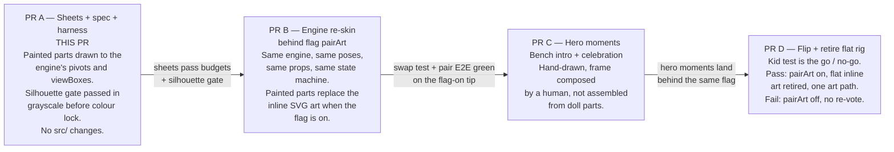
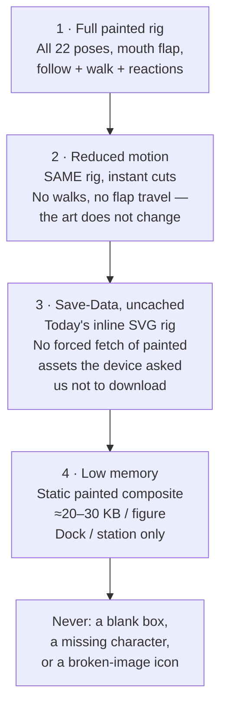

# Model Sheet Spec — Holmes & Watson Painted Re-Skin

> **Status:** Binding spec for PR A. Written 2026-11-07.
> **Owner ruling:** Veeresh, 2026-11-07 ~21:24 CST, in chat:
> "Yes to all three — start PR A" — given after ❤️ + "Love this
> version" on the regenerated mockup. The three are: (2) the
> LOOK as a live rig, (3) the doll chassis + hero moments,
> (4) the per-cell kid test as the go/no-go gate. Ruling (1) —
> the Cold Trail card films are the reference — was confirmed
> earlier the same day, 2026-11-07 ~15:57 CST, by voice.
> **Study of record:** `STUDY-format-rebuild.md` +
> `MOCKUP-NOTES.md` in the format-study evidence folder
> (`~/workspace/meridian-detective-evidence/format-study/`).
> **Engine of record:** `src/game/loop/detective/DetectivePair.tsx`
> and `src/game/loop/detective/detective-host-props.ts` on
> `main` @ `9e49da3`. Where this spec and the code disagree,
> §12 names the disagreement out loud. Do not paper over it.

This document is written so a new developer can start work
from it alone. The why comes before the what in every section.
If a word here could be read two ways, the narrower, safer
reading wins — and the reading you chose goes in your report.

---

## 1. Purpose — why we are re-drawing two characters who already work

The shipped Holmes & Watson work. They follow, walk, read
clues aloud, celebrate, and never leak an answer. The owner
played them and said the problem plainly (2026-11-07): the
pair reads **"very flat, very dull — not fun characters
children would enjoy."**

That is a drawing problem, not an engine problem. A child
decides in about two seconds whether a character is a friend
worth following. Flat vector shapes with thin outlines do
not pass that test against the warm, painted storybook look
of the Cold Trail card films — the films the owner pointed
to and confirmed as the reference.

So we keep everything that makes the pair safe and alive —
the transform engine, the pose system, the palm anchors, the
answer-blindness, the state machine — and we replace only
what the child sees: the art itself, rebuilt as painted
parts that the existing engine can still move.

**What this PR (PR A) is:** model sheets, this spec, and the
measurement harness that proves the sheets meet the budgets
and laws below. No engine code changes. No new flag. No
behaviour changes.

**What this PR is not:** the re-skin itself. That is PR B.

---

## 2. Programme shape — four small PRs, not one big one

Why four? Each step can fail on its own evidence and stop
without wasting the next step. The art can fail the kid
test. The engine swap can fail performance. If we built it
all at once, we would not know which part failed.



| PR | Delivers | Flag | If it fails |
| :--- | :--- | :--- | :--- |
| A | Model sheets, this spec, palm / size / budget harness | None added | Sheets are redrawn. Nothing in the game changed, so nothing can break for a player. |
| B | Painted parts wired into `DetectivePair.tsx` | `pairArt` (new, default off; baked default `false`, `public/flags.json` explicit `false` until flip) | Flag stays off. Players keep today's inline SVG. |
| C | Hand-drawn bench + celebration art | Same `pairArt` flag | Hero moments stay on the doll versions from PR B. |
| D | Flip, then delete the flat art path | `pairArt: true` | A failed kid-test bar flips `pairArt` off with **no re-vote** — the standing pattern for this feature. See §10. |

The flag name is `pairArt`. It does **not** exist in the
codebase yet — `src/lib/flags.ts` on `main` @ `9e49da3`
knows only `detectivePair`, `hostsStaging`, and `watsonWalk`.
PR A must not create it. PR B creates it. Naming it here
stops two crews inventing two names.

---

## 3. The chassis — a painted-parts paper doll on the existing engine

### 3.1 Why a paper doll, in plain words

A film plays the same frames every time, from the same
camera. Our pair does not live in a film. Holmes follows a
child's finger to a place nobody predicted. Watson walks a
gutter whose length changes with the screen. A celebration
starts wherever the last clue card happened to be.

You cannot pre-film "follow that finger." You can move
painted parts — a head, a coat, two arms, two legs — with
the transforms the engine already knows. That is a paper
doll: flat painted pieces, each pivoting at one joint,
moved by code that already exists and already passes its
tests.

The study priced the alternatives and they are dead ends,
not opinions:

- **Full-film companion:** ≈9.6 MB (≈19 MB with alpha);
  software alpha decode on weak Android; no viable alpha
  path on iOS.
- **Sprite companion:** 2.0–3.5 MB plus 33–50 MB decoded
  memory — over the memory budget in §7 on its own.

The doll is the only option inside both budgets. Its honest
limits, stated now so nobody discovers them in review:
no per-frame smears, no per-scene relighting, and motion
outside the hero beats is stepped, not fluid. Those limits
are accepted. "Flat and dull" is fixed by the painted
texture, the faces, and the silhouette — not by fluidity.

### 3.2 What a "part" is

Each character is drawn as separate painted pieces. The
engine moves a piece by rotating or translating it around
one fixed pivot point. If you draw a part, you must draw
it so that pivot still works: the shoulder pivot must sit
inside the painted shoulder, the palm must land where the
anchor says it lands. A beautiful arm that pivots from the
elbow is a broken arm.

All coordinates below are in each character's own viewBox
units, unflipped. Facing is a mirror the engine applies;
you draw facing one way only, exactly as the current rigs do
(Holmes's base art faces right; Watson's base art profiles
left and is mirrored for "right" — see the comments in
`DetectivePair.tsx`; the painted parts keep that convention).

### 3.3 Holmes — parts, pivots, viewBox

**ViewBox: `0 0 120 178`.** Tall and thin. Brick-red plaid
cape-coat (`#a52a21` base), rust deerstalker (`#b45a1b`),
burgundy tie, clean-shaven. **No pipe — in any pose, ever.**
No glasses.

| Part | What it is | Engine pivot / anchor | Notes for the artist |
| :--- | :--- | :--- | :--- |
| Hat | Deerstalker, with front + back brims and ear-flaps | Rides inside the head group; head pivot `62,54` | Part of the silhouette test. A Holmes a child cannot name from the hat alone has failed. |
| Head | Face + hair + nose profile | Pivot `62,54` (the head group's `transformOrigin`) | Carries one face from §6 per pose. The nose points the gaze — see the Gaze-Leak Law, §9.3. |
| Torso / coat | Plaid coat body, vest wedge, tie, buttons | Pivot `60,132` | Coat hem is the bottom of the torso piece; legs start beneath it. |
| Arm-front (glass arm) | Right arm, shoulder to palm | **Pivot `78,58`** | **Palm anchor: the hand circle at `87,83` in the base pose.** In the `high-five` pose this arm is drawn explicitly, not rotated: the palm **is** `HIGH_FIVE_CONTACT.holmes = (99, 25)`. See §3.5. Holds the magnifying glass in most poses (§5). |
| Arm-back (swing arm) | Left arm, shoulder to palm | **Pivot `44,58`** | Holds the clue card in `card-look` only. Otherwise empty-handed. |
| Legs | Two legs (`leg-a`, `leg-b`) + shoes | Pivots `52,118` and `64,118` | Walk motion comes from CSS keyframes on these groups in `detective.css`. Paint both legs as full pieces; do not bake a stride into the torso. |
| Halo / keyline (optional layer) | Cream halo + near-black keyline painted **under** the figure, inside the artwork | No pivot — a silhouette underlay group (`data-part="halo"`) | Baked into the art, never a live CSS filter (§7). Ships only when the caller asks for it, as today. |

Holmes pose rotations live in `HOLMES_POSE_SPECS` in
`DetectivePair.tsx`. The painted arm pieces must read
correctly at every rotation that table uses — the extremes
are `berth-think` frontArm `−112°` (glass raised to the
face) and `celebrate-jump` swingArm `140°`. Draw the
shoulder cap round enough that no rotation opens a gap at
the shoulder.

### 3.4 Watson — parts, pivots, viewBox

**ViewBox: `0 0 134 140`.** Shorter and wider — about
three-quarters of Holmes's height (§8). Royal-blue plaid
(`#27408b` base), navy bowler (`#1d2f57`), gold tie
(`#c9a227`), cream vest, ginger moustache. The moustache
stays shrunk with a visible mouth beneath it — Watson is
the character who reads every clue aloud, so his mouth
must be seen to speak.

| Part | What it is | Engine pivot / anchor | Notes for the artist |
| :--- | :--- | :--- | :--- |
| Hat | Navy bowler + band | Rides inside the head group; head pivot `60,50` | Round, low, unmistakable next to the deerstalker. |
| Head | Face + moustache + ear + cheek | Pivot `60,50` | Carries one face from §6 per pose. Mouth stays visible under the moustache in every face. |
| Torso / coat | Plaid coat body, cream vest, gold tie, buttons | Pivot `60,110` | Wider than Holmes's at every height — that width difference is half the identity test. |
| Arm-front | Left arm (in unflipped art), shoulder to palm | **Pivot `36,54`** | **Palm anchor: the hand at `26,89` in the base pose.** In the `high-five` pose this arm is drawn explicitly: the palm **is** `HIGH_FIVE_CONTACT.watson = (15, 21)`. See §3.5. |
| Arm-back (notebook arm) | Right arm, shoulder to palm | **Pivot `82,54`** | Carries the notebook, the clue card, the pencil, or — in `celebrate-jump` only — Holmes's magnifying glass after the hand-off. |
| Legs | Two legs (`leg-a`, `leg-b`) + shoes | Pivots `52,92` and `66,92` | Same walk-keyframe contract as Holmes. |
| Halo / keyline (optional layer) | Cream halo + near-black keyline underlay | No pivot — `data-part="halo"` group | Watson's render scale differs from Holmes's, so stroke widths that produce the same rendered halo differ. Match the **rendered** halo (≈3–4 px cream, ≈1.5 px keyline at rig scale), not the viewBox numbers. |

Watson pose rotations live in `WATSON_POSE_SPECS`. The
extremes to check while drawing: `read` / `think` noteArm
`−52°` (card raised to reading height), `celebrate-jump`
noteArm `−80°` (glass held high), and `clap` frontArm
`−52°` / noteArm `+40°` (both hands meeting).

### 3.5 The high-five contact — the one place two parts must agree

A high-five where the palms miss reads as a mistake to a
five-year-old. The engine therefore does not guess: in the
`high-five` pose each raised arm is drawn explicitly so its
palm sits exactly on a fixed anchor, and the host places
the two rigs so the anchors coincide.

| Anchor | ViewBox point |
| :--- | :--- |
| `HIGH_FIVE_CONTACT.holmes` | `(99, 25)` |
| `HIGH_FIVE_CONTACT.watson` | `(15, 21)` |

- Draw each high-five palm centred on its anchor. Not near
  it. On it.
- The budget for error is **≤3 px at rendered rig scale,
  measured by an automated test** — not by eye (§7).
- `CELEBRATE_LAYOUT` in `DetectivePair.tsx` converts these
  anchors into the rendered offset between the two figures.
  If you move a palm, that layout lies, and the celebration
  breaks silently. **Do not move a palm. If a sheet needs a
  different palm, that is a spec amendment (§5.3), and PR B
  must re-derive `CELEBRATE_LAYOUT` in the same change.**
- The glass hand-off is part of this beat: in
  `celebrate-jump`, `high-five`, and `clap`, Holmes holds
  **no** glass — Watson holds it (in `celebrate-jump`) or
  has taken it. A high-five holding a magnifier reads
  wrong, and the study says so in those words.

---

## 4. The two whitelists — do not mix them up

Two different things in this codebase are both called a
whitelist. Mixing them up is how an answer leaks.

### 4.1 The host-props whitelist — what the pair may *know*

`detective-host-props.ts` is the single place the host's
props are built. Its key list is pinned by a unit test.
The pair may receive **exactly these seven fields, and
nothing else:**

```text
caseIndex · cluesRevealed · status · sheetOpen ·
lastGuessPlaceId · freshDeal · answerPlaceId
```

Plain meaning: which case is open (for audio lookup), how
many clues are on screen, whether the game is playing /
won / lost, whether the confirm sheet is up, the player's
own last pick echoed back, whether the case was dealt
fresh, and — **only after the game itself has revealed
the answer on screen, when `status` is `"won"`** — the
answer's place id for the spoken debrief. The builder
forces `answerPlaceId` to `null` while playing or lost,
whatever the caller passes.

There is no puzzle object, no clue text, no target, no
list of guesses, and no right/wrong verdict anywhere in
that shape. That absence is the product's safety story:
Holmes is answer-blind **by construction**, not by a
promise in a code review.

**PR A changes none of this. PR B changes none of this.
No re-skin PR changes any of this.** See §9.3.

### 4.2 The visual-props whitelist — what the pair may *hold*

A prop is a thing in a painted hand. The closed list,
from the pose specs in `DetectivePair.tsx`:

| Prop | Who holds it | When |
| :--- | :--- | :--- |
| Magnifying glass | Holmes (front arm); Watson (notebook arm) in `celebrate-jump` only, after the hand-off | Holmes: every pose except `celebrate-jump`, `high-five`, `clap` (glass is `null` there). Watson: `celebrate-jump` only. |
| Clue card | Holmes (swing arm) in `card-look`; Watson (notebook arm) in `read` and `think` | Only those poses. The card is a blank ruled card in the art — it never shows real clue text. |
| Notebook + pencil | Watson (notebook arm) | `walk`, `station-idle`, `notebook-mark`, `gasp`, `high-five`, `pout`. The pencil appears with the notebook except in `gasp` and `high-five`. |
| Coffee cup | Both, seated | **Bench only.** See the warning below. |

> **Warning — the coffee cup is not in the rigs.** In the
> shipped code the cups live in the host's bench markup
> (`DetectiveHost.tsx` + `detective.css`), not in
> `DetectivePair.tsx` — the rig file says so in its header
> comment: "the cups stay on the bench and never enter
> play." PR A's sheets therefore draw **exactly one shared cup part for the bench hero tableau — never for either character as a held or worn prop, and never inside either character rig**. The bench cup is a shared hero-moment part
> (PR C), drawn with the bench, in the host's bench scene.
> A cup rendered inside either character rig in any pose — seated, standing, or walking — is a defect
> against the Staging Law (§9.2): no bench props in walk
> or in-play frames.

No other props. No pipe (ever — this is a standing owner
rule, not a style choice). No umbrella, no letter, no map,
no flag, no pennant in the rig poses. If a beat seems to
need a new prop, see §5.3.

---

## 5. The verb shortlist — the whole vocabulary, decided here

### 5.1 The principle

A small set of moves, done brilliantly, beats a large set
done adequately — every time, and doubly so for children,
who learn a character the way they learn a friend: by
seeing the same gestures mean the same things.

**The 22 poses below are the whole vocabulary of the live
rig.** That is a decision, recorded here, not a starting
point for negotiation in a later PR. The study's words:
"Verb shortlist decided in the art PR; tiny verb set done
brilliantly over many mediocre poses."

### 5.2 The 22 poses, with their faces

Faces are named by `FaceKind` (§6). The assignments below
are read directly from `HOLMES_POSE_SPECS` and
`WATSON_POSE_SPECS` in `DetectivePair.tsx` on
`main` @ `9e49da3` — PR A's sheets must supply a painted
face for every cell.

**Holmes — 12 poses** (viewBox `120×178`):

| # | Pose | Face | Plain meaning — when a child sees it |
| :--- | :--- | :--- | :--- |
| 1 | `dock` | `neutral` | Resting at his station beside the map. Calm, present, waiting with you. |
| 2 | `walk` | `focused` | Moving to a new spot after you pause. Purposeful, eyes ahead. |
| 3 | `search` | `focused` | Leaning in, glass up, looking at the area **you** are exploring. |
| 4 | `berth-think` | `thinking` | Parked and thinking while you think. Glass raised toward his own face — never toward an answer (§9.3). |
| 5 | `ack` | `attentive` | A short nod of acknowledgement after a clue read. "I heard that too." |
| 6 | `announce` | `hushed` | The case-open hushed moment. There is no true whisper on this rig; hushed is the honest version. |
| 7 | `gaze-up` | `wonder` | Looking up in wonder — at the sky, the scale of the place — never down at a target. **Reserve / unwired:** no `viewForState` phase emits this pose today — drawn and held in reserve, awaiting a beat; it is not a live pose and no PR may claim it plays (panel round 1, Game designer nit 4; see §16.3). |
| 8 | `card-look` | `reading` | Reading the clue card in his swing hand, with Watson. **Reserve / unwired:** no `viewForState` phase emits this pose today — drawn and held in reserve, awaiting a beat; it is not a live pose and no PR may claim it plays (panel round 1, Game designer nit 4; see §16.3). |
| 9 | `celebrate-jump` | `delighted` | The solve jump. No glass in hand (handed to Watson). |
| 10 | `high-five` | `delighted` | Palm raised to the anchor `(99, 25)`. Palm meets Watson's palm exactly. |
| 11 | `clap` | `delighted` | Clapping after the high-five. Both arms in, no glass. |
| 12 | `pout` | `pout` | The loss beat. Disappointed **with** the player, never **at** them. Head and torso slump. |

**Watson — 10 poses** (viewBox `134×140`):

| # | Pose | Face | Plain meaning |
| :--- | :--- | :--- | :--- |
| 13 | `walk` | `neutral` | Walking the gutter to the next clue card, notebook in hand. |
| 14 | `read` | `reading` | Holding the clue card up and reading it aloud — his main job in the game. Eyes on the card. |
| 15 | `think` | `thinking` | Card still raised, thinking over what he just read. |
| 16 | `station-idle` | `neutral` | Standing at the clue station, notebook ready, waiting for you. |
| 17 | `notebook-mark` | `marking` | Head down, pencil marking the notebook — recording what was learned. |
| 18 | `gasp` | `surprised` | The surprise reaction. Notebook still in hand, pencil dropped from the pose. No silent moments: a guess, good or bad, gets a reaction. |
| 19 | `celebrate-jump` | `delighted` | The solve jump, holding Holmes's glass (the hand-off happened). |
| 20 | `high-five` | `delighted` | Palm raised to the anchor `(15, 21)`. Notebook stays in the other hand. |
| 21 | `clap` | `delighted` | Clapping, hands meeting, no props in either hand. |
| 22 | `pout` | `pout` | The loss beat, matching Holmes — assurance, not blame. |

Count check: 12 + 10 = **22 poses**. That number is the
shortlist. If a sheet set contains a 23rd live-rig pose,
it is out of spec until §5.3 is followed.

### 5.3 Adding a pose is a spec amendment, not a drive-by

A new pose, a new prop, a moved palm anchor, or a changed
face assignment requires:

1. An edit to this file, in the same PR as the art, stating
   the beat the new pose serves and why no existing pose
   serves it.
2. The pose's face assignment recorded in the table above.
3. The full pipeline verdict on the new tip — the panel
   judges the amended spec, not just the drawing.

A pose that arrives in art without this amendment is
removed in review, however good it looks. This rule exists
because every pose costs size (§7), a face (§6), a kid-test
cell (§10), and a maintenance surface forever. The price
is paid knowingly, or not at all.

### 5.4 Two things that are NOT poses

**Speaking is an overlay, not a pose.** In the shipped rig,
`speaking` is a boolean on top of any pose: a CSS mouth
flap (`.detective-speaking .detective-mouth`, a generic
0.26 s oscillation in `detective.css` — explicitly **not**
lip-sync) plus a slight head motion. Any face can speak.
The painted rig keeps this contract: PR B must provide a
mouth-flap treatment that works on **every** face in §6,
including under Watson's moustache. A "speaking face" as a
23rd pose is out of spec. Note the study's warning, which
is a quality bar, not a suggestion: painted faces raise the
bar — a mouth flap that looked acceptable on flat art looks
broken on painted art. Budget drawing time for the flap.

> **Coordinator ruling (2026-11-07 night — records cure (d)):**
> the mouth measure recorded for this programme is a
> **mouth-height** bar, not a centroid-travel bar. The flap
> must sit in a mouth region tall enough — ≥3 px at rig
> scale — to read as speech on the painted face; expressions
> are never required to move the mouth centroid by any
> distance. Face measures recorded in the asset lock are
> read under this ruling.

**The static composite is a degradation image, not a
pose.** When a device cannot run the rig, the player still
sees a whole, painted figure standing at the station —
one flattened composite per character (≈20–30 KB per
figure, §7). It has one neutral face, no pivots, and no
animation. It is drawn **from** the sheets (same silhouette,
same scale ratio), but it is not a pose and it is never
blank. Degradation ends at a figure, never at an empty box.

> **Delivered in PR A (coordinator ruling (c), 2026-11-07
> night):** the static composites of record are the delivered
> pose plates — Holmes `holmes-pose-dock.png` (14,690 B),
> Watson `watson-pose-station-idle.png` (16,651 B) — both
> within the ≈20–30 KB band (slightly under is fine; the band
> is a budget, not a target). These are PR A’s sheet
> composites for the kid test, NOT a change to the locked
> in-game degradation tiers: the low-memory tier keeps its
> own small static composite, and the shipped degradation
> architecture is untouched by this PR.

---

## 6. The expression set — 11 faces × 2 characters

### 6.1 Why faces ship in the base re-skin

Faces are not a polish pass. The study adopted this as a
designer law: **face and mouth expressiveness ships in the
base re-skin, never deferred.** Painted texture raises what
a child expects from a face; a painted character with a
flat mouth reads as broken, where the same mouth on flat
vector art read as simple. Deferring faces would ship the
exact complaint we are fixing, in higher resolution.

### 6.2 The 11 FaceKinds

The type in `DetectivePair.tsx` — the closed set:

```text
neutral · focused · thinking · attentive · hushed ·
wonder · reading · marking · delighted · surprised · pout
```

Each face is brow + eye + mouth. A face must read **alone,
at game scale, in under two seconds** — that was true of
the flat rig ("each pose reads solo at game scale") and it
is doubly true painted.

| FaceKind | Holmes — used by | Watson — used by | What must read at a glance |
| :--- | :--- | :--- | :--- |
| `neutral` | `dock` | `walk`, `station-idle` | Calm, friendly, awake. Not blank. Blinking and breathing squash live here (idle life comes from the engine's CSS, painted faces must not fight it). |
| `focused` | `walk`, `search` | — (no current pose) | Brow lowered, eye steady, mouth a flat line. Concentration, not anger. |
| `thinking` | `berth-think` | `think` | Brow curved up, gaze slightly aside, mouth short and flat. "Working on it." |
| `attentive` | `ack` | — (no current pose) | Brow level, eye wide, small closed smile. "I heard you." |
| `hushed` | `announce` | — (no current pose) | Small round mouth. Quiet, close, secret-sharing — without a finger prop or a whisper claim. |
| `wonder` | `gaze-up` | — (no current pose) | Brow high, eye lifted, small open mouth. Awe at something big. |
| `reading` | `card-look` | `read` | Eyes dropped **onto the card in the character's own hand**. This gaze target is always legitimate — it is the character's own prop, never the map answer (§9.3). |
| `marking` | — (no current pose) | `notebook-mark` | Eyes down on the notebook, brow angled, mouth flat with effort. |
| `delighted` | `celebrate-jump`, `high-five`, `clap` | `celebrate-jump`, `high-five`, `clap` | Closed happy eye arc, wide open smile. The biggest mouth in the set. |
| `surprised` | — (no pose today; face exists in Holmes's renderer) | `gasp` | Brow high and angled, eye a large circle, mouth a clear O. |
| `pout` | `pout` | `pout` | Brow angled down-in, mouth an inverted arc. Sad, kind, together-in-failure. |

### 6.3 A gap in the shipped code the sheets must close

Read the table again, by column. The shipped renderers do
**not** draw all 11 faces distinctly for both characters:

- **Holmes** has distinct art for 10 faces. `marking` falls
  through to his `neutral` default — he has no pose that
  uses it today, so the gap never showed.
- **Watson** has distinct art for 6 faces (`reading`,
  `thinking`, `marking`, `delighted`, `surprised`, `pout`).
  `focused`, `attentive`, `hushed`, and `wonder` fall
  through to his `neutral` default — again, no current
  Watson pose uses them.

This spec requires **11 distinct painted faces per
character — 22 face drawings** — even where no pose uses
one today. Why: the verb set is closed, but the face set is
the rig's emotional alphabet; a future spec amendment that
assigns, say, `attentive` to a Watson pose must not discover
the face was never drawn. PR A sheets deliver all 22. PR B
wires the ones the poses use and keeps the rest in the
sheet asset, inside the §7 budget. If the budget cannot
hold 22 faces, that is a §5.3 amendment discussion — it is
not resolved by quietly drawing 16.

### 6.4 The mouth-travel rule

A reaction a child cannot see is a silent moment, and this
programme has no silent moments. The study's rule, binding
here:

> **Between a character's neutral mouth and any reaction
> mouth (`delighted`, `surprised`, `pout` at minimum), the
> mouth must move by ≥3 px at rig scale.**

"At rig scale" means at the rendered size (§8), measured
on the built rig — the vertical distance the mouth's
centre or arc travels between the neutral drawing and the
reaction drawing. Draw reaction mouths bigger than feels
polite. Then measure. A face pair that fails this rule
fails the expression cell of the kid test (§10) in advance.

> **Clarifying note (panel round 1 — Game designer nit 2 +
> Game audio nit 2; see §16.1):** this §6.4 rule and the
> §5.4 coordinator ruling (d) are **not** in conflict, and
> neither replaces the other. Ruling (d)'s **mouth-HEIGHT
> ≥3 px** governs the **speaking flap** — the mouth region
> must be tall enough to read as speech. This §6.4 rule's
> **≥3 px centroid/arc travel** governs **expression
> mouths** — the visible change between a neutral mouth
> and a reaction mouth. Different mechanisms, different
> measures, both binding.

---

## 7. Budgets — hard numbers, not aspirations

Every number in this section is a gate. "About" is not a
pass. The PR A harness measures the first three against
the actual sheet files; PR B re-measures them against the
wired rig; the kid test (§10) re-checks performance on a
real device class.

| Budget | Hard number | Why this number |
| :--- | :--- | :--- |
| Total runtime pair assets | **≤500 KB, lazy-loaded** | The pair must never tax the game's first load. Lazy means: nothing in the initial bundle path; the assets load when the detective edition needs them, behind `pairArt` in PR B. |
| Decoded memory | **≤32 MB** | A 2 GB-class Android (the kid-test device floor) must hold the decoded pair plus the map. The rejected sprite option alone was 33–50 MB decoded — that is why it was rejected. |
| Palm-anchor error | **≤3 px at rendered rig scale, by automated measurement** | Palm-to-palm contact is the celebration's whole point (§3.5). Eyeballing is not measurement. The harness locates each painted palm against its §3.5 anchor and reports the error in rendered pixels. |
| Live per-frame SVG filters | **ZERO** | No `filter`, no CSS `drop-shadow`, nothing per-frame on a moving figure. This is the performance seat's veto from the shipped makeover, kept: separation (halo + keyline) is **baked into the art** (§3.3), never computed live. |
| Static composite size | **≈20–30 KB per figure** | The low-memory fallback must be cheap enough that keeping it costs nothing — so it is never the thing that gets cut. |

### The degradation ladder — every rung ends at a figure

Weak devices are not edge cases; they are a large share of
the children this game is for. The ladder, in order:



Rung notes:

- **Rung 2 is the same art.** Reduced motion changes
  movement, never the drawing. A child who needs reduced
  motion gets the same friends.
- **Rung 3 is why the inline SVG stays.** Today's
  `DetectivePair.tsx` art is not deleted in PR B or PR C.
  It is the Save-Data fallback. It is retired only in
  PR D, after the flip — and PR D must state what rung 3
  becomes before it deletes anything.
- **Rung 4 is drawn in PR A.** The static composites are
  part of the sheets deliverable, at the §8 scale ratio,
  with the `neutral` face. The kid test includes the
  static fallback in its find-Holmes cells (§10) — a
  fallback children cannot find is not a fallback.

---

## 8. Scale law — Watson is three-quarters of Holmes, everywhere

### 8.1 The law

> **Watson ≈0.75× Holmes in every frame.** Height ratio,
> measured on the rendered figures. A near-equal pairing
> is a defect, not a style choice.

Why so strict: children tell the pair apart by size before
they learn the costumes. Two same-sized figures are two
strangers; a tall one and a three-quarter one are Holmes
and Watson. The mockup QA rounds measured a walk still at
**0.97** (Watson 116 px against Holmes 120 px) and ruled
it a defect on sight. That number is recorded here so it
is never re-litigated as a taste question.

### 8.2 The locked bench-tableau sizes

One scale standard per width, anchored on the bench scene
(the bench still is the presence reference for the whole
set — faces readable, generous, per `MOCKUP-NOTES.md`):

| Width | Holmes height | Watson height | Ratio |
| :--- | :--- | :--- | :--- |
| 390 px | **170 px** | **130 px** | 0.76 |
| 1280 px | **150 px** | **115 px** | 0.77 |

Widths between and beyond these follow the kid-test bands
in §8.3 — the ratio holds even where the absolute heights
interpolate. If a layout cannot fit the locked height,
the layout changes; the ratio does not.

> **Which lock governs where (panel round 1 — Game level
> architect nit 1 + UX designer nit 1; see §16.2):** the
> 170/130 and 150/115 locks in this section govern the
> **bench hero tableau** — the composed surface the numbers
> were measured on. They do **not** govern in-play sizes.
> In-play sizes are governed by the §8.3 bands alone
> (112–128 px at 390, and so on). The zero-coverage PASS on
> record was proven at 128 px at 390 — the band maximum —
> and at no larger in-play size.

**Hero moments are different, on purpose.** The bench and
the celebration are composed frames (PR C). Their artwork
carries the ≈0.75 ratio **inside the drawing** — the
artist composes both figures together at the right
relative size, and no code scales one against the other.

### 8.3 Kid-test size bands and face floors

These bands bind the art and the test together, so the
two cannot drift apart (the study's staging addendum
requires the model sheets to state them, for exactly
this reason):

| Viewport width | Figure height band | Face floor — pending owner's ruling, not binding (see below) |
| :--- | :--- | :--- |
| 390 px | 112–128 px | **38 px** |
| 768 px | 128–144 px | **44 px** |
| 1280 px | 144–160 px | **48 px** |
| 1920 px | 160–176 px | **52 px** |

"Face floor" is the smallest rendered face height (hat
brim to chin) allowed in that cell. Below the floor, the
§6 faces cannot read in two seconds, and the expression
gate in §10 cannot pass honestly.

> **Face floors DEMOTED — PENDING THE OWNER'S RULING
> (panel re-vote cure, 2026-11-08; see §16.5):** why this
> demotion exists: the size band and the face floors in
> this section cannot both be met for Holmes. At his
> delivered head share (~24% of figure height), meeting
> the floors would need figure heights of 157 / 181 /
> 197 / 213 px — above the band maxima of 128 / 144 /
> 160 / 176 px in every cell. A law no sheet can obey
> must not stand as binding law, and this spec does not
> pick a winner. The choice — **re-proportion Holmes's
> head** away from the owner-approved register, **or
> amend the floors** — is the owner's, and it is
> **deferred** until he rules. **Until he rules, the
> face floors are NOT binding law. The size band
> stands** and remains binding. The measured shortfall
> (Holmes 31 / 35 / 39 / 43 px against the floors) stays
> on record as a measurement, not as a breach of a
> binding floor.

> **In-play governance (panel round 1; see §16.2):** these
> bands are the ONLY in-play size law. PR B must not
> implement the §8.2 bench lock (170 px at 390) as an
> in-play size without first re-proving zero clue-text
> coverage at that size, on the built page, at every width
> it ships — the coverage proof on record covers 128 px
> at 390, not 170 px.

> **Known tension, stated openly (see also §12):** the
> shipped engine pins the rig height at
> `DETECTIVE_RIG_HEIGHT_PX = 104` px, and the staging
> programme shipped 104 px on the map / at the station
> with ~128 px in the bench slot. The locked heights and
> bands above come from the re-skin study and mockup QA,
> and they are **larger**. Reconciling the rig height
> with this law is PR B's sizing work, gated by the §10
> kid test — it is not waved away here, and PR A sheets
> must be drawn at source resolution that holds up at
> 176 px rendered height without softening.

---

## 9. Three laws that outrank the art

A sheet that breaks any law in this section is rejected
however beautiful it is. These laws exist because each
one protects a child, not a codebase preference.

### 9.1 — no, read §9.2 and §9.3 first if you read nothing else

Seriously. §9.2 keeps the pair from covering the words a
child is trying to read. §9.3 keeps the pair from cheating.
Both have blocked shipped work before.

### 9.2 Staging law — figures live in page space

- **Figures live in the page, in the gutter beside the
  content — never on the map.** No figure stands on map
  tiles, the map frame, the attribution bar, or any map
  button. No figure covers any UI chrome: not the speaker,
  not replay, not the sound chip, not a deck chip.
- **Zero clue-text coverage.** Neither figure ever covers
  clue or question text — 0 px², in every state, at the
  maximum in-band size (§8.3). This is the standing
  accessibility law of the pair, extended by the study
  from clue text to all UI chrome.
- **Holmes's in-play place** is his follow-model park: in
  the gutter beside the map, at the height of the player's
  last pause. He stays with the pointer — returning to a
  home spot after a pause is a bug (owner ruling,
  2026-11-07), and no sheet may imply a "home" pose that
  contradicts the follow model. (`dock` is a pose name in
  the engine, not a promise that he goes home.)
- **Watson's in-play place** is the clue station in the
  gutter, and on his walk, the gutter path to the card.
  Speech releases only when he arrives — that is shipped
  behaviour the art must fit (stride length and bob come
  from the host's walk, not from the sheet).
- **No bench furniture in walk frames.** When Watson
  walks, the bench has already exited. No bench slats, no
  orphan cups, no bench props of any kind appear in a
  walk sheet or a walk frame. The mockup's round-2
  re-stage exists because this was violated in a draft.
- **Celebration lives in page flow.** The pair celebrates
  in a slot in the page flow that the cards displace
  around — the same pattern as the bench slot — **never
  composited on top of clue cards.** The mockup's round-1
  re-stage exists because a jumping pair covered Clue 2's
  text. The palm contact (§3.5) must be achievable inside
  that slot at every width in §8.3.

### 9.3 Gaze-leak law — the pair must never point at the answer

This law is stated at full force. It is not summarised
here; the words below are the law.

> **Gaze/lean is an answer-leak channel.** A character who
> looks at the right place on the map has answered the
> question, whatever his mouth says. Children follow a
> character's eyes before they follow a clue.
>
> **Directed gaze may only use coordinates that
> answer-blind Holmes legitimately receives via
> `detective-host-props.ts`** — the pinned seven-key list
> in §4.1 (`caseIndex`, `cluesRevealed`, `status`,
> `sheetOpen`, `lastGuessPlaceId`, `freshDeal`,
> `answerPlaceId` with its post-solve-only derivation).
> In practice, for the art, that means: gaze may target
> the character's **own prop** (the card or notebook in
> his own hand), the **other character**, the **player's
> own pointer or pick** (echoed back as `lastGuessPlaceId`
> — the player's input, never a verdict on it), or
> **nothing in particular** (sky, middle distance, the
> player's last pause point, which Holmes's follow model
> already legitimately holds).
>
> **One gaze toward the correct place = a BLOCK-class
> defect.** Not a nit. Not "fix it later." A sheet, a pose,
> or a hero frame that aims a gaze or a lean at the
> answer — or at anything correlated with the answer,
> including distance or direction toward it — blocks the
> PR that carries it, on the same standing as the K5 swap
> test it would defeat.
>
> **The re-skin changes NO props, NO state machine, and
> NO answer-blindness architecture.** Not the seven keys.
> Not `detective-state.ts`. Not the berth solver. Not the
> swap test. If a drawing seems to need a new coordinate,
> the drawing is wrong. Redraw it.

Artist's checklist for every sheet, before it is submitted:

1. Where is each character looking? Name the target out
   loud. If you cannot name it from the list above, the
   gaze is out of spec.
2. Does any lean, point, glass angle, or raised arm line
   up with a map direction? The glass in `search` aims
   where the **player** is exploring — the sheet must
   draw it aim-able by rotation around §3's pivots, never
   pre-aimed at a fixed map bearing.
3. Would this frame still be legal if the answer were in
   the opposite corner? If not, it leaks. Redraw.

---

## 10. The kid test — the go/no-go gate for the PR D flip

The kid test is not feedback. It is a gate with
pre-committed numbers, run per **width × background cell**
(390 / 768 / 1280 / 1920 px against the game's real map
and page backgrounds), on the built page — never on loose
art files.

| Bar | Threshold | Notes |
| :--- | :--- | :--- |
| Find Holmes | **≥27/30 children, in ≤2 s, in every cell** — including the static-fallback cell (rung 4, §7) | **≤25/30 in any cell = kill.** 26/30 is a fail that may be re-drawn and re-tested once per the panel's call; it is not a pass. |
| Identity | **≥27/30** | The child names which figure is Holmes and which is Watson; ≤3/30 confusion with each other, the Cold Trail tracker, or Jolly. |
| Expression | **≥26/30** | The child reads the face's feeling (delighted / surprised / pout at minimum) from the §6 art at the cell's in-band size (face floors pending the owner's ruling — §16.5). |
| Clue-text coverage | **Zero** | At the maximum in-band size (§8.3), sampled through play: bench, walk, reading, celebration, closed states. One covered word fails the cell. |
| Performance | **Sustained ~60 fps** on a 2 GB-class Android during map pan + Holmes follow + Watson walk, on the built page at 390 / 768 / 1280 | Measured, not felt. Frame collapse that trips the pair's auto-kill counts as a failure of this bar, not as the device's fault. |

**The consequence is pre-committed:** a failed bar at
PR D flips `pairArt` off with **no re-vote**, on the same
standing pattern as this feature's earlier gates. Nobody
re-argues the numbers after seeing the results. If the
numbers are wrong, they are amended in this file, in a
PR, **before** the test runs — never after.

**PR A's part in this:** PR A does not run the kid test
(no children, no wired rig yet). PR A delivers the
**smoke gate**: the harness checks that are automatable
now — palm error (§7), asset size and decoded estimate
(§7), scale ratio (§8) on the composed sheets, silhouette
renders (§11) — so the art that reaches PR B is already
inside every budget a machine can check. The human cells
above belong to PR D, and the sheet sizes in §8.3 exist
so PR D's cells and PR A's art cannot drift apart.

---

## 11. Silhouette gate — grayscale before colour

Colour hides a weak silhouette. A child at arm's length,
on a bright map, in sunlight, recognises these characters
by outline first — hat, height, width, stance.

**The gate (crew-internal, inside PR A):**

1. Render every pose sheet in **grayscale at 104 px**
   figure height — the shipped rig height, deliberately
   the hardest small size, below every §8.3 band.
2. A reviewer who did not draw the sheets confirms, from
   the grayscale renders alone: Holmes and Watson are
   told apart in every pose pair; each character is
   recognisable as *themselves* (deerstalker vs bowler,
   tall-thin vs short-wide) without any colour or face
   detail; the high-five palms still meet.
3. **Only after that approval is colour locked.** Colour
   work before the gate is thrown away without discussion
   if the gate fails — that is the point of the order.

The grayscale renders **live with the sheets** in the
repo (committed alongside them under
`public/assets/detective/pair-art/` — the renders are
asset files, not docs; `docs/pair-art/` holds only this
spec, the PR body, and the locks),
so the panel can re-check the gate from the PR alone,
without regenerating anything.

---

## 12. Where the study and the code disagree — flagged, not papered over

The task that commissioned this spec ordered disagreements
named. Here they are. Each one states which source governs
for PR A and what the follow-up is.

1. **Coffee cup — study/task wording vs code.**
   The commissioning brief lists the coffee cup among the
   pose-spec props. The code disagrees: cups live in the
   host's bench markup, and `DetectivePair.tsx` states
   they never enter the rigs. **Code governs.** §4.2
   records the cup as bench-only, host-drawn. Exactly one
   shared cup part (`prop-cup.png`) is drawn in PR A for
   the bench hero tableau — never as a held or worn prop
   inside either character rig (coordinator ruling (b)).
2. **Face coverage — spec requirement vs shipped renderers.**
   §6.3: Holmes lacks a distinct `marking` face; Watson
   lacks distinct `focused`, `attentive`, `hushed`, and
   `wonder` faces. The *type* has 11 kinds for both; the
   *art* does not. **This spec governs for PR A** (draw
   all 22); PR B must wire the previously defaulted faces
   or record why a face stays unwired.
3. **`follow.ts` — protected list vs the tree.**
   The protected-files list (§13) names
   `src/game/loop/detective/follow.ts`. **That file does
   not exist on `main` @ `9e49da3`** — Holmes's follow
   behaviour currently lives in `DetectiveHost.tsx` and
   `companion.ts`. The file belongs to the pair-behaviour
   train on its own branch. PR A treats the name as
   protected anyway: it must not create it, and if the
   file lands on `main` before PR A merges, PR A rebases
   over it untouched.
4. **`pairArt` flag — programme vs the tree.**
   §2: the flag does not exist yet. That is by design
   (PR B creates it), recorded here so no reviewer flags
   PR A for "missing" it — or adds it early.
5. **Rig height — scale law vs `DETECTIVE_RIG_HEIGHT_PX`.**
   §8.3: the study's locked heights (170 px at 390) and
   bands (112–176 px) exceed the shipped engine constant
   (104 px) and the staging programme's shipped sizes.
   **The study governs as the target; the code is the
   starting point.** PR B owns the reconciliation and
   the §10 performance cell is where a too-big rig would
   be caught. PR A draws at source resolution for the
   176 px top band regardless.
6. **Speaking flap — rig vs stylesheet.**
   The mouth flap is CSS in `detective.css` acting on
   `.detective-mouth` elements inside the faces; it is
   not part of `DetectivePair.tsx`'s pose specs. A
   painted rig's flap equivalent is therefore PR B
   engine work (with `detective.css` in its scope), not
   a sheet deliverable — but §5.4's quality bar for the
   flap is set here, in PR A, so PR B cannot discover it
   late.
7. **Study record itself is a reconstruction.**
   `STUDY-format-rebuild.md` states on its face that the
   original study was lost in a `/var/tmp` wipe and the
   file is a summary rebuilt from the ruling recorded in
   memory and the surviving council record. Every number
   in this spec that traces to the study (§7, §8, §10)
   also traces to that recorded ruling. If the original
   study resurfaces and contradicts a number here, the
   number is re-checked against the owner's recorded
   words — not silently swapped.

---

## 13. Task capsule (repo `AGENTS.md` format)

```text
TASK / requested outcome:
  PR A of the character re-skin programme: painted model
  sheets for Holmes & Watson drawn to the existing
  engine's pivots, viewBoxes, palm anchors, pose set, and
  face set — plus this binding spec, the automated harness
  (palm error, asset budgets, scale ratio, silhouette
  renders), the handbook addendum, and BRANCH_STATUS.
  Sheets + spec + harness ONLY. No engine swap, no flag,
  no behaviour change.

Interpretations considered and selected reading:
  - "Sheets" = separate painted part drawings per §3
    (hat, head, torso/coat, arm-front, arm-back, legs,
    per-pose composites, all 22 faces, static composites),
    at source resolution for a 176 px rendered height —
    not a single illustration per character. The engine
    moves parts; a single illustration cannot be doll-
    rigged in PR B.
  - "Props whitelist" names two whitelists in this
    codebase; §4 records both and keeps them separate.
    The visual list is read from the pose specs; the
    coffee cup is bench-only and host-drawn (code over
    brief wording — §12.1).
  - The verb shortlist is the engine's current 22 poses
    exactly as tabled in §5.2 — decided, closed, and
    amendable only via §5.3.
  - The kid test (§10) is PR D's gate. PR A's obligation
    is the automatable smoke gate (§10, last paragraph),
    not a child panel.

Tier and rationale:
  Tier 2 — Council. New feature programme, 3+ files, a
  new asset pipeline surface, and a design-of-record
  decision (the verb shortlist) the owner reserves. The
  programme was decided by the 2026-11-07 format study
  (multi-seat, unanimous feasibility verdict) and the
  owner's three rulings; this capsule executes that
  record, it does not re-open it.

Done condition / scenarios / evidence that will prove it:
  - Sheets exist for every part in §3.3 + §3.4, every
    pose in §5.2 (22 composites), every face in §6.2
    (22 faces), and both static composites (§5.4).
  - Harness output, committed with the PR, showing:
    palm error ≤3 px (§7); total runtime asset estimate
    ≤500 KB and decoded estimate ≤32 MB (§7); Watson /
    Holmes rendered height ratio within 0.73–0.79 on
    every composite (§8.1); zero live-filter constructs
    in any delivered sheet asset (§7).
  - Silhouette gate (§11): grayscale 104 px renders
    committed with the sheets + the gate reviewer's
    sign-off recorded in the PR body.
  - This spec, the handbook addendum, BRANCH_STATUS.md,
    and the PR body draft are consistent with each other
    and with the code they cite (spot-checked against
    DetectivePair.tsx + detective-host-props.ts).
  - No file under src/ is touched; PR A's own harness,
    scripts, and assets are in scope per coordinator
    ruling (a) (diff audit in the PR body).

Files and interfaces in scope:
  - docs/pair-art/MODEL_SHEET_SPEC.md (this file, new)
  - docs/pair-art/PR_BODY.md (new)
  - public/assets/detective/pair-art/ (sheet assets +
    grayscale renders, as delivered by the art crew)
  - docs/pair-art/ (spec, PR body, locks + harness
    output, as delivered by the harness crew — paths
    named in the PR body when they land)
  - docs/handbook/10-holmes-and-watson-pair.md
    (additive PR A addendum ONLY — no rewrite of any
    existing section)
  - BRANCH_STATUS.md (repo root, this branch's capsule)

Protected files OUT of scope — UNTOUCHED, no exceptions:
  - The pair-behaviour train, in full:
    src/game/loop/detective/DetectiveHost.tsx
    src/game/loop/detective/detective-state.ts
    src/game/loop/detective/companion.ts
    src/game/loop/detective/follow.ts
      (not present on main @ 9e49da3 — see §12.3;
      protected by name regardless)
    src/game/loop/detective/watson-walk.ts
  - And, for PR A specifically, everything else under
    src/ — including DetectivePair.tsx and
    detective-host-props.ts themselves. They are read as
    the contract. They are PR B's scope, behind pairArt,
    not PR A's. (Coordinator ruling (a): PR A's own
    harness and assets — tests/e2e/pair-art-kidtest.spec.ts,
    the pair-art-kidtest project in playwright.config.ts,
    scripts/kidtest-*, and public/assets/detective/pair-art/
    — are PR A's deliverables, in scope, not protected.)

Dependencies / ordering:
  - Art sheets and harness are sibling crew deliverables;
    this spec is their shared contract and lands first.
  - PR B blocks on: sheets + harness green + silhouette
    gate passed. PR C blocks on PR B. PR D blocks on
    PR C + the §10 kid test.
  - The pair-behaviour train (follow redesign, session /
    moments, mute-by-character) owns its files on its own
    branches; any merge-up is a faithful union, never an
    edit of their surfaces from this branch.

Verification contract:
  - Diff audit: git diff --stat against the scope list
    above; any src/ path in the diff fails the PR on
    sight, as does any tests/, scripts/, or public/ path
    beyond PR A's own harness and assets (ruling (a)).
  - Harness run output committed (not pasted from memory):
    exact commands, target revision, pass/fail per budget.
  - Repo gates: tsc / unit / worker / lint-cards / build
    were RUN and green on the final art tip (the PR body
    records the counts) — an earlier draft of this capsule
    said NOT RUN; that text was stale once the harness
    landed and the gates were executed, and is corrected
    here.
  - Full pipeline on the final tip: Silo QA (keyed by
    PR# + head SHA) → 13-seat panel incl. the Game player
    seat → DevEx → benchmark → CI. The panel approves
    the FINAL tip; a cure is re-voted.
  - Merge only on the panel's READY / READY-WITH-NITS
    verdict on the final tip (ship-when-ready, owner
    2026-11-04).

Assumptions, risks, unknowns:
  - Assumption: sheet source format (layered source +
    exported parts) is the art crew's call inside §7's
    budgets; the harness measures exports, not sources.
  - Risk: 22 faces + 22 pose composites + parts inside
    500 KB is tight for painted art. If it does not fit,
    §5.3 / §6.3 require an amendment discussion — not a
    silent cut of faces or poses.
  - Risk: the §8 scale reconciliation (104 px shipped vs
    170 px locked at 390) may interact with the staging
    programme's gutter geometry (118 px). PR B owns it;
    PR A flags it (§12.5) so it is priced early.
  - Unknown: Watson's host-velocity drawn walk cycle
    (study's one open engineering choice) is PR B
    prototyping against the §10 performance bar. PR A's
    walk sheets must not pre-decide it: draw the walk
    parts so both a transform walk and a drawn cycle
    remain possible.

Simpler or rejected approach, and why:
  - One illustration per character, sliced later —
    rejected: slices guess at pivots; §3's pivots are
    known now, so parts are drawn to them directly.
  - Enriched vector instead of paint — rejected by the
    study: vector cannot reach the painted texture that
    is the owner's actual complaint.
  - Spec after the art — rejected: the palm, scale, and
    gaze laws are cheaper to obey while drawing than to
    retrofit. This spec lands first, on purpose.

Budget: Tier 2 parent cap 400k tokens (repo default),
  shared across coordinator + all delegates.

Approvals needed (exact action + owner), checker,
escalation:
  - Owner rulings (2)–(4): GIVEN (Veeresh, 2026-11-07
    ~21:24 CST — "Yes to all three — start PR A").
  - PR opening + merge: under the coordinator's
    assignment, ship-when-ready (owner, 2026-11-04) —
    merge on the panel's READY / READY-WITH-NITS verdict
    on the final tip. Branch protection untouched.
  - Checker: Silo QA + the 13-seat panel, neither being
    any sheet's own artist (no self-certification).
```

---

## 14. Redundancy audit — what PR A adds, and what it must not duplicate

The owner's standing rule (2026-10-29): before any push,
audit the diff for duplicate paths to the same job. A new
surface earns its place only if it deals from its own
context. PR A's audit:

| Surface PR A adds | Existing surface it could be confused with | Verdict | Reason |
| :--- | :--- | :--- | :--- |
| PR A measurement harness (palm error, budgets, scale ratio, silhouette renders) | The detective E2E suite (`tests/e2e/detective-*.spec.ts`: visibility, staging, stations, watson-walk, swap, berth, closed-state, sound, …) | **Keep — complements, does not duplicate** | The E2E suite tests the **wired game in a browser**: placement, occlusion, speech timing, answer-blindness in play. The harness tests **loose sheet files before any wiring exists**: palm pixels, file budgets, height ratios, grayscale legibility. Neither can do the other's job — E2E cannot measure an unwired sheet, and the harness cannot prove in-play occlusion. When PR B wires the sheets, PR B re-runs the E2E suite on the flag-on tip; the harness is not re-purposed as an E2E substitute. |
| Painted model sheets under `public/assets/detective/pair-art/` | The inline SVG art inside `DetectivePair.tsx` | **Keep — complements, does not duplicate** | Two art paths exist **on purpose, for a bounded time**: the inline art is the shipping fallback (Save-Data rung 3, §7, and the flag-off path for PRs B–C); the sheets are the source PR B wires behind `pairArt`. The duplication is retired in exactly one place — PR D deletes the flat path after the flip. Until then, neither path is edited to mimic the other. |
| This spec (`docs/pair-art/MODEL_SHEET_SPEC.md`) | Handbook ch.10 (`docs/handbook/10-holmes-and-watson-pair.md`) | **Keep — different jobs** | The handbook is the decision record: what was ruled, when, by whom. This spec is the build contract: pivots, numbers, gates an artist and a harness can execute. The handbook addendum (§15 pointer) summarises and points here; it does not copy the tables. |
| `docs/pair-art/PR_BODY.md` | `BRANCH_STATUS.md` | **Keep — different readers** | BRANCH_STATUS is the branch's living capsule + checklist, updated as work lands. The PR body is the one-time merge record the panel votes on. Same facts, two moments in the lifecycle — the repo's standing convention for every branch. |

No surface in PR A offers the same action twice. If the
art or harness crews' deliverables add a surface this
table does not name, the PR body's redundancy audit is
updated in the same PR — the audit ships with the diff,
not after it.

---

## 15. Where to read next

- Handbook decision record + PR A addendum:
  `docs/handbook/10-holmes-and-watson-pair.md`
- Engine contract (read, never edited in PR A):
  `src/game/loop/detective/DetectivePair.tsx`,
  `src/game/loop/detective/detective-host-props.ts`
- Study + mockup evidence: the format-study folder
  named at the top of this file.
- Branch state: `BRANCH_STATUS.md` at the repo root.

---

## 16. Amendments — panel round 1 cure (2026-11-08)

Recorded in the §12 style: each amendment names the finding
it answers, states what now governs, and does not silently
rewrite the sections it clarifies. The clarifications are
also noted inline at §5.2, §6.4, §8.2, and §8.3.

### 16.1 Mouth rules — two measures, two mechanisms (Game designer nit 2, Game audio nits 1–2)

- §5.4 / coordinator ruling (d) — **mouth-HEIGHT ≥3 px** —
  governs the **speaking flap**: the mouth region must be
  tall enough to read as speech on the painted face.
- §6.4 — **≥3 px mouth centroid/arc travel** between neutral
  and a reaction mouth — governs **expression readability**.
- Both stand. They measure different things for different
  mechanisms; neither is a relaxation of the other.
- **Recorded gap (Game audio nit 1):** the ≥3 px
  mouth-height bar is currently measured **nowhere** — no
  shipped code takes it, and PR A does not pass it. It is
  therefore a named **PR B entry measurement**: PR B must
  record, per face, a mouth region in the pair-art manifest
  (the mouth's placement box, as faces already record
  `faceBox`) and measure its rendered height against the
  ≥3 px bar before the flap is wired. Until that measurement
  exists, any claim about the flap bar is UNVERIFIED.

### 16.2 §8.2 vs §8.3 — which size law governs where (Game level architect nit 1, UX designer nit 1)

- The §8.2 locks (Holmes 170 px / Watson 130 px at 390;
  150/115 at 1280) govern the **bench hero tableau**, the
  composed surface they were measured on.
- The §8.3 bands (112–128 px at 390, etc.) govern **in-play
  sizes**, everywhere, with no exception imported from §8.2.
- The zero clue-text coverage PASS on record was proven at
  **128 px at 390** (the band maximum). **PR B must not
  implement 170 px in-play without re-proving coverage at
  that size** on the built page at every width it ships.

### 16.3 Orphan poses — reserve / unwired (Game designer nit 4)

- Holmes `gaze-up` and Holmes `card-look` are emitted by
  **no** `viewForState` phase in `detective-state.ts`.
  They are flagged in the §5.2 table as **reserve /
  unwired**: drawn, awaiting a beat. They count toward the
  22-pose sheet deliverable; they do not count as live
  behaviour, and no report may describe them as playing.
- Wiring either pose is a §5.3 amendment plus a state-
  machine change in its own PR — never a silent side
  effect of the re-skin.

### 16.4 Harness + protocol cures recorded (Game developer F4 + nit 1, Senior developer nits, UX researcher B1–B3 + nit 1)

- **Assembly + palm (F4, BLOCK):** the kid-test spec now
  ships the measurer §7 always required — parts composed
  per the manifest contract at the high-five pose, palm
  error measured from the assembly's raised-hand skin
  cluster, reported in viewBox units, natural px, and
  rendered rig px (the pre-cure "0.35 px" was a viewBox-unit
  distance mislabelled), plus an assembly-vs-plate pixel
  diff. A missing contract or hand is an explicit
  FAIL/NOT RUN, never a silent skip.
- **Measure-1 honesty (Game developer nit 1):** the size
  measure now also asserts natural aspect vs rendered
  aspect and natural height ≥ band max; the spec text
  states plainly what the set-then-assert height check can
  and cannot catch.
- **Senior developer nits:** identity/expression choices
  use Fisher–Yates (was `sort(() => rng() - 0.5)`);
  `discoverPlates()` sorts its file list, so seed 20261107
  reproduces across filesystems; a find-trial spot the real
  page cannot lawfully offer is reconciled into the trial
  manifest (`spotId` + `spotSource`) before the manifest is
  written, so manifest and screenshot agree.
- **Expression leg (B1):** trials render the face on the
  figure at the cell's in-band minimum size (floor scale),
  cover delighted + surprised + pout per cell, record the
  emotion per trial, and include Watson at the same bar.
- **Allocation + bands (B2, B3):** the protocol now states
  independent observations per cell (30 per cell, one cell
  per child, total N = 360, first exposure by construction)
  and per-age-band floors of ≥9/10 per band, written before
  any run; the results template reports pooled, per-band,
  and first-exposure counts per cell.
- **Statistics (UX researcher nit 1):** the protocol states
  plainly that at n=30 the bars are acceptance rules, not
  population estimates (27/30 Wilson 95% CI ≈ 74–97%), and
  that the all-cells-pass requirement in practice demands
  a true rate well above 90%.
- **Gate of record (§7 palm):** the ASSEMBLY measurer —
  the kid-test harness's assembly + palm measurement
  (`tests/e2e/pair-art-kidtest.spec.ts`), which composes
  the parts per the manifest contract and measures the
  assembled figure — is the §7 palm gate of record.
  Plate palm measures and standalone part measures are
  diagnostics, not the gate, and neither may be quoted
  as the §7 result.

### 16.5 Face floors demoted — pending the owner's ruling (panel re-vote cure, 2026-11-08)

- **Why:** §8.3's size band and face floors are jointly
  unsatisfiable for Holmes. Meeting the floors at his
  delivered head share (~24% of figure height) would need
  figure heights of 157 / 181 / 197 / 213 px, against band
  maxima of 128 / 144 / 160 / 176 px.
- **What now governs:** the face floors are **DEMOTED to
  PENDING THE OWNER'S RULING**. They are **not binding
  law** until the owner rules. The §8.3 **size band
  stands** and remains binding.
- **The deferred choice is the owner's alone:**
  re-proportion Holmes's head away from the register he
  approved, or amend the floors. This spec takes no side,
  and no later PR may present either option as already
  decided.
- **What does not change:** the measurements stay on
  record (Holmes 31 / 35 / 39 / 43 px; Watson 38 / 43 /
  48 / 53 px at 390 / 768 / 1280 / 1920). They are
  recorded shortfalls against a pending floor, not
  breaches of a binding one. Earlier text that said the
  floors "bind the PR D flip" is superseded by this
  demotion until the owner rules.

### 16.6 Coverage scope — what the proof does and does not cover (panel re-vote cure, 2026-11-08)

Why this section exists: a coverage PASS is easy to read
as wider than it is. The record must say plainly where
the proof stops, so a later PR does not claim a bar it
has not measured.

- **Proven, and only this:** zero clue-text coverage is
  proven for **static single-figure endpoints** — a
  figure standing at a measured place, at the §8.3 band
  maximum (128 px at 390, and the other cells' maxima).
  Nothing beyond those endpoints is proven by that PASS.
- **(i) The celebration slot is UN-DIMENSIONED.** No
  width, height, or figure size for the celebration slot
  (§9.2) is dimensioned in this spec or measured on
  record. **PR C must dimension the celebration slot and
  prove zero clue-text coverage inside it before
  claiming §9.2** for the celebration. Until then, any
  §9.2 celebration claim is UNVERIFIED.
- **(ii) Watson's swept walk path is UNMEASURED.** The
  walk moves Watson through the gutter; the area his
  figure sweeps while moving has not been measured
  against clue text. **PR B must measure the sweep at the
  band maximum before claiming §10 coverage for walk or
  celebration.** Until then, §10 coverage for the walk
  is UNVERIFIED — the endpoint PASS does not cover the
  path between endpoints.

- **(iii) §6.4 mouth travel for `delighted` and `pout`
  is NOT MEASURED on record.** The §6.4 bar is ≥3 px of
  mouth-centre/arc travel between the neutral drawing
  and the reaction drawing. On record, only
  `surprised`↔`wonder` travel is measured (3.56 / 3.93
  rig px, ≥3). For `delighted` and `pout` no travel
  measurement stands in the lock or the harness: the
  cure record shows `delighted` is the biggest mouth in
  Holmes's set by mouth-box dark-pixel count (size, not
  travel), and `pout` was redrawn as an inverted arc
  (shape, not travel). Until a travel number is
  measured and recorded, §6.4 is UNVERIFIED for
  `delighted` and `pout` for both characters — the
  expression cells rest on the kid test (PR D), not on
  a §6.4 pass claimed here.

- **(iv) The find leg: placement is asserted against
  map + chrome + page text at settle time.** The
  harness now asserts the placed figure against the
  map, the page chrome, and page text — not clue text
  alone. At 390/768 no lawful spot exists on the
  case-open page (every placement intersects the map,
  clue text, or page chrome incl. page text), so find
  screens at those widths are **NOT RUN**, with the
  reason recorded here. The §10 find gate at PR D
  needs either a lawful staging state at those widths
  or an owner-accepted substitute — until then the
  find claim covers 1280/1920 only.
