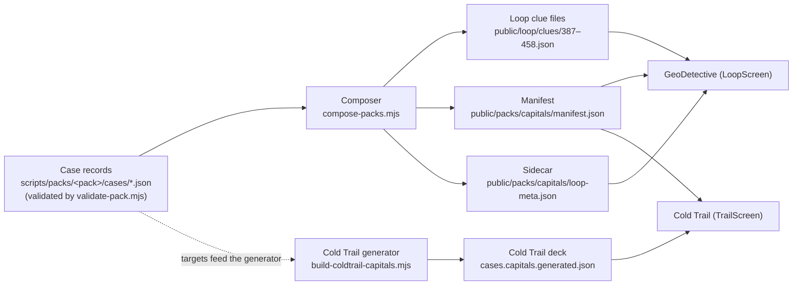

# Story packs

A story pack is a set of extra cases that plug into the games Meridian
already has. The first pack is **Capitals**: 72 cases (44 country
capitals and 28 US state capitals) that play inside GeoDetective and
Cold Trail. No pack is a game of its own.

This file is the vendored copy of the pack design (issue #319). The
code cites its section numbers, so the numbers below match the
design draft they came from. Where the shipped v1 differs from the
draft, this file says so plainly — the corrections are part of the
design now, not footnotes: see §1.4 (directions), §2.2 (Cold Trail
coverage), §2.3 (reverse play), and the ratio note in §1.1.

How a pack flows from a written record to a case on screen:

## 0. Governing owner rulings

Recorded from the owner's voice call of 2026-11-02 (no transcript):

- New geography content lands as case packs inside the existing
  engines, never as standalone modes or editions.
- Coverage is a curated greatest-hits set per category — capitals,
  rivers, oceans, mountain ranges and famous peaks, national parks,
  deserts, flags. Completeness is a non-goal.
- A pack is additive, never load-bearing: if a pack fetch fails, the
  game plays exactly the core game. Pack code may never block, delay,
  or alter core play.
- Each edition keeps its own pack state and its own store. Resetting
  or wiping one edition never touches the other edition's pack
  progress.

A fallback deal is always labeled as what it is. The case screen
says, in one plain sentence, where the open case came from — "This
case is from your Capitals deck." or "This case is from All
cases." When a pack could not load and the deal fell back, that
same sentence spot carries the explanation instead ("Capitals
couldn't load just now — this case is from All cases instead…"),
and the shelf's next-case line stays quiet while it is up, so only
one message speaks at a time. A core case is never presented as a
pack case.

## 1. Pack data format

A pack ships as data next to the game, never inside the core clue
files: a manifest, a metadata sidecar, and one core-format clue file
per case at indexes the pack owns. The core deck owns loop indexes
0–386; the Capitals pack owns 387–458.

### 1.1 Authoring record — `meridian.pack.case.v1`

One JSON file per case under `scripts/packs/<packId>/cases/`. A
record carries:

- `target` — the place the player must find: GeoNames id, name,
  curated aliases, coordinates, feature code. Coordinates always
  come from the shipped GeoNames dataset (the Hyderabad rule, §5 of
  the design draft: a place's coordinates must match its claimed
  location, gated at build time).
- `subject` and `subjectAnswer` — the land the target belongs to (a
  country or a US state), and the answer form for it.
- `prompt` — what the game hands the player up front (§2.1).
- `packTier` — the curated difficulty slot, 1–5.
- `clues` — the five-rung ladder, in order:
  1. **Geography** — where in the world, in words a kid can picture.
  2. **Climate** — what the sky and seasons feel like.
  3. **History** — the capital-making moment: the event that made
     this place the capital.
  4. **Hook** — one retellable fact that belongs to the target (a
     person, an event, a record, a name story). If a kid can't
     retell it, the rung failed.
  5. **Giveaway** — a capital-only role fact (the parliament, the
     capitol, the governor's seat). This rung may name the subject.
- `reveal.blurb` — 2–4 plain sentences, kid-friendly, ending with
  the plain pairing: "X is the capital of Y."
- `source` — the Wikipedia article the case was written from. Every
  clue carries a verbatim quote from that article; no claim in a
  clue may outrun its quote (the no-fabrication rule).

Authoring inputs live beside the records in
`scripts/packs/<packId>/inputs/` — the Wikipedia extracts and chunk
data each record was built from. `scripts/packs/validate-pack.mjs`
gates every record; see `scripts/packs/README.md` for the rebuild
sequence.

**Directions field.** A record carries `direction` and
`directions`. **v1 truth: Direction A is the only direction that
ships** — `directions` is `["A"]` on every v1 record and `direction`
is `"A"`. No other direction is dealt, offered, or implied anywhere
in v1 (see §2.3).

**The curated ratio governs.** The design draft spoke of a 3:1
country-to-state mix. The curated Capitals list is **44 countries :
28 states**, and that ratio is the rule: curation follows the
greatest-hits list in the pack's curation doc, not the draft's 3:1
line.

**Cure swap (2026-11-03, PR #323 round-1 cure).** Nairobi (Kenya)
and Ankara (Turkey) were removed from the pack and replaced by
Accra (Ghana) and Abu Dhabi (United Arab Emirates), at the same
pack tier. Reason: both already sit in the core deck (core clues 74
and 218), so the pack dealt each target twice and the 459-unique-
targets gate failed at 457. The replacements are famous GeoNames
PPLC capitals absent from the core deck, each meeting the curation
sizing rule (at least 3 of: curriculum fame, scale salience,
cultural salience, teaching-trap value — and fame or salience is
required). The pack stays 72 cases; Africa and Asia counts are
unchanged.

### 1.2 Pack manifest + pack metadata sidecar

- **Manifest** — `public/packs/<packId>/manifest.json`: the pack's
  identity (`packId`, `category`), its size, the loop clue indexes
  it owns, and the pack tier of each owned index, in the same order.
- **Sidecar** — `public/packs/<packId>/loop-meta.json`: per-index
  briefing metadata. The core clue files stay in the frozen
  five-string format; everything richer lives here. Each entry
  carries:
  - `subject` — `{ name, kind }`: the land the briefing names.
  - `blurb` — the reveal blurb (may name the target; it only ever
    shows after a solve).
  - `anchorCoords` — the subject's witness anchor (§2.2), or `null`
    when the subject has no core-deck city.

The sidecar is briefing material only. A missing sidecar entry means
the case still plays — it just deals without a briefing and without
a pack blurb. Sidecar trouble never blocks play.

### 1.3 GeoDetective adapter

The GeoDetective clue-file format is unchanged: the composer writes
pack cases into `public/loop/clues/` in the same five-string shape
as core cases. The one runtime addition is the pack layer in
`src/game/loop/packs.ts`, which loads the manifest and sidecar,
validates them, and deals pack cases through the same loop the core
deck uses (§6).

### 1.4 Cold Trail adapter

Cold Trail gets its own generated pack file
(`src/game/coldtrail/cases.capitals.generated.json`), built by
`scripts/build-coldtrail-capitals.mjs` from the pack records. The
core deck file is never touched. Cold Trail pack progress lives in
its own store key, `meridian.coldtrail.pack.capitals.v1`, separate
from the GeoDetective pack state and from the Cold Trail core store.

## 2. How a pack plugs into each engine

### 2.1 GeoDetective — the mystery form

GeoDetective asks for a place and deals the five-rung ladder.
Direction A: the game names the subject, the player finds its
capital — `prompt.givenName` is the subject, the answer is the
target.

**The subject-leak rule (B2).** One rule, stated once, in the same
words in the pack schema (`scripts/packs/schema.mjs`) and the
validator (`scripts/packs/validate-pack.mjs`):

> Direction A (find the capital of a named subject): clues may use
> the subject freely; only the target's name is banned.
>
> Direction B2 (neither name given): the subject is a second
> secret. Its name and aliases are banned from every clue except
> rung 4 (clue index 3, the hook rung), where the country is
> confirmed by design (design §2.1). The target stays banned from
> all five clues, and the giveaway (index 4) bans the subject
> again.

Read plainly for v1, which ships Direction A only: no clue may
contain the target's name or aliases; the subject is named in the
briefing by design, and the giveaway may name it again (it is a
capital-only role fact) but never the target.

### 2.2 Cold Trail — the triangulation form

Cold Trail deals three witness rings and one tap. **The
witness-anchor rule:** a pack case must never be a player's first
sight of its subject land. Each subject is *witnessed* by a
core-deck city (its anchor) the player has already met, so when the
pack case arrives, the land is familiar ground.

**v1 truth:** Cold Trail stamps are not built, so a capital that is
not itself a witness anchor does not appear in Cold Trail v1. The
generated Cold Trail Capitals deck holds 60 cases and teaches **51
anchor capitals** across them (recounted on the shipped tree after
the §1.1 cure swap). Every other capital plays in GeoDetective
only, until stamps land.

### 2.3 What "both directions" honestly means

A reverse case (B1/B2) plays the mirror image: the game names the
capital, the player names its subject land. **Reverse-direction
play is a follow-up, not part of v1.** The record format leaves
room for it (a future `directions` value), but nothing in v1 deals,
renders, or scores a reverse case.

## 6. Dealing

- **Whole-pack deck.** A pack deals as one shuffled deck of all its
  cases (Fisher–Yates, crypto RNG) — never a daily case, never a
  sampled subset. A fresh cycle reshuffles.
- **Deck state.** GeoDetective keeps one deck state per pack in its
  own store fields (`packDecks`, `activeDeckId`); the core deck's
  state shape is untouched. Cold Trail keeps its own pack store
  (§1.4). Switching decks never writes the other deck's state; a
  deck switch is refused while a guess is in flight.
- **Resume wins.** Opening an edition resumes the deck whose store
  holds an unrevealed current case, ahead of any stored shelf
  selection. A pick made mid-case survives leaving and coming back.
- **Deck completion.** Finishing a pack cycle celebrates the pack,
  in the pack's own numbers: the Capitals cycle closes "All 72
  Capitals case files". The core cycle's celebration copy is
  unchanged. Rusty, the trail companion, greets a completed pack
  cycle by name.

## 7. Selection UX — the shelf

Both editions show the same deck shelf: the core deck and each pack
as chips the player can switch between.

- **One shared list.** `buildDeckList` builds the chip list for both
  editions from the manifest data, so the two shelves cannot drift
  apart.
- **Per-edition totals.** A chip's progress line uses the total for
  the edition showing it: 72 for the Capitals pack in GeoDetective,
  60 (the Cold Trail deck's real case count) in Cold Trail. The core
  chip always shows the core total.
- **The status line speaks.** The line under the chips says out loud
  what switching does ("Your current case stays saved — switching
  decks never loses it") and carries `role="status"`, so screen
  readers announce the consequence of a switch.
- **Room to wrap.** At narrow widths (≤340px) the chip row reserves
  a second row, so a pack chip that loads late wraps into space
  that is already there instead of pushing the case below it down.
  At 390px and on desktop the row is unchanged.
