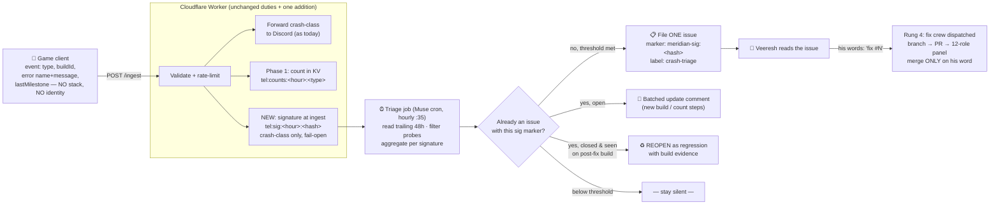

# Rung 2 — Auto-Triage: Design

**What this is:** the design for the second rung of Veeresh's crash-report
proactivity ladder (his words, 2026-10-21: crash reports should be
"proactive to fix issues the moment we see issues").

- **Rung 1 (done, awaiting go-live):** Phase 1 counting — the worker counts
  events in Cloudflare KV, posts an hourly digest and threshold alerts to
  Discord. It tells us *how much* is crashing. It cannot tell us *what*.
- **Rung 2 (this document):** auto-triage — group crashes into "the same
  crash," and file **one deduplicated GitHub issue per distinct crash**,
  kept up to date as new builds and counts arrive.
- **Rung 4 (later, sketched in §5):** assisted fix drafts — a triaged issue
  becomes a dispatched fix crew. Triage itself never starts a fix.

**Status: DESIGN ONLY.** No code, no deploys, no issues filed. Build starts
only after Phase 1 is live and Veeresh answers the credential decision in §8.

Everything below was checked against the shipped Phase 1 worker
(`workers/crash-report/src/index.ts` on main `33a28fe`, 33 unit tests) and
the event schema in `docs/observability.md`.

---

## 1. The hard fact that shapes the whole design: there are no stack traces

Most crash-triage systems group crashes by *top stack frame*. Meridian
cannot, on purpose:

- The client **never sends stack traces** — the privacy statement in
  `docs/observability.md` and `src/lib/observability.ts` is explicit
  ("NO stack traces"), and the schema caps the error at `name` (≤80 chars)
  + `message` (≤300 chars).
- The forwarded Discord alert truncates further: name ≤60, message ≤140.
- KV (Phase 1) stores **counts only**, keyed by UTC hour × event type, with
  breakdowns by build / edition / region / device bucket. No error text at
  all.
- `suspected_crash` — the most important event (a session died outright) —
  usually has **no error object at all**. Its diagnostic payload is the
  breadcrumb's `lastMilestone` (where the trail stopped).

So a signature here must be built from what actually exists:

| Signal | Where it exists | Fidelity |
|---|---|---|
| `type` | ingest body, Discord, KV | exact |
| `error.name` | ingest body; Discord (≤60 chars) | good |
| `error.message` | ingest body (≤300); Discord (≤140) | good, needs normalizing |
| `lastMilestone` | ingest body, Discord | exact |
| `buildId` | ingest body, Discord, KV | exact |
| `edition` / `regionId` / `chunkId` | ingest body (chunkId **not** in Discord) | exact |
| device bucket (os/form) | derived in worker, Discord, KV | coarse by design |

**The only place with complete signature material is the ingest request
itself, inside the worker, for a few milliseconds.** Discord is lossy
(truncated message, no `chunkId`, hiccup-class events never forwarded
individually), and KV has no error data at all. Any honest architecture
must therefore compute the signature **in the worker at ingest**; the only
real question is who talks to GitHub.

---

## 2. The signature

```
signature = SHA-256( type ‖ error.name ‖ normalize(error.message) ‖ funnel-part )
sig id    = first 12 hex chars of the hash (display: sig:a1b2c3d4e5f6)
```

- **Error events** (`js_error`, `unhandled_rejection`, `map_error`, and
  `boot_failure` when it carries an error): `funnel-part` is empty. The
  `lastMilestone` is *recorded* on the signature (the most common one is
  shown in the issue) but is not part of its identity — the same bug can
  throw at different milestones.
- **Process-death events** (`suspected_crash`, error-less `boot_failure`):
  there is no error, so identity *is* the funnel:
  `funnel-part = lastMilestone ‖ edition ‖ chunkId (when present)`.
  This matches how the funnel is already read by hand ("trails stop at
  `data_chunk_load_start` for Globe = sessions die loading globe data").
- **`normalize(message)`** — the make-or-break step. Error messages embed
  volatile details that would fragment one bug into fifty signatures.
  Rules (applied in order, each one unit-tested):
  1. lowercase, collapse all whitespace to single spaces, trim;
  2. mask UUIDs, hex strings ≥8 chars, and long digit runs → `#`;
  3. mask quoted strings ('…' / "…") → `'…'`;
  4. mask URLs and file paths → `…`;
  5. keep the first 120 chars of the result.
- **`buildId` is NOT part of the signature.** It is tracked *per
  signature* (a builds map, exactly like Phase 1's `CountBucket.builds`).
  That is what makes "fixed in build X, seen again in X+2" detectable
  (§4) — if build were part of the identity, a regression would file a
  brand-new issue instead of reopening the old one.
- **Low-information signatures:** some messages carry almost nothing
  (the classic cross-origin `Script error.` with an empty name, or an
  empty message). These get `lowInfo: true` and a much higher filing
  threshold (§4), split by milestone where one exists. They are real
  signal in aggregate but near-useless as individual issues.
- First/last seen use **worker receive time** (the KV hour label, the
  same convention Phase 1's `recordTelemetry` already uses), never the
  client-supplied `ts` — client clocks skew.

### Where signatures live: a sibling KV bucket family

The worker gains one new bucket family next to Phase 1's:

```
key:   tel:sig:<utcHour>:<sigHash>
value: { type, tier, total,
         builds{}, editions{}, regions{}, devices{},   // same shape as CountBucket
         name, messageSample,        // capped exactly like Discord: 60 / 140 chars
         milestoneTop, chunkId?,     // funnel facts for process-death signatures
         lowInfo }
```

- Written in the ingest path with the **same fail-open discipline** as
  `recordTelemetry`: its own try/catch, its own log line, and a failure
  can never skip counting or forwarding (§7).
- The sample fields are built from a **whitelist** (type, error
  name/message, milestone, chunk, the already-coarse dimensions). The
  write path never touches `sessionId`, `device.ua`, `breadcrumb`, or IP
  — and a unit test asserts the stored JSON contains none of them, the
  same way Phase 1 asserts counts-only.
- Privacy posture is unchanged: the message sample is data Discord
  already receives today; no new *class* of data is stored, and still no
  identity of any kind.
- **Crash-class only.** Hiccup-class (`tile_failed`,
  `webgl_context_lost`) stays aggregate-only via Phase 1's threshold
  alerts — it is high-volume and usually benign, and per-signature
  buckets would burn KV writes (the constrained free-tier resource;
  Phase 1's code comment already budgets 1 GET + 1 PUT per event).
- KV keys are written with no TTL today, so a missed triage run loses
  nothing — the backlog is still there next run (§7). A later cleanup
  can expire `tel:sig:` keys after ~45 days; the GitHub issue is the
  long-term record, not KV.

---

## 3. Architecture: worker computes, agent files (hybrid)

Three shapes were compared:

**(a) Worker-side triage.** The worker groups *and* files: a scheduled
handler reads the hour's signature buckets and calls the GitHub Issues
API directly.
- ✅ No dependence on agent scheduling; files within the hour.
- ❌ Needs a **write-capable GitHub credential inside a public,
  unauthenticated, internet-facing worker** (it accepts POSTs from
  anywhere; the only gate is a per-IP rate limit). The credential would
  be a **fine-grained personal access token scoped to the single
  Meridian repo with Issues: Read and write and nothing else** — the
  classic PAT (`repo` scope = every repo, code included) is rejected
  outright, and a full GitHub App (app registration + JWT signing in the
  worker) is the "proper" version of the same idea at far more build
  cost. Even scoped correctly, the blast radius of a leak is issue spam
  / issue vandalism on the repo, and — the Phase 1 lesson — **every
  worker deploy risks dropping the secret** (a fresh upload cannot
  inherit secret bindings; error 10021), adding a manual re-supply step
  to every future deploy.

**(b) Agent-side triage only.** A scheduled Muse job reads what exists
and files issues.
- ✅ No new secret anywhere; dedupe and judgment live where the context is.
- ❌ **The data isn't there.** KV counts have no error identity, so the
  agent could only file "js_error spiked on build X" — an issue with no
  error name, no message, no milestone: not actionable. Reading the
  Discord forwards instead is both lossy (140-char truncation, no
  chunkId, hiccups absent) and not actually available — there is no
  Discord read path for the agent. Pure (b) fails on evidence, not on
  effort.

**(c) Hybrid — RECOMMENDED.** Split the job at the fidelity boundary:
- The **worker** does the one deterministic thing only it can do:
  compute the signature at ingest and keep per-signature counts in KV
  (§2). No GitHub credential in the worker. No change to forwarding.
- A **scheduled Muse triage job** (hourly, at :35 — after the :15
  digest cron) reads the trailing 48 hours of `tel:sig:` buckets via the
  Cloudflare API path Muse already uses, filters probes and noise,
  dedupes against GitHub (search before file — §4), and files/comments/
  reopens issues using the **GitHub auth Muse already holds on this
  machine** (`gh`). Zero new secrets, zero new paid services: KV,
  GitHub API, and agent crons are all free at this volume (the standing
  zero-cost lens is satisfied — there is no Sentry-shaped bill and no
  new vendor).
- The job writes a run report every run (§7's dead-man's switch depends
  on it) and surfaces a summary to Veeresh **only when it filed or
  reopened something** — silence is the healthy signal, same as the
  digest.

Why hybrid wins: each side does what only it can do. The worker is the
sole point of full fidelity; the agent is where dedupe judgment, the
repo's history, and — decisively — the rung-4 dispatch already live, so
triage and fix-dispatch share one brain and one audit trail. The cost of
the split is latency (an issue appears up to ~1 hour after its threshold
is crossed, vs. minutes in (a)) and a dependence on agent scheduling
(mitigated in §7 — a missed run delays filing, it never loses data).



---

## 4. Dedupe and lifecycle

**One issue per signature — one home, forever.** Every triage issue
carries a machine-readable marker in its body,
`<!-- meridian-sig: a1b2c3d4e5f6 -->`, plus the label `crash-triage`.
Before filing anything, the job searches GitHub (open *and* closed) for
that marker. The marker search is the dedupe; a per-run cap (below) is
the storm brake. Two overlapping runs are prevented by the job being a
single scheduled instance, and made safe anyway by search-before-create
plus a verify-after-create pass (if a duplicate of our own making is
found, the job closes the younger one as a duplicate of the first).

**Filing thresholds** (constants, env-style tunables like Phase 1's
`TELEMETRY_THRESHOLD_*`; conservative at first, loosened only on
evidence):

| Case | File when |
|---|---|
| Error signature (normal info) | ≥ **3** occurrences in trailing 24 h |
| Process-death signature (`suspected_crash`, error-less `boot_failure`) | ≥ **1** — each one is a whole dead session, already rare, and dedupe caps it at one issue |
| Low-information signature | ≥ **25** in trailing 24 h |
| Hiccup-class | never per-signature (no sig buckets); a *type-level* issue only if Phase 1's threshold alert fired in ≥3 of the last 24 hours — expected to be rare |

**Probe and noise control:**
- **Hard denylist, checked before anything else:** `buildId` =
  `observability-probe`, any buildId containing `probe`, and any
  buildId on the job's known-test-builds list. Probe events are still
  *counted* by Phase 1 (they were how we verified the pipeline) — they
  simply can never file. (The 2026-10-21 restore-verification probe is
  the standing example: it must produce a Discord line and a count, and
  never an issue.)
- **Per-run filing cap: 3 new issues.** A genuine incident that crosses
  thresholds for 9 signatures files the top 3 by count and lists the
  rest in the run report for Veeresh — never a 9-issue burst in his
  inbox.
- Update comments are **batched**: at most one comment per issue per
  run, and only when something material changed — first sighting on a
  new build, or the trailing-24h count crossing a step (10 / 50 / 100 /
  500). No hourly "still happening +1" spam.

**Close / reopen:**
- Triage **never auto-closes**. Issues close the human way: a fix PR
  says `Fixes #N`, or Veeresh closes by hand.
- When a fix ships, the fix crew's closing comment records
  `fixed-in: <buildId>` (the build live after deploy) — that comment is
  what arms the regression rule.
- Sightings after close split three ways:
  - **Only on builds older than `fixed-in`** → one comment ("still seen
    on pre-fix build X — expected stragglers"), no reopen.
  - **On `fixed-in` or any newer build** → **REOPEN**, comment titled
    REGRESSION with the build + count evidence.
  - **Closed as wontfix / duplicate / not-a-bug** → never auto-reopen;
    the signature is listed in the run report so Veeresh sees it if it
    keeps recurring.
- Known approximation, stated plainly: "newer build" is judged by
  first-seen hour vs. the fix's ship time, not by a build-ordering
  oracle (build ids are opaque). Good enough for v1; the evidence
  comment lets a human overrule at a glance.

---

## 5. The issue template

Title: `[crash-triage] js_error · TypeError — cannot read properties of # … · first build 9f3c…`

Body (privacy-clean by construction — every field comes from the
whitelisted signature bucket; there is no payload to leak):

```markdown
<!-- meridian-sig: a1b2c3d4e5f6 -->
**Filed automatically by crash triage (rung 2). Triage files issues
only — it never starts fixes, branches, or PRs.**

## Signature
| | |
|---|---|
| Type | `js_error` |
| Error | `TypeError` — cannot read properties of # (reading '…') |
| Top milestone | `map_init_start` |
| First seen | 2026-10-21 14:00 UTC (build `9f3c…`) |
| Last seen | 2026-10-21 16:00 UTC |
| Count | 17 in trailing 24 h |
| Builds affected | `9f3c…` ×14 · `a1b2…` ×3 |
| Top editions / regions | globe ×15 · — |
| Top device buckets | ios/phone ×12 · android/phone ×5 |

## Sample (as forwarded to Discord at first sighting)
🚨 Meridian crash report
type: js_error · build: 9f3c…
… (rebuilt with buildAlert's exact format from the stored sample fields)

## Notes for the fix crew
- No stack trace exists — by design (privacy: the client never sends
  one). Start from the error name + normalized message + milestone.
- Counts and per-build history: this issue's comment thread.
- Raw hourly counts: KV `tel:sig:*` / `tel:counts:*` (see
  workers/crash-report/README.md).
```

The sample is *rebuilt* from the stored capped fields in `buildAlert`'s
format — the worker retains no full payload anywhere, so there is
nothing else a sample could be. That limitation is a feature: the issue
can never contain more than Discord already showed.

---

## 6. Handoff to rung 4 (assisted fix drafts) — the human gates

Triage's authority ends at the issue tracker. The gates, named exactly:

1. **Filing needs no per-issue approval** — that is the rung Veeresh
   approved by approving this design (if he approves it). Filing,
   batched update comments, and regression reopens per §4 are the
   job's whole mandate.
2. **Starting a fix needs Veeresh's words naming the issue** — e.g.
   `fix #123`, "dispatch a crew on #123", in chat or as an issue
   comment. The triage job may *propose* in its run report ("#123 looks
   crew-ready: stable signature, plausible repro in the body") but a
   proposal is not an authorization, and silence is not one either.
3. **From there it is the ordinary Meridian flow, unchanged:** a fix
   crew (coordinator + reality-checker) on a branch, a PR that says
   `Fixes #123`, the full 12-role review pipeline, and **merge only on
   Veeresh's per-PR merge word**. Triage never assigns, never branches,
   never opens PRs, never merges — and never touches branch protection.
4. The crew's last step closes the loop in §4: deploy, then comment
   `fixed-in: <buildId>` on the issue, which arms regression reopening.

---

## 7. Failure modes — fail-open, always

The invariant inherited from Phase 1: **reporting must never break the
game, and triage must never break reporting.** Triage sits entirely
outside the request path — the game cannot tell whether it exists.

| Failure | Effect | Guard |
|---|---|---|
| Sig-bucket write fails in the worker | Event uncounted-by-signature; Phase 1 count + Discord forward unaffected | Sig recording is its own try/catch (same pattern as `recordTelemetry`), ordered so its failure cannot skip counting or forwarding |
| Worker down entirely | No new reports at all (pre-existing risk, unchanged) | Client `emit()` is fire-and-forget (sendBeacon/fetch, failures swallowed); the game plays on; endpoint unconfigured = complete no-op |
| Triage job down / VM off / run skipped | Issues file late, **never never** | KV buckets persist (no TTL); each run scans the trailing 48 h, so the next run backfills; search-before-file makes backfill idempotent |
| Triage job itself crashes mid-run | Partial comments possible; no corrupt state | GitHub is the state (marker search), KV is read-only to the job; next run reconciles. The job writes its run report *last*, so a missing report = a failed run |
| Dead-man's switch | A silently dead triage job looks like a healthy quiet game | Every run writes a report to this goal's `hidden_files/`; if no successful run in 26 h, the main chat surfaces it to Veeresh |
| GitHub API rate limit (search 30/min, core 5,000/h — triage uses a handful per run) | Filing pauses | On 403/429: stop filing this run, note it in the report, next run retries. Never loop, never retry-storm |
| Duplicate storm (same bug, message variants) | Several issues for one root cause | Conservative normalization (§2) + the dry-run week (§8) to tune it; merging by hand is cheap (close as duplicate — the marker keeps the survivor canonical) |
| Junk / hostile events (endpoint is public) | Junk signatures | Per-IP rate limit (10/min, already shipped), filing thresholds, probe denylist, 3-per-run cap — worst case is a few junk issues, closable by hand |
| Discord down | Digest/alerts delayed | Triage doesn't read Discord at all (hybrid reads KV) — unaffected |
| A crash *in* the signature code | Worst case it throws inside ingest | Fail-open wrapper + unit tests incl. fuzz-ish malformed messages; the schema validation upstream already caps every field the normalizer touches |

---

## 8. Build plan (crew steps, sized)

1. **Worker PR — signature counting.** Signature module (normalize +
   hash via `crypto.subtle`), `tel:sig:` bucket writes (crash-class
   only, whitelist-built, fail-open), tests mirroring the existing
   33-test suite: normalization cases, probe denylist, privacy
   assertions (no sessionId/UA/IP in stored JSON), fail-open proofs.
   Full pipeline review as usual. *One crew, one PR.*
2. **Deploy in the Phase 1 go-live window.** No new binding (same KV),
   **no new secret**. Any worker deploy still carries the known caveat:
   re-supply the Discord webhook secret after upload (error 10021
   lesson) — one line in the go-live runbook, applying to Phase 1 and
   this together.
3. **Triage job — report-only dry run (1 week).** The hourly :35 cron
   runs the full logic but files nothing; it writes "would file /
   would reopen" reports. Veeresh reviews precision (fragments? merges?
   junk?) before any real filing. *This step is the tuning gate — do
   not skip it.*
4. **Triage job — filing on.** Same job, filing enabled with §4's
   thresholds and caps; run reports continue; summaries surface only on
   filing/reopen.
5. **Docs.** Handbook ch07 gains the triage section (this design,
   condensed); ch08 gains the `fix #N` dispatch wording and the
   `fixed-in:` closing-comment convention. *Small docs PR.*

Steps 1–2 are the only code. Steps 3–4 are the same job with one flag
flipped — on Veeresh's word after the dry-run week.

---

## 9. Decisions Veeresh owes (answer by number)

1. **Approve the hybrid** — worker stores signature counts in KV; the
   Muse triage job files issues with the GitHub auth already on this
   machine. **No new secret anywhere.** (Recommended.)
2. **Or worker-side filing** — the worker files issues itself; needs a
   fine-grained GitHub token (Issues read/write, Meridian repo only)
   stored as a worker secret, re-supplied after every deploy.
3. **Either way: no classic PAT** — its repo-wide scope is rejected in
   this design, permanently.
4. **Filing thresholds** — start with §4's numbers (3-in-24 h for
   errors, 1 for process deaths, 25 for low-info, cap 3 new per run),
   tune after the dry-run week. Or name different numbers now.
5. **Dry-run week first** — recommended yes: report-only for 7 days
   before the job may file a real issue.

**Biggest risk:** signature quality. With no stack traces (by privacy
design), message normalization decides whether one bug becomes one
issue, twenty fragments, or one merged blob hiding two bugs. The
mitigations are the conservative normalizer, the dry-run week to
measure fragmentation before filing is live, and cheap manual merges —
but this risk cannot be designed away, only tuned down with real data.
