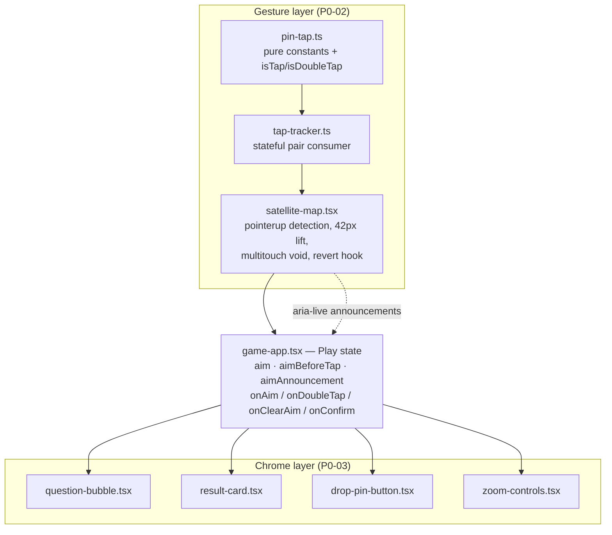

# Meridian P0-02 + P0-03 — Final close-out report

**Date:** 2026-09-29 · **Branch:** `feat/p0-02-p0-03-gesture-chrome-rework`
**Baseline:** `41f7b40ac2c14f004b16f61cec5cfa71f3b0658d` → **Final HEAD:** `83bd93f`
**Commits:** 16 atomic local commits · **Pushed:** never · **Deployed:** never
**Repo:** `https://github.com/veeresh-bikkaneti/Meridian` · **Clone:** `~/workspace/meridian-build`

## Bottom line

Both PBIs are complete and every gate is green. The gesture model is locked
(single tap places/moves, **Drop pin** is the only commit, double-click/double-tap
zoom only), the chrome is floating and full-bleed, and two review-found issues
(a screen-reader blocker and a dropped privacy notice) were fixed, re-verified,
and committed atomically. Nothing was pushed or deployed — local handoff only.

## Gate table

| Gate | Result | Evidence |
|---|---|---|
| E2E — Playwright, 14 scenarios | **PASS 18/18** | Desktop + touch emulation + reduced-motion; 0 failures [OBSERVED from side-chat-meridian 2026-09-29 ~14:48] |
| Typecheck | **PASS** | `npm run typecheck` exit 0 @ `83bd93f` [MEASURED] |
| Unit tests (scoped src/lib+game+map) | **PASS 101/101, 16 suites** | `node --experimental-strip-types --test <17 files>` @ `83bd93f` [MEASURED] |
| Pages build | **PASS** | `npm run build:pages` exit 0, prerendered `/` @ `f4766b6` [MEASURED] |
| Technical architect | **APPROVE** | Final diff review `41f7b40..3c46db3`; 1 non-blocking finding, fixed [REPORT] |
| Accessibility | **PASS** | 1 blocker found → fixed `9524faa` → targeted re-check PASS [REPORT] |
| SOLID / OOD / Clean Architecture | **PASS** | Sign-off, no violations above low severity [REPORT] |
| Tone / docs | **PASS** | Copy consistent; 1 nit fixed `83bd93f` [REPORT] |
| Performance | **+1.17% raw / +0.96% gzip-9** | vs `41f7b40`, captured @ `f4766b6` [MEASURED] |

**Honesty notes:** E2E ran at `3c46db3`; the 3 commits after it are string/live-region
only (typecheck + unit + targeted a11y re-check cover them). Perf captured at
`f4766b6`; the final commit `83bd93f` changes one aria-label string (~10 bytes,
same chunk) — the measured delta stands. The full `npm test` chain is **not**
claimed green: the baseline had 16 pre-existing scaffold/script failures
(masked by `&&`); only the scoped suites above are reported.

## P0-02 outcome — gesture rework

- Single tap places or moves the pin; **Drop pin** is the only commit path.
- Double-click / double-tap zooms only and never leaves a stray pin or commit
  (double-tap reverts the first tap's placement via `aimBeforeTap`).
- Tap detection on raw `pointerup` (touch double-tap suppresses the second
  tap's compatibility click, so click-based tracking would miss tap two).
- Touch lift 42 px on the placement coordinate; tap window ~500 ms / 48 px.
- Multitouch voids the gesture; `pointercancel` handled; no `preventDefault`
  — MapLibre keeps drag/pinch/dblclick zoom.
- Pin placement/commit gets visual + supported haptic feedback.
- Real `<button>` controls, 44×44 px targets.
- Keyboard: arrows aim with crosshair, Enter/Space place, Escape clears;
  Drop pin keyboard-operable; `map.keyboard.disable()` per M6 so Space/Enter
  on buttons don't double-place.
- Reduced-motion: scripted camera moves become instant jumps; pin-drop
  animates CSS `translate` (never `transform`, which MapLibre rewrites).
- The 2–2.5 s reveal beat (`REVEAL_CAMERA_MS = 2200`) is a **single** `fitBounds`
  with card-aware padding — architect confirmed no scope creep into deferred
  reveal choreography.

## P0-03 outcome — chrome rework

- Full-bleed map; chrome is floating overlays, `pointer-events-none` roots
  with `pointer-events-auto` only on interactive elements.
- Floating question bubble: collapse, dismiss, restore.
- Compact floating result card: all reveal info reachable
  (distance, line/circle explainer, story, source link, share).
- Drop pin button overlay (44 px), on-screen +/− zoom controls,
  attribution becomes a bottom-left chip (now carrying the pin-privacy notice).
- No naked text over satellite imagery; safe-area insets respected.

## Architecture



**Dependency direction is clean** (architect-verified): pure gesture logic →
map component → Play state → chrome components. Single commit path
(`handleDrop` re-checks a live `aim` mark; phase guard second line).

## Changed files (`41f7b40..83bd93f`, 13 files, +1145/−183)

| File | Change |
|---|---|
| `src/map/pin-tap.ts` | Pure tap/double-tap classifier replaces confirm logic |
| `src/map/tap-tracker.ts` | **New** — stateful pair consumer (triple-tap safe) |
| `src/map/satellite-map.tsx` | `pointerup` detection, touch lift, revert, zoom controls, attribution chip, keyboard crosshair, reveal camera |
| `src/components/game-app.tsx` | Play wiring: `onAim`/`onDoubleTap`/`onClearAim`, live-region announcements |
| `src/components/drop-pin-button.tsx` | **New** — 44 px overlay commit button, haptic |
| `src/components/zoom-controls.tsx` | **New** — on-screen +/−, labeled |
| `src/components/question-bubble.tsx` | **New** — floating, collapse/dismiss/restore |
| `src/components/result-card.tsx` | **New** — compact floating reveal card |
| `src/styles.css` | Frosted-chrome tokens, pin-drop animation, reduced-motion |
| `src/map/pin-tap.test.ts` | 15 classifier tests |
| `src/map/tap-tracker.test.ts` | **New** — 5 pair-consumer tests |
| `package.json` | Test script gains `tap-tracker.test.ts` (no dependency changes) |
| `README.md` | How-to-play copy describes the new gesture model |

## Commit ledger (16, newest first)

| # | SHA | Message |
|---|---|---|
| 16 | `83bd93f` | p0-02: aria-label names both Enter and Space for keyboard pin placement |
| 15 | `f4766b6` | p0-03: restore pin-privacy notice in the attribution chip (was dropped with the footer strip) |
| 14 | `9524faa` | p0-02: announce aim place/move/clear in the sr-only live region (a11y 4.1.3) |
| 13 | `3c46db3` | p0-02: fix touch double-tap revert (option-b) |
| 12 | `73f65ac` | p0-03: wire onDoubleTap revert and onClearAim in Play |
| 11 | `0ebb17c` | p0-02: README/how-to-play copy describes the new gesture model |
| 10 | `8eb4560` | p0-02: reveal camera is a single 2-2.5s beat with card-aware padding |
| 9 | `fb7f099` | p0-02: pin-drop animation, single pulse ring, reduced-motion handling |
| 8 | `276fd50` | p0-02: keyboard aiming with crosshair (arrows/Enter/Space/Escape) |
| 7 | `dbf0967` | p0-02: on-screen +/- zoom controls; attribution becomes bottom-left chip |
| 6 | `19f9cbf` | p0-02: Drop pin button overlay, 44px, keyboard-operable, haptic |
| 5 | `886cc85` | p0-02: remove double-tap confirm paths; re-enable double-click zoom; tap places with touch lift and double-tap revert |
| 4 | `8c2139d` | p0-02: tap window constants and double-tap classifier replace confirm logic |
| 3 | `199bf74` | p0-03: compact floating result card; all reveal info reachable |
| 2 | `157ec4c` | p0-03: floating question bubble with collapse, dismiss, restore |
| 1 | `ec5bd4b` | p0-03: full-bleed map layout; chrome becomes floating overlays |

## Verification detail

- **E2E:** Playwright 14-scenario suite — 18/18 passed, 0 failures, across
  desktop, touch emulation, and reduced-motion cases [OBSERVED]. Artifacts:
  `playwright-report/index.html`, screenshots under `playwright-report/data/`,
  a trace zip, and an md report (untracked, in `~/workspace/meridian-build/`).
  **Touch results are emulation-verified and provisional** — pending Veeresh's
  real-device check after his push. A supplementary probe run was still active
  at report time.
- **Unit:** `node --experimental-strip-types --test` over 17 files
  (app-data ×2, auth ×2, game ×8, map ×5 incl. new pin-tap/tap-tracker):
  **101 tests, 16 suites, 101 pass, 0 fail** @ `83bd93f` [MEASURED].
- **Typecheck:** `npm run typecheck` (tsc --noEmit) exit 0 @ `83bd93f` [MEASURED].
- **Build:** `npm run build:pages` exit 0, prerendered `/` @ `f4766b6` [MEASURED].

## Performance

Method: `npm ci` + `npm run build:pages` in clean git worktrees, `dist/client`
JS+CSS sizes, gzip -9. BEFORE file:
`~/workspace/meridian-review/perf/before-41f7b40.txt`; AFTER:
`~/workspace/meridian-review/perf/after-f4766b6.txt`.

| Chunk | BEFORE raw / gzip | AFTER raw / gzip | Δ raw / Δ gzip |
|---|---|---|---|
| index-*.js | 430,814 / 133,551 | 430,814 / 133,588 | 0 / +37 |
| routes-*.js | 1,156,752 / 320,513 | 1,168,904 / 323,825 | +12,152 / +3,312 |
| routes-*.css | 82,962 / 10,407 | 82,962 / 10,399 | 0 / −8 |
| styles-*.css | 20,653 / 5,213 | 28,364 / 6,410 | +7,711 / +1,197 |
| __grok styles.css | 6,717 / 1,812 | 6,717 / 1,801 | 0 / −11 |
| **Total** | **1,697,898 / 471,496** | **1,717,761 / 476,023** | **+19,863 (+1.17%) / +4,527 (+0.96%)** |

Growth is concentrated where the work is (map-route chunk = gesture rework,
styles = floating chrome). No new chunks, no new packages. [MEASURED]

## Review outcomes

- **Technical architect — APPROVE.** Gesture core clean; revert/commit paths
  sound; chrome overlay architecture correct; no dead confirm paths
  (`classifyTap` fully removed); `gesture.ts` still live-imported by
  `atlas-map.tsx` — deletion correctly deferred to P1-13. Finding (fixed):
  `IMAGERY_NOTICE` had become a dead export — the "pin stays on this device"
  notice was no longer visible; restored in the attribution chip (`f4766b6`).
- **Accessibility — PASS after fix.** Blocker: aim place/move/clear/revert
  never announced (WCAG 4.1.3). Fixed (`9524faa`): the sr-only live region
  announces "Pin placed / Pin moved / Pin moved back / Pin cleared" with
  "Press Drop pin to lock in your guess", cleared on phase change.
  Targeted re-check: sign-off, no new issues. Non-blocking observations kept
  as known: focus may fall to `<body>` when controls unmount; crosshair not
  non-visually perceivable; play view lacks an h1; disabled Drop pin can't
  expose its hint directly; identical consecutive announcements don't
  re-announce (rare).
- **SOLID / OOD / Clean — PASS**, no violations above low severity.
  Non-blocking cleanup (not expanded): `Drop` type back-edge, duplicated
  `usePrefersReducedMotion`, duplicated frosted token, near-duplicate
  entrance primitives, `SatelliteMap` growing but cohesive.
- **Tone/docs — PASS.** Copy consistently says tap places/moves,
  pinch/double-tap zooms, Drop pin is the only commit. Nit fixed: aria-label
  now names Enter **and** Space (`83bd93f`).

## Residual risks (observed evidence only)

1. Touch double-tap revert rests on `pointerup` firing for both taps —
   covered by touch **emulation** E2E; real-device verification pending
   Veeresh's check after his push.
2. Escape gap: with focus on the Drop button and a pin placed, Escape is a
   no-op (pin clearing still reachable via map focus + Escape). Minor.
3. `role="application"` on the map wrapper — flagged, no issue found.
4. Baseline full `npm test` has 16 pre-existing scaffold/script failures;
   only the scoped suites are reported green.
5. QA supplementary probe was still in flight at report time.
6. Non-blocking nits listed under reviews remain as future cleanup.

## Rollback plan (local, atomic — reverse order)

```bash
cd ~/workspace/meridian-build
git revert --no-commit 83bd93f   # 16 aria-label copy
git revert --no-commit f4766b6   # 15 privacy notice in chip
git revert --no-commit 9524faa   # 14 live-region announcements
git revert --no-commit 3c46db3   # 13 touch double-tap revert
git revert --no-commit 73f65ac   # 12 onDoubleTap/onClearAim wiring
git revert --no-commit 0ebb17c   # 11 README copy
git revert --no-commit 8eb4560   # 10 reveal camera beat
git revert --no-commit fb7f099   # 9 pin-drop animation
git revert --no-commit 276fd50   # 8 keyboard aiming
git revert --no-commit dbf0967   # 7 zoom controls + attribution chip
git revert --no-commit 19f9cbf   # 6 Drop pin overlay button
git revert --no-commit 886cc85   # 5 confirm-path removal + zoom re-enable
git revert --no-commit 8c2139d   # 4 tap constants + classifier
git revert --no-commit 199bf74   # 3 result card
git revert --no-commit 157ec4c   # 2 question bubble
git revert --no-commit ec5bd4b   # 1 full-bleed layout
git commit -m "revert p0-02/p0-03 to 41f7b40"
```

Each commit is independently revertable; reverting all 16 returns the tree to
`41f7b40` semantics. No push, no deploy involved at any point.

## Production validation

**N/A — no deployment occurred.** Nothing was pushed to any remote; the branch
exists only in `~/workspace/meridian-build`.

## Inspect & push — Veeresh runs these (not executed by the crew)

```bash
cd ~/workspace/meridian-build
git log --oneline 41f7b40..HEAD          # the 16 commits
git diff 41f7b40..HEAD --stat            # what changed
git status --short                       # untracked QA scaffolding below
```

When Veeresh explicitly authorizes the push:

```bash
git push -u origin feat/p0-02-p0-03-gesture-chrome-rework
```

## Untracked QA scaffolding — decision needed

`playwright.config.ts`, `tests/`, `playwright-report/`, `test-results/` are
untracked by design (never committed). **Open question:** should the
14-scenario Playwright suite be committed as permanent test infrastructure?
Say the word and it gets reviewed and committed; otherwise it stays local.

## Next

**Z3 only**, on branch `feat/z3-zoom-out-region` (zoom beyond regional bounds,
selected region stays highlighted). Z4 follows Z3 on a separate branch.
No Z3/Z4 code exists yet.
